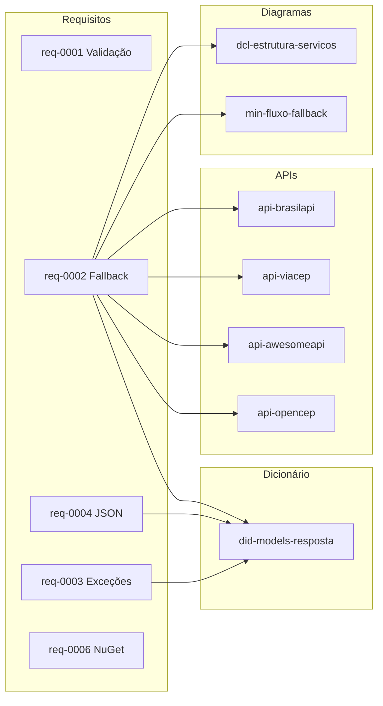

# Documentação — Sirb.CepBrasil

> Biblioteca .NET para consulta de CEP brasileiro com fallback entre 4 provedores (BrasilAPI → ViaCEP → AwesomeAPI → OpenCEP). Multi-target .NET 8, 9, 10.

---

## Contexto

Este diretório contém a documentação oficial do projeto **Sirb.CepBrasil**, organizada conforme a estrutura padronizada definida pela skill `documentation`. A documentação abrange requisitos funcionais e não funcionais, especificações técnicas, diagramas, dicionário de dados, APIs externas, análise de pontos de função, matriz de riscos e documentos de apoio.

---

## Governança

| Documento | Status |
|-----------|--------|
| [Constituição do Projeto](constituicao.md) | `aprovado` |
| [Mapeamento do Sistema](system-mapping.md) | `aprovado` |
| [Arquitetura e Tech Stack](architecture-tech-stack.md) | `aprovado` |
| [Matriz de Risco Global](system-risk-matrix.md) | `rascunho` |
| [Tamanho da Aplicação (APF Consolidado)](tamanho-aplicacao.md) | `rascunho` |

---

## Requisitos

### Funcionais

| Código | Nome | Status | APF |
|--------|------|--------|-----|
| req-0001 | [Validação de CEP](requirement/req-0001-validacao-cep.md) | `rascunho` | 23 PF |
| req-0002 | [Busca de Endereço com Fallback Multi-Provedor](requirement/req-0002-busca-endereco-fallback.md) | `rascunho` | 12 PF |
| req-0003 | [Tratamento de Exceções de Serviço](requirement/req-0003-excecoes-servico.md) | `rascunho` | 12 PF |
| req-0004 | [Serialização/Desserialização JSON](requirement/req-0004-serializacao-json.md) | `rascunho` | 15 PF |
| req-0006 | [Publicação Automática no NuGet](requirement/req-0006-publicacao-nuget.md) | `rascunho` | 7 PF |
| **Total** | | | **69 PF** |

> **Nota:** req-0005 foi cancelado e não faz parte do escopo.

### Artefatos por Requisito

Cada requisito possui os seguintes artefatos vinculados:

| Requisito | Tec | APF | Análise | Checklist | Aprovação |
|-----------|-----|-----|---------|-----------|-----------|
| req-0001 | [`tec-req-0001`](requirement/tec/tec-req-0001-validacao-cep.md) | [`apf-req-0001`](requirement/apf/apf-req-0001.md) | [`analise-req-0001`](requirement/analises/analise-req-0001.md) | [`checklist-req-0001`](requirement/checklist/checklist-req-0001.md) | — |
| req-0002 | [`tec-req-0002`](requirement/tec/tec-req-0002-busca-endereco-fallback.md) | [`apf-req-0002`](requirement/apf/apf-req-0002.md) | [`analise-req-0002`](requirement/analises/analise-req-0002.md) | [`checklist-req-0002`](requirement/checklist/checklist-req-0002.md) | — |
| req-0003 | [`tec-req-0003`](requirement/tec/tec-req-0003-excecoes-servico.md) | [`apf-req-0003`](requirement/apf/apf-req-0003.md) | [`analise-req-0003`](requirement/analises/analise-req-0003.md) | [`checklist-req-0003`](requirement/checklist/checklist-req-0003.md) | — |
| req-0004 | [`tec-req-0004`](requirement/tec/tec-req-0004-serializacao-json.md) | [`apf-req-0004`](requirement/apf/apf-req-0004.md) | [`analise-req-0004`](requirement/analises/analise-req-0004.md) | [`checklist-req-0004`](requirement/checklist/checklist-req-0004.md) | — |
| req-0006 | [`tec-req-0006`](requirement/tec/tec-req-0006-publicacao-nuget.md) | [`apf-req-0006`](requirement/apf/apf-req-0006.md) | [`analise-req-0006`](requirement/analises/analise-req-0006.md) | [`checklist-req-0006`](requirement/checklist/checklist-req-0006.md) | — |

---

## Documentação Técnica

### APIs Externas

| Documento | Descrição | Status |
|-----------|-----------|--------|
| [BrasilAPI](requirement/api/api-brasilapi.md) | Integração com BrasilAPI para consulta de CEP | `rascunho` |
| [ViaCEP](requirement/api/api-viacep.md) | Integração com ViaCEP para consulta de CEP | `rascunho` |
| [AwesomeAPI](requirement/api/api-awesomeapi.md) | Integração com AwesomeAPI para consulta de CEP | `rascunho` |
| [OpenCEP](requirement/api/api-opencep.md) | Integração com OpenCEP para consulta de CEP | `rascunho` |

### Dicionário de Dados

| Documento | Descrição | Status |
|-----------|-----------|--------|
| [Modelos de Resposta](requirement/did/did-models-resposta.md) | Dicionário de dados dos modelos de resposta (`CepResult`, `CepContainer`) | `rascunho` |

### Diagramas

| Documento | Descrição | Status |
|-----------|-----------|--------|
| [Diagrama de Classes — Estrutura de Serviços](diagrams/dcl-estrutura-servicos.md) | Hierarquia de classes, interfaces e relacionamentos dos serviços de CEP | `rascunho` |
| [Diagrama de Integração — Fluxo de Fallback](diagrams/min-fluxo-fallback.md) | Fluxo de integração entre orquestrador e provedores externos | `rascunho` |

---

## Documentos de Apoio

| Documento | Descrição |
|-----------|-----------|
| [Extras — Índice](extras/README.md) | Documentos preservados da documentação original do projeto (9 arquivos) |

---

## Convenção de Prefixos

| Prefixo | Tipo de Documento | Diretório |
|---------|-------------------|-----------|
| `req-` | Requisito (visão de negócio) | `requirement/` |
| `tec-req-` | Requisito técnico (detalhamento para implementação) | `requirement/tec/` |
| `apf-req-` | Análise de Pontos de Função por requisito | `requirement/apf/` |
| `analise-req-` | Análise cross-artifact entre requisitos | `requirement/analises/` |
| `checklist-req-` | Quality checklist por requisito | `requirement/checklist/` |
| `api-` | Documentação de API externa | `requirement/api/` |
| `did-` | Dicionário de dados | `requirement/did/` |
| `dcl-` | Diagrama de classes | `diagrams/` |
| `min-` | Diagrama de integração de sistemas | `diagrams/` |
| `constituicao.md` | Constituição do projeto | `docs/` |
| `system-mapping.md` | Mapeamento do sistema | `docs/` |
| `architecture-tech-stack.md` | Arquitetura e tech stack | `docs/` |
| `system-risk-matrix.md` | Matriz de risco global | `docs/` |
| `tamanho-aplicacao.md` | APF consolidado (tamanho da aplicação) | `docs/` |

---

## Status dos Artefatos

| Status | Significado |
|--------|-------------|
| `rascunho` | Documento criado, aguardando revisão e aprovação |
| `aprovado` | Documento revisado e aprovado |

### Resumo por Categoria

| Categoria | Total | `aprovado` | `rascunho` |
|-----------|-------|------------|------------|
| Governança | 5 | 3 | 2 |
| Requisitos | 5 | 0 | 5 |
| Tec (requisitos técnicos) | 5 | 0 | 5 |
| APF | 5 | 0 | 5 |
| Análise | 5 | 0 | 5 |
| Checklist | 5 | 0 | 5 |
| APIs | 4 | 0 | 4 |
| Dicionário de dados | 1 | 0 | 1 |
| Diagramas | 2 | 0 | 2 |
| Extras | 9 | — | — |
| **Total (excl. extras)** | **37** | **3** | **34** |

---

## Índice de Vínculos entre Requisitos e Artefatos

---

## Documentos Originais (a serem removidos na Wave 6)

Os seguintes documentos na raiz `docs/` foram migrados para `docs/extras/` com novos nomes e serão removidos na Wave 6:

| Original (raiz `docs/`) | Destino (`docs/extras/`) |
|--------------------------|--------------------------|
| `QUICK_START.md` | `extras/guia-rapido.md` |
| `SUMARIO-FINAL-EXCEPTIONEXTENSION.md` | `extras/sumario-exceptionextension.md` |
| `RESUMO-TESTES-CEPEXTENSION.md` | `extras/resumo-testes-cepextension.md` |
| `TESTES-CEPE XTENSION.md` | `extras/testes-cepextension.md` |
| `RESUMO_DOCUMENTACAO.md` | `extras/resumo-documentacao.md` |
| `SUMARIO-MELHORIAS-COMPLETO.md` | `extras/sumario-melhorias.md` |
| `CHECKLIST-RELEASE.md` | `extras/checklist-release.md` |
| `SUMARIO-EXECUTIVO.md` | `extras/sumario-executivo.md` |
| `SUMARIO-EXECUTIVO-FINAL.md` | `extras/sumario-executivo-final.md` |

---

**Última atualização:** 23/07/2026

**© 2026 Rodrigo Araujo Barbosa — Sirb.CepBrasil**
