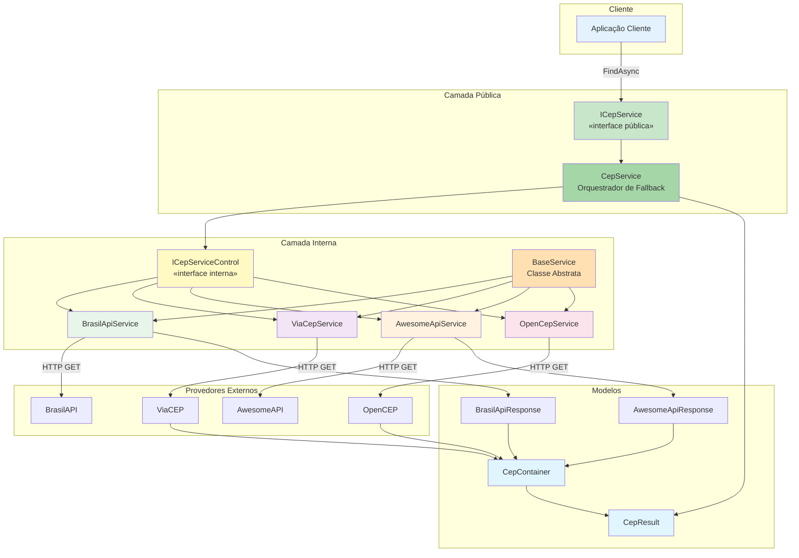
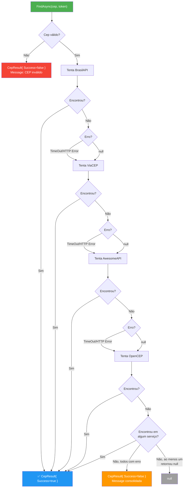

# Arquitetura e Tech Stack — Sirb.CepBrasil

> **Propósito:** Registro de arquitetura, stack tecnológica, integrações externas e decisões arquiteturais do sistema.

| Campo           | Valor                    |
|-----------------|--------------------------|
| **Versão**      | v1.0                     |
| **Data**        | 23/07/2026               |
| **Autor**       | Rodrigo Araujo Barbosa   |
| **Status**      | `aprovado`               |

---

## Histórico de Alterações

| Data       | Versão | Descrição                         | Autor                 |
|------------|--------|-----------------------------------|-----------------------|
| 23/07/2026 | v1.0   | Registro inicial de arquitetura   | Rodrigo Araujo Barbosa |

---

## 1. Visão Geral do Sistema

**Sirb.CepBrasil** é uma biblioteca .NET (C#) para consulta de endereços brasileiros através do Código de Endereçamento Postal (CEP). A biblioteca implementa uma estratégia de **fallback automático** entre 4 provedores públicos para garantir máxima disponibilidade e resiliência.

---

## 2. Stack Tecnológica

| Componente            | Tecnologia                                          |
|-----------------------|-----------------------------------------------------|
| **Linguagem**         | C# 12+                                              |
| **Plataforma**        | .NET 8.0, 9.0, 10.0                                 |
| **SDK**               | .NET SDK (mínimo: 8.0)                              |
| **Serialização**      | `System.Text.Json` (nativa)                         |
| **HTTP Client**       | `System.Net.Http.HttpClient`                        |
| **Testes**            | xUnit 2.9.3                                         |
| **Cobertura**         | Coverlet 8.0.0                                      |
| **Test SDK**          | Microsoft.NET.Test.Sdk 18.0.1                       |
| **Build**             | MSBuild / dotnet CLI                                |
| **CI/CD**             | GitHub Actions                                      |
| **Distribuição**      | NuGet.org                                           |
| **Licença**           | MIT                                                 |

### 2.1 Versões do .NET Suportadas

| Framework | Versão | Status    |
|-----------|--------|-----------|
| .NET 8    | 8.0.x  | ✅ Ativo  |
| .NET 9    | 9.0.x  | ✅ Ativo  |
| .NET 10   | 10.0.x | ✅ Ativo  |

### 2.2 Configuração do Projeto

**Sirb.CepBrasil.csproj** (destaques):
- `<TargetFrameworks>net8.0;net9.0;net10.0</TargetFrameworks>`
- `<GenerateDocumentationFile>true</GenerateDocumentationFile>`
- `<EnforceCodeStyleInBuild>true</EnforceCodeStyleInBuild>`
- `<NeutralLanguage>pt-BR</NeutralLanguage>`
- `InternalsVisibleTo` para `Sirb.CepBrasil.Test`
- `PackageReadmeFile` apontando para `README.md`

---

## 3. Arquitetura de Software

### 3.1 Padrão Arquitetural: Fallback Chain + Strategy + Facade

A biblioteca combina três padrões de design:

1. **Strategy Pattern:** Cada provedor externo é uma estratégia concreta (`BrasilApiService`, `ViaCepService`, `AwesomeApiService`, `OpenCepService`) que implementa a interface comum `ICepServiceControl`.
2. **Facade Pattern:** `CepService` expõe uma interface pública simplificada (`ICepService`) que oculta a complexidade do fallback entre múltiplos provedores.
3. **Chain of Responsibility (Fallback Chain):** Os provedores são encadeados em ordem de prioridade; cada um tenta processar a requisição e, se falhar, passa para o próximo.

### 3.2 Diagrama de Arquitetura



### 3.3 Fluxo de Fallback



---

## 4. Integrações Externas

### 4.1 Provedores de CEP

| Provedor    | URL Base                               | Método | Descrição                         |
|-------------|----------------------------------------|--------|-----------------------------------|
| BrasilAPI   | `https://brasilapi.com.br/api/cep/v1/` | GET    | Serviço público brasileiro        |
| ViaCEP      | `https://viacep.com.br/ws/`            | GET    | Serviço público ViaCEP            |
| AwesomeAPI  | `https://cep.awesomeapi.com.br/json/`  | GET    | Serviço público AwesomeAPI        |
| OpenCEP     | `https://opencep.com/v1/`              | GET    | Serviço público OpenCEP           |

### 4.2 Padrão de Chamada

- **Protocolo:** HTTPS obrigatório
- **Método HTTP:** GET
- **Headers padrão:** nenhum header especial (APIs públicas)
- **Encoding:** UTF-8
- **Timeout por tentativa:** 30 segundos (configurável via `CancellationToken`)
- **Formato de resposta:** JSON

### 4.3 Mapeamento de Respostas

Cada provedor retorna um formato JSON diferente. A biblioteca normaliza para `CepContainer`:

| Campo `CepContainer` | BrasilAPI (`BrasilApiResponse`) | ViaCEP (`CepContainer`) | AwesomeAPI (`AwesomeApiResponse`) | OpenCEP (`CepContainer`) |
|-----------------------|---------------------------------|-------------------------|-----------------------------------|--------------------------|
| `Cep`                 | `cep`                           | `cep`                   | `cep`                             | `cep`                    |
| `Logradouro`          | `street`                        | `logradouro`            | `address`                         | `logradouro`             |
| `Bairro`              | `neighborhood`                  | `bairro`                | `district`                        | `bairro`                 |
| `Cidade`              | `city`                          | `localidade`            | `city`                            | `localidade`             |
| `Uf`                  | `state`                         | `uf`                    | `state`                           | `uf`                     |
| `Complemento`         | — (null)                        | `complemento`           | — (null)                          | `complemento`            |
| `Ibge`                | — (null)                        | `ibge`                  | — (null)                          | `ibge`                   |

---

## 5. Decisões Arquiteturais

### 5.1 Fallback Chain no Lugar de Parallel Calls

**Decisão:** Tentar provedores em sequência (chain) em vez de paralelo.

**Motivação:**
- Evitar sobrecarga desnecessária em provedores (4 chamadas simultâneas para cada consulta).
- O primeiro provedor (BrasilAPI) é o mais rápido e confiável, resolvendo a maioria dos casos.
- Reduz custo de banda e processamento.
- Respeita boas práticas de consumo de APIs públicas (rate limiting).

**Trade-off:** Pior latência no cenário em que o BrasilAPI falha e é necessário tentar outros (até 120s no pior caso).

### 5.2 Separação por Serviço (Strategy)

**Decisão:** Cada provedor em uma classe separada com interface comum.

**Motivação:**
- Baixo acoplamento: adicionar/remover provedores não afeta outros.
- Fácil testar cada provedor isoladamente com mocks.
- Cada classe gerencia seu próprio mapeamento de campos e lógica específica (ex.: tratamento `erro` do ViaCEP).

### 5.3 Interface Dupla (Pública + Interna)

**Decisão:** Duas interfaces com diferentes níveis de retorno.

| Interface           | Visibilidade | Retorno              | Finalidade                |
|---------------------|--------------|----------------------|---------------------------|
| `ICepService`       | `public`     | `Task<CepResult>`    | API pública da biblioteca |
| `ICepServiceControl`| `internal`   | `Task<CepContainer>` | Contrato interno entre serviços |

**Motivação:**
- `ICepServiceControl` é mais simples (retorna apenas o container ou null) e adequada para implementação dos provedores.
- `ICepService` (pública) adiciona a camada de resultado com metadados (success, message, exceptions), apropriada para consumo externo.

### 5.4 BaseService como Classe Abstrata

**Decisão:** Extrair lógica HTTP comum para `BaseService`.

**Motivação:**
- Evita duplicação de código entre os 4 provedores.
- Encapsula padrões como `ConfigureAwait(false)`, `CancellationTokenSource` com `using`, validação de URL e desserialização.
- Facilita a manutenção (mudanças no tratamento HTTP afetam todos os serviços).

### 5.5 Uso de Primary Constructors

**Decisão:** Usar primary constructors (C# 12) nos serviços.

**Motivação:**
- Código mais conciso e legível.
- Elimina a declaração explícita de campos privados para dependências injetadas.

### 5.6 Retorno de CepResult em vez de Exceção para Falha Geral

**Decisão:** O método `FindAsync` do `CepService` retorna `CepResult { Success = false }` em vez de lançar `ServiceException` quando todos os serviços falham.

**Motivação:**
- Melhor experiência de uso: o consumidor verifica `result.Success` em vez de precisar de try-catch.
- Exceções são reservadas para casos excepcionais (erro de programação, validação de entrada).
- Consistente com o padrão de resultado da biblioteca.

### 5.7 Dispose Condicional do HttpClient

**Decisão:** `CepService` só descarta o `HttpClient` se ele foi criado internamente.

**Motivação:**
- Respeita o padrão de DI onde o container gerencia o ciclo de vida.
- Evita `ObjectDisposedException` quando o `HttpClient` é compartilhado.

### 5.8 Gerenciamento de Timeout com CancellationTokenSource

**Decisão:** Timeout por tentativa usando `CancellationTokenSource` com `using`.

**Motivação:**
- Evita memory leak (CTS são liberados corretamente).
- Timeout padrão de 30s quando nenhum token é fornecido.
- Se o usuário fornece `CancellationToken`, seus timeouts e cancelamento prevalecem.

---

## 6. Observabilidade

Atualmente a biblioteca **não implementa** logging interno ou telemetria. Decisões futuras podem incluir:

- **Logging via Microsoft.Extensions.Logging.ILogger** (opcional, via DI).
- **Métricas** de tempo de resposta por provedor e taxa de sucesso/fallback.

---

## 7. CI/CD

### 7.1 Pipeline de Publicação NuGet

- **Trigger:** `release: [published]` (criação de release no GitHub) + `workflow_dispatch` (manual).
- **Job 1 — Build and Test:** restaura → build multi-target → executa testes → verifica cobertura.
- **Job 2 — Publish:** (dependente do Job 1) → build Release → pack → publica no NuGet.org → upload de artefato.
- **Secret necessária:** `NUGET_API_KEY` no repositório GitHub.

### 7.2 Diretório de Workflow

```
.github/workflows/
└── publish_nuget.yml           ← Workflow de publicação
```

---

## 8. ADRs Relacionados

Nenhum ADR foi criado formalmente para este projeto até o momento. As decisões arquiteturais acima documentam as escolhas implícitas do código.

---

## 9. Clarificações e Notas

| Data       | Nota                                                                                       |
|------------|--------------------------------------------------------------------------------------------|
| 23/07/2026 | Registro inicial de arquitetura baseado no código-fonte (Sirb.CepBrasil v1.4.0).             |
| 23/07/2026 | A classe `CepServiceOrchestrator` documentada nos diagramas originais foi implementada como `CepService` — não existe classe separada com esse nome. |

---

**© 2026 Rodrigo Araujo Barbosa — Sirb.CepBrasil**
