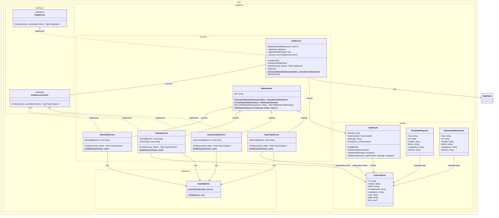

# Diagrama de Classes — Estrutura de Serviços

> **Propósito:** Documentar a hierarquia de classes, interfaces e relacionamentos dos serviços de busca de CEP com fallback multi-provedor.

| Campo           | Valor                    |
|-----------------|--------------------------|
| **Código**      | dcl-estrutura-servicos   |
| **Versão**      | v1.0                     |
| **Data**        | 23/07/2026               |
| **Autor**       | Rodrigo Araujo Barbosa   |
| **Status**      | `rascunho`               |

---

## Histórico de Alterações

| Data       | Autor                 | Versão | Descrição                        |
|------------|-----------------------|--------|----------------------------------|
| 23/07/2026 | Rodrigo Araujo Barbosa | v1.0   | Criação do diagrama de classes   |

---

## Diagrama

---

## Descrição textual

### Interfaces
- **`ICepService`** (pública) — Contrato público da biblioteca. Método `FindAsync` retorna `Task<CepResult>`, encapsulando sucesso/erro.
- **`ICepServiceControl`** (interna) — Contrato interno para provedores. Método `FindAsync` retorna `Task<CepContainer>`, mais simples e direto.

### Classes abstratas
- **`BaseService`** (interna abstrata) — Fornece operações HTTP comuns: criação de requisição, execução, desserialização, gerenciamento de timeout via `CancellationTokenSource`.

### Classes concretas (serviços provedores)
- **`BrasilApiService`** — Provedor BrasilAPI. Primeira tentativa no fallback.
- **`ViaCepService`** — Provedor ViaCEP. Segunda tentativa. Tratamento especial para campo `erro`.
- **`AwesomeApiService`** — Provedor AwesomeAPI. Terceira tentativa.
- **`OpenCepService`** — Provedor OpenCEP. Quarta e última tentativa.

### Orquestrador
- **`CepService`** (pública, sealed) — Implementa `ICepService` e `IDisposable`. Orquestra o fallback mantendo uma lista (`List<ICepServiceControl>`) dos provedores registrados em ordem.

### Modelos
- **`CepResult`** — Container de resultado com flag `Success`, dados (`CepContainer`), `Message` e `Exceptions`.
- **`CepContainer`** — Modelo imutável com campos do endereço brasileiro.
- **`BrasilApiResponse`** — DTO interno para desserialização da resposta da BrasilAPI.
- **`AwesomeApiResponse`** — DTO interno para desserialização da resposta da AwesomeAPI.

### Validação
- **`CepValidation`** (estática interna) — Validação de formato do CEP, usada por todos os provedores.

---

## Referências no código

| Classe / Interface | Arquivo | Linhas |
|-------------------|---------|--------|
| `ICepService` | `Sirb.CepBrasil/Interfaces/ICepService.cs` | 1-21 |
| `ICepServiceControl` | `Sirb.CepBrasil/Interfaces/ICepServiceControl.cs` | 1-16 |
| `BaseService` | `Sirb.CepBrasil/Services/BaseService.cs` | 14-104 |
| `CepService` | `Sirb.CepBrasil/Services/CepService.cs` | 25-174 |
| `BrasilApiService` | `Sirb.CepBrasil/Services/BrasilApiService.cs` | 19-86 |
| `ViaCepService` | `Sirb.CepBrasil/Services/ViaCepService.cs` | 25-91 |
| `AwesomeApiService` | `Sirb.CepBrasil/Services/AwesomeApiService.cs` | 19-86 |
| `OpenCepService` | `Sirb.CepBrasil/Services/OpenCepService.cs` | 19-76 |
| `CepResult` | `Sirb.CepBrasil/Models/CepResult.cs` | 15-77 |
| `CepContainer` | `Sirb.CepBrasil/Models/CepContainer.cs` | 75-184 |
| `BrasilApiResponse` | `Sirb.CepBrasil/Models/BrasilApiResponse.cs` | 14-61 |
| `AwesomeApiResponse` | `Sirb.CepBrasil/Models/AwesomeApiResponse.cs` | 14-60 |
| `CepValidation` | `Sirb.CepBrasil/Validations/CepValidation.cs` | 13-81 |

---

## Rastreabilidade

| Item | Referência |
|------|------------|
| Requisito de negócio | `docs/requirement/req-0002-busca-endereco-fallback.md` |
| Requisito técnico | `docs/requirement/tec/tec-req-0002-busca-endereco-fallback.md` |

---

## Clarification Log

| Data | Pergunta | Resposta | Status | Origem | Impacto |
|------|----------|----------|--------|--------|---------|
| 23/07/2026 | N/A — Diagrama gerado a partir do código-fonte | — | N/A | Criação | Sem impacto |

---

**© 2026 Rodrigo Araujo Barbosa — Sirb.CepBrasil**
