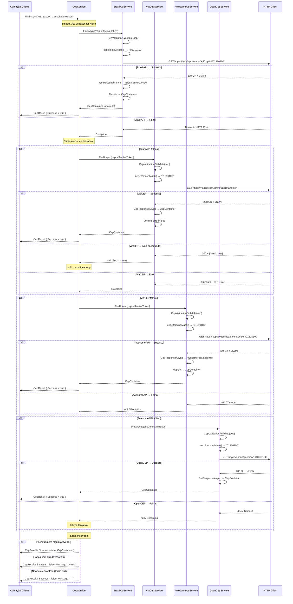
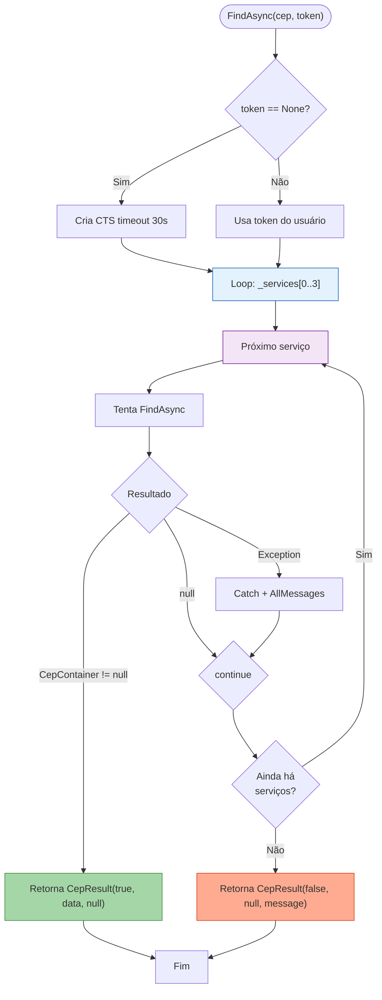

# Diagrama de Integração — Fluxo de Fallback Multi-Provedor

> **Propósito:** Documentar o fluxo de integração entre o orquestrador `CepService` e os 4 provedores externos, demonstrando a sequência de tentativas e as decisões de fallback.

| Campo           | Valor                    |
|-----------------|--------------------------|
| **Código**      | min-fluxo-fallback       |
| **Versão**      | v1.0                     |
| **Data**        | 23/07/2026               |
| **Autor**       | Rodrigo Araujo Barbosa   |
| **Status**      | `rascunho`               |

---

## Histórico de Alterações

| Data       | Autor                 | Versão | Descrição                        |
|------------|-----------------------|--------|----------------------------------|
| 23/07/2026 | Rodrigo Araujo Barbosa | v1.0   | Criação do diagrama de integração|

---

## Diagrama de Sequência — Fallback Completo



---

## Diagrama de Fluxo — Decisão de Fallback



---

## Tabela de Comportamento por Cenário

| Cenário | BrasilAPI | ViaCEP | AwesomeAPI | OpenCEP | Resultado Final |
|---------|-----------|--------|------------|---------|-----------------|
| 1 — Sucesso imediato | ✅ Encontrou | — | — | — | `CepResult { Success = true }` |
| 2 — Fallback 1→2 | ❌ Erro | ✅ Encontrou | — | — | `CepResult { Success = true }` |
| 3 — Fallback 1→2→3 | ❌ Erro | ❌ Erro | ✅ Encontrou | — | `CepResult { Success = true }` |
| 4 — Fallback completo | ❌ Erro | ❌ Erro | ❌ Erro | ✅ Encontrou | `CepResult { Success = true }` |
| 5 — Todos com erro | ❌ Erro | ❌ Erro | ❌ Erro | ❌ Erro | `CepResult { Success = false, Message = erros }` |
| 6 — Nenhum encontrou | ❌ Null | ❌ Null | ❌ Null | ❌ Null | `CepResult { Success = false, Message = "" }` |
| 7 — Timeout no 1º | ⏱ Timeout | ✅ Encontrou | — | — | `CepResult { Success = true }` |

**Legenda:** ✅ = Sucesso | ❌ = Erro/Falha | ⏱ = Timeout | — = Não tentado

---

## Timeline de Timeout

```
Usuário chama FindAsync("01310100")
│
├─→ Tentativa 1 (BrasilAPI): 0-30s
│   ├─→ Sucesso → retorna imediatamente (~100-500ms)
│   ├─→ Timeout → passa para próximo
│   └─→ Erro → passa para próximo
│
├─→ Tentativa 2 (ViaCEP): 0-30s
│   ├─→ Sucesso → retorna imediatamente
│   ├─→ Timeout → passa para próximo
│   └─→ Erro → passa para próximo
│
├─→ Tentativa 3 (AwesomeAPI): 0-30s
│   ├─→ Sucesso → retorna imediatamente
│   ├─→ Timeout → passa para próximo
│   └─→ Erro → passa para próximo
│
└─→ Tentativa 4 (OpenCEP): 0-30s
    ├─→ Sucesso → retorna imediatamente
    ├─→ Erro → loop encerra
    └─→ Timeout → loop encerra

Tempo típico (sucesso):    100-500ms (apenas BrasilAPI)
Pior caso (4 timeouts):    ~120s
Cenário médio com fallback: 500ms-5s
```

---

## Descrição textual do fluxo

1. A aplicação cliente chama `CepService.FindAsync(cep, cancellationToken)`.
2. O `CepService` verifica se o `CancellationToken` é `CancellationToken.None`. Se sim, cria um `CancellationTokenSource` com timeout de 30 segundos para limitar a duração total da tentativa.
3. Inicia o loop sobre a lista de serviços `_services` na ordem: BrasilAPI → ViaCEP → AwesomeAPI → OpenCEP.
4. Para cada serviço:
   - O serviço valida o CEP (`CepValidation.Validate`).
   - Remove a máscara do CEP (`RemoveMask`).
   - Constrói a URL específica do provedor.
   - Executa a requisição HTTP GET.
   - Se a resposta for um `CepContainer` não nulo: retorna imediatamente ao cliente com `CepResult { Success = true }`.
   - Se a resposta for nula: continua para o próximo serviço.
   - Se ocorrer uma exceção (timeout, HTTP error): captura a mensagem de erro, concatena e continua para o próximo.
5. Após o loop:
   - Se encontrou → `CepResult { Success = true }` com dados.
   - Se todos com erro → `CepResult { Success = false }` com mensagens consolidadas.
   - Se todos retornaram null → `CepResult { Success = false }` com mensagem vazia.

---

## Referências no código

| Componente | Arquivo | Linhas |
|------------|---------|--------|
| Orquestrador | `Sirb.CepBrasil/Services/CepService.cs` | 101-125 |
| Registro de serviços | `Sirb.CepBrasil/Services/CepService.cs` | 167-173 |
| BaseService HTTP | `Sirb.CepBrasil/Services/BaseService.cs` | 61-103 |
| Validação de CEP | `Sirb.CepBrasil/Validations/CepValidation.cs` | 45-80 |

---

## Rastreabilidade

| Item | Referência |
|------|------------|
| Requisito de negócio | `docs/requirement/req-0002-busca-endereco-fallback.md` |
| Requisito técnico | `docs/requirement/tec/tec-req-0002-busca-endereco-fallback.md` |
| Diagrama de classes | `docs/diagrams/dcl-estrutura-servicos.md` |

---

## Clarification Log

| Data | Pergunta | Resposta | Status | Origem | Impacto |
|------|----------|----------|--------|--------|---------|
| 23/07/2026 | N/A — Diagrama gerado a partir do código-fonte | — | N/A | Criação | Sem impacto |

---

**© 2026 Rodrigo Araujo Barbosa — Sirb.CepBrasil**
