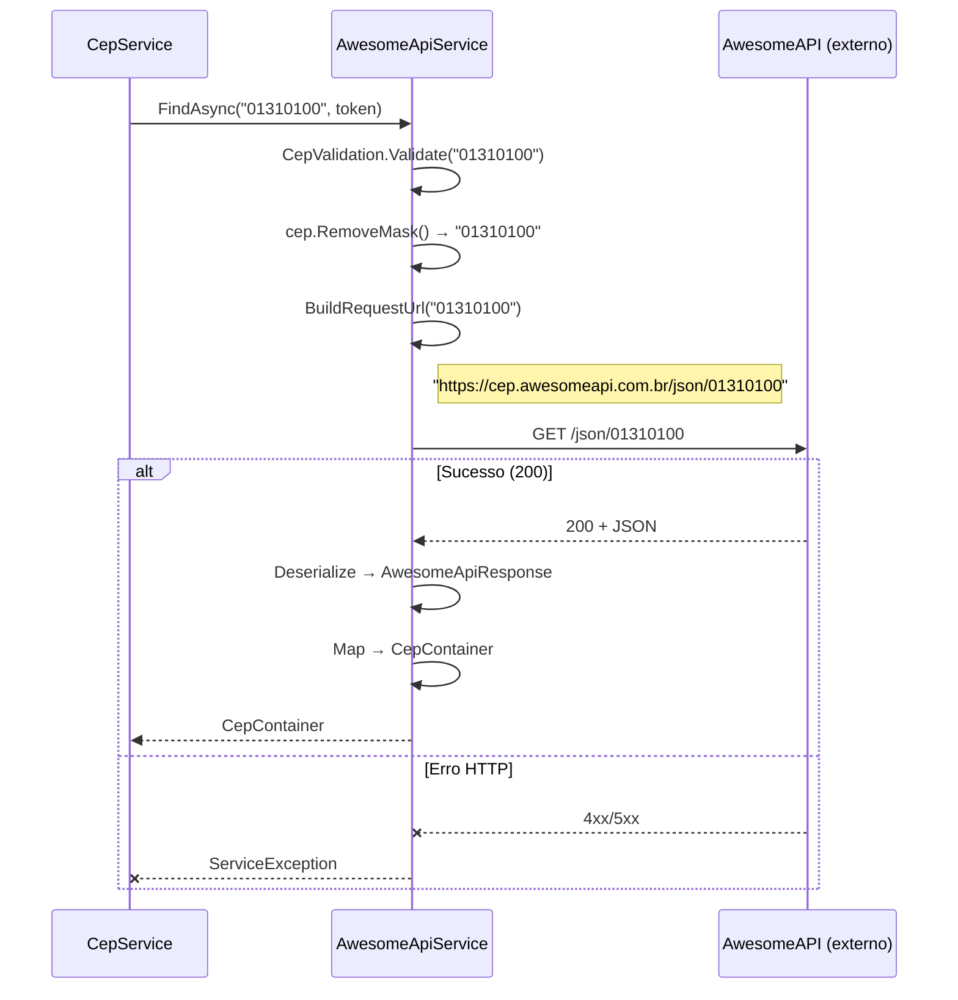

# Documentação da API — AwesomeAPI

## Metadados

| Campo                | Valor                    |
|----------------------|--------------------------|
| **Código**           | api-awesomeapi           |
| **Título**           | AwesomeAPI — Consulta de CEP |
| **Data de criação**  | 23/07/2026               |
| **Última atualização**| 23/07/2026               |
| **Autor**            | Rodrigo Araujo Barbosa   |
| **Versão**           | v1.0                     |
| **Status**           | Rascunho                 |
| **Requisito associado** | `docs/requirement/req-0002-busca-endereco-fallback.md` |

---

## Histórico de Alterações

| Data       | Autor                 | Versão | Descrição                        |
|------------|-----------------------|--------|----------------------------------|
| 23/07/2026 | Rodrigo Araujo Barbosa | v1.0   | Criação da documentação da API   |

---

## 1. Visão Geral

- **Provedor:** AwesomeAPI
- **Site oficial:** [https://cep.awesomeapi.com.br/](https://cep.awesomeapi.com.br/)
- **Documentação da API:** [https://docs.awesomeapi.com.br/](https://docs.awesomeapi.com.br/)
- **Tipo:** Serviço público gratuito, sem necessidade de autenticação
- **Protocolo:** HTTPS obrigatório
- **Formato de resposta:** JSON
- **Método HTTP:** GET

---

## 2. Endpoint

### Consultar CEP

```
GET https://cep.awesomeapi.com.br/json/{cep}
```

**Parâmetros de URL:**

| Parâmetro | Tipo | Obrigatório | Descrição | Exemplo |
|-----------|------|-------------|-----------|---------|
| `cep` | `string` | Sim | CEP com 8 dígitos numéricos (sem máscara) | `01310100` |

**Headers:**

| Header | Valor | Descrição |
|--------|-------|-----------|
| `Accept` | `application/json` | Formato de resposta esperado |

---

## 3. Respostas

### 3.1 Sucesso (200 OK)

```json
{
  "cep": "01310100",
  "address_type": "logradouro",
  "address_name": "Avenida Paulista",
  "address": "Avenida Paulista",
  "state": "SP",
  "district": "Bela Vista",
  "lat": -23.561,
  "lng": -46.656,
  "city": "São Paulo",
  "city_ibge": "3550308",
  "ddd": 11
}
```

### 3.2 Erro (4xx/5xx)

**CEP não encontrado:**
```json
{
  "status": 404,
  "code": "not_found",
  "message": "CEP não encontrado"
}
```

### 3.3 Mapeamento para CepContainer

| Campo JSON | Tipo | Mapeamento CepContainer | Descrição |
|------------|------|------------------------|-----------|
| `cep` | `string` | `Cep` | CEP formatado (00000000 sem máscara) |
| `state` | `string` | `Uf` | Sigla da UF (2 letras) |
| `city` | `string` | `Cidade` | Nome da cidade |
| `district` | `string` | `Bairro` | Nome do bairro |
| `address` | `string` | `Logradouro` | Nome do logradouro |

**Campos não mapeados:**
- `address_type`, `address_name`: redundantes com `address`
- `lat`, `lng`: coordenadas geográficas (não utilizadas)
- `city_ibge`: código IBGE (pode ser mapeado futuramente)
- `ddd`: código de área telefônico
- `Complemento`: sempre `null` (AwesomeAPI não retorna complemento)
- `Ibge`: não mapeado atualmente (disponível como `city_ibge`)

### 3.4 Códigos de Status

| Código | Descrição | Comportamento no fallback |
|--------|-----------|--------------------------|
| 200 | Sucesso — CEP encontrado | ✅ Retorna dados |
| 404 | CEP não encontrado | → Tenta próximo provedor |
| 400 | Requisição inválida | → Tenta próximo provedor |
| 500 | Erro interno do servidor | → Tenta próximo provedor |
| Timeout | Sem resposta em 30s | → Tenta próximo provedor |

---

## 4. Diagrama de Sequência



---

## 5. Considerações Técnicas

- **Rate Limit:** A AwesomeAPI não documenta rate limits públicos. Recomenda-se consumo moderado.
- **Disponibilidade:** Serviço gratuito sem SLA.
- **Tempo de resposta típico:** 200-500ms.
- **Formato do CEP:** A AwesomeAPI retorna o CEP sem máscara (8 dígitos), diferentemente da BrasilAPI e ViaCEP.
- **Dados extras:** A API retorna coordenadas geográficas (`lat`, `lng`) que podem ser úteis em versões futuras.

---

## 6. Classe C# de Desserialização

```csharp
namespace Sirb.CepBrasil.Models;

internal sealed class AwesomeApiResponse
{
    [JsonPropertyName("cep")]
    public string Cep { get; set; }

    [JsonPropertyName("state")]
    public string Uf { get; set; }

    [JsonPropertyName("city")]
    public string Cidade { get; set; }

    [JsonPropertyName("district")]
    public string Bairro { get; set; }

    [JsonPropertyName("address")]
    public string Logradouro { get; set; }

    [JsonPropertyName("service")]
    public string Service { get; set; }
}
```

---

## 7. Rastreabilidade

| Item | Referência |
|------|------------|
| Requisito | `docs/requirement/req-0002-busca-endereco-fallback.md` (RF-08) |
| Código do serviço | `Sirb.CepBrasil/Services/AwesomeApiService.cs` |
| DTO de resposta | `Sirb.CepBrasil/Models/AwesomeApiResponse.cs` |
| Testes | `Sirb.CepBrasil.Test/Services/AwesomeApiServiceTest.cs` |

---

## Clarification Log

| Data | Pergunta | Resposta | Status | Origem | Impacto |
|------|----------|----------|--------|--------|---------|
| 23/07/2026 | N/A — API pública documentada conforme código | — | N/A | Criação | Sem impacto |

---

**© 2026 Rodrigo Araujo Barbosa — Sirb.CepBrasil**
