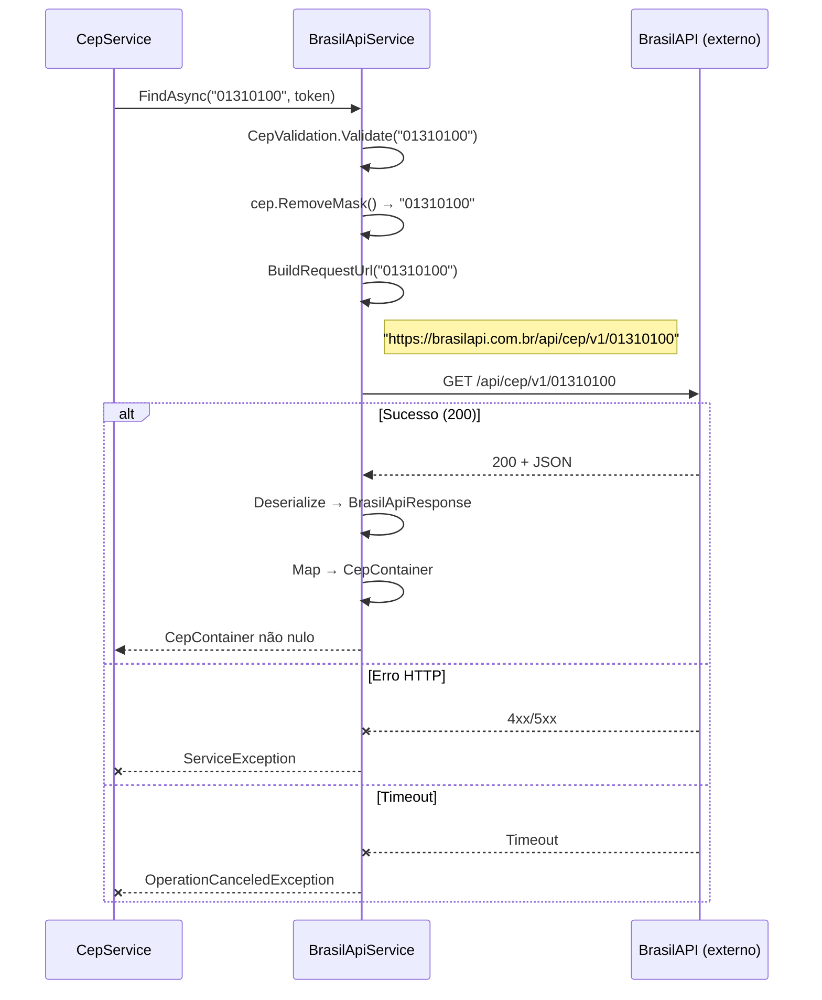

# Documentação da API — BrasilAPI

## Metadados

| Campo                | Valor                    |
|----------------------|--------------------------|
| **Código**           | api-brasilapi            |
| **Título**           | BrasilAPI — Consulta de CEP |
| **Data de criação**  | 23/07/2026               |
| **Última atualização**| 23/07/2026               |
| **Autor**            | Rodrigo Araujo Barbosa   |
| **Versão**           | v1.0                     |
| **Status**           | Rascunho                 |
| **Requisito associado** | `docs/requirement/req-0002-busca-endereco-fallback.md` |

---

## Histórico de Alterações

| Data       | Autor                 | Versão | Descrição                        |
|------------|-----------------------|--------|----------------------------------|
| 23/07/2026 | Rodrigo Araujo Barbosa | v1.0   | Criação da documentação da API   |

---

## 1. Visão Geral

- **Provedor:** BrasilAPI
- **Site oficial:** [https://brasilapi.com.br/](https://brasilapi.com.br/)
- **Documentação da API:** [https://brasilapi.com.br/docs](https://brasilapi.com.br/docs)
- **Tipo:** Serviço público gratuito, sem necessidade de autenticação
- **Protocolo:** HTTPS obrigatório
- **Formato de resposta:** JSON
- **Método HTTP:** GET

---

## 2. Endpoint

### Consultar CEP

```
GET https://brasilapi.com.br/api/cep/v1/{cep}
```

**Parâmetros de URL:**

| Parâmetro | Tipo | Obrigatório | Descrição | Exemplo |
|-----------|------|-------------|-----------|---------|
| `cep` | `string` | Sim | CEP com 8 dígitos numéricos (sem máscara) | `01310100` |

**Headers:**

| Header | Valor | Descrição |
|--------|-------|-----------|
| `Accept` | `application/json` | Formato de resposta esperado |

---

## 3. Respostas

### 3.1 Sucesso (200 OK)

```json
{
  "cep": "01310100",
  "state": "SP",
  "city": "São Paulo",
  "neighborhood": "Bela Vista",
  "street": "Avenida Paulista",
  "service": "viacep"
}
```

### 3.2 Mapeamento para CepContainer

| Campo JSON | Tipo | Mapeamento CepContainer | Descrição |
|------------|------|------------------------|-----------|
| `cep` | `string` | `Cep` | CEP formatado (00000-000) |
| `state` | `string` | `Uf` | Sigla da UF (2 letras) |
| `city` | `string` | `Cidade` | Nome da cidade |
| `neighborhood` | `string` | `Bairro` | Nome do bairro |
| `street` | `string` | `Logradouro` | Nome do logradouro |
| `service` | `string` | — | Identificação do provedor interno |

**Campos não mapeados:**
- `Complemento`: sempre `null` (BrasilAPI não retorna complemento)
- `Ibge`: sempre `null` (BrasilAPI não retorna código IBGE)

### 3.3 Erro (4xx/5xx)

A BrasilAPI retorna erros HTTP padrão. Exemplos:

**CEP não encontrado (404):**
```json
{
  "message": "CEP não encontrado",
  "type": "not_found"
}
```

**Erro interno (500):**
```json
{
  "message": "Erro interno do servidor",
  "type": "internal_error"
}
```

### 3.4 Códigos de Status

| Código | Descrição | Comportamento no fallback |
|--------|-----------|--------------------------|
| 200 | Sucesso — CEP encontrado | ✅ Retorna dados |
| 404 | CEP não encontrado | → Tenta próximo provedor |
| 400 | Requisição inválida | → Tenta próximo provedor |
| 500 | Erro interno do servidor | → Tenta próximo provedor |
| 503 | Serviço indisponível | → Tenta próximo provedor |
| Timeout | Sem resposta em 30s | → Tenta próximo provedor |

---

## 4. Diagrama de Sequência



---

## 5. Considerações Técnicas

- **Rate Limit:** A BrasilAPI é um serviço público sem rate limit documentado, mas recomenda-se consumo responsável.
- **Disponibilidade:** Serviço gratuito sem SLA.
- **Tempo de resposta típico:** 100-300ms.
- **Campos opcionais:** `neighborhood` e `street` podem vir vazios para CEPs genéricos (grandes avenidas, áreas rurais).

---

## 6. Classe C# de Desserialização

```csharp
namespace Sirb.CepBrasil.Models;

internal sealed class BrasilApiResponse
{
    [JsonPropertyName("cep")]
    public string Cep { get; set; }

    [JsonPropertyName("state")]
    public string Uf { get; set; }

    [JsonPropertyName("city")]
    public string Cidade { get; set; }

    [JsonPropertyName("neighborhood")]
    public string Bairro { get; set; }

    [JsonPropertyName("street")]
    public string Logradouro { get; set; }

    [JsonPropertyName("service")]
    public string Service { get; set; }
}
```

---

## 7. Rastreabilidade

| Item | Referência |
|------|------------|
| Requisito | `docs/requirement/req-0002-busca-endereco-fallback.md` (RF-08) |
| Código do serviço | `Sirb.CepBrasil/Services/BrasilApiService.cs` |
| DTO de resposta | `Sirb.CepBrasil/Models/BrasilApiResponse.cs` |
| Testes | `Sirb.CepBrasil.Test/Services/BrasilApiServiceTest.cs` |

---

## Clarification Log

| Data | Pergunta | Resposta | Status | Origem | Impacto |
|------|----------|----------|--------|--------|---------|
| 23/07/2026 | N/A — API pública documentada conforme código | — | N/A | Criação | Sem impacto |

---

**© 2026 Rodrigo Araujo Barbosa — Sirb.CepBrasil**
