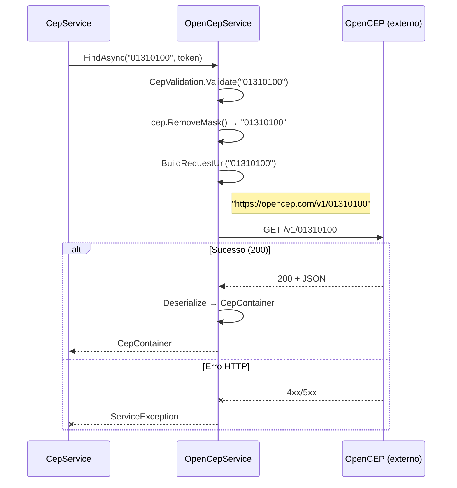

# Documentação da API — OpenCEP

## Metadados

| Campo                | Valor                    |
|----------------------|--------------------------|
| **Código**           | api-opencep              |
| **Título**           | OpenCEP — Consulta de CEP |
| **Data de criação**  | 23/07/2026               |
| **Última atualização**| 23/07/2026               |
| **Autor**            | Rodrigo Araujo Barbosa   |
| **Versão**           | v1.0                     |
| **Status**           | Rascunho                 |
| **Requisito associado** | `docs/requirement/req-0002-busca-endereco-fallback.md` |

---

## Histórico de Alterações

| Data       | Autor                 | Versão | Descrição                        |
|------------|-----------------------|--------|----------------------------------|
| 23/07/2026 | Rodrigo Araujo Barbosa | v1.0   | Criação da documentação da API   |

---

## 1. Visão Geral

- **Provedor:** OpenCEP
- **Site oficial:** [https://opencep.com/](https://opencep.com/)
- **Repositório:** [https://github.com/filipedeschamps/cep-promise](https://github.com/filipedeschamps/cep-promise)
- **Tipo:** Serviço público gratuito, sem necessidade de autenticação
- **Protocolo:** HTTPS obrigatório
- **Formato de resposta:** JSON
- **Método HTTP:** GET

---

## 2. Endpoint

### Consultar CEP

```
GET https://opencep.com/v1/{cep}
```

**Parâmetros de URL:**

| Parâmetro | Tipo | Obrigatório | Descrição | Exemplo |
|-----------|------|-------------|-----------|---------|
| `cep` | `string` | Sim | CEP com 8 dígitos numéricos (sem máscara) | `01310100` |

**Headers:**

| Header | Valor | Descrição |
|--------|-------|-----------|
| `Accept` | `application/json` | Formato de resposta esperado |

---

## 3. Respostas

### 3.1 Sucesso (200 OK)

```json
{
  "cep": "01310-100",
  "logradouro": "Avenida Paulista",
  "complemento": "",
  "bairro": "Bela Vista",
  "localidade": "São Paulo",
  "uf": "SP",
  "ibge": "3550308",
  "gia": "",
  "ddd": "11",
  "siafi": "7107"
}
```

### 3.2 Erro (4xx/5xx)

**CEP não encontrado:**
```json
{
  "status": 404,
  "message": "CEP não encontrado"
}
```

### 3.3 Mapeamento para CepContainer

| Campo JSON | Tipo | Mapeamento CepContainer | Descrição |
|------------|------|------------------------|-----------|
| `cep` | `string` | `Cep` | CEP formatado (00000-000) |
| `logradouro` | `string` | `Logradouro` | Nome do logradouro |
| `complemento` | `string` | `Complemento` | Informação complementar |
| `bairro` | `string` | `Bairro` | Nome do bairro |
| `localidade` | `string` | `Cidade` | Nome da cidade |
| `uf` | `string` | `Uf` | Sigla da UF (2 letras) |
| `ibge` | `string` | `Ibge` | Código IBGE do município |

**Campos não mapeados:** `gia`, `ddd`, `siafi` (não utilizados no modelo)

**Observação:** OpenCEP retorna o mesmo formato do ViaCEP, mas sem o campo `erro`.

### 3.4 Códigos de Status

| Código | Descrição | Comportamento no fallback |
|--------|-----------|--------------------------|
| 200 | Sucesso — CEP encontrado | ✅ Retorna dados |
| 404 | CEP não encontrado | → Tenta próximo provedor |
| 400 | Requisição inválida | → Tenta próximo provedor |
| 500 | Erro interno do servidor | → Tenta próximo provedor |
| Timeout | Sem resposta em 30s | → Tenta próximo provedor |

---

## 4. Diagrama de Sequência



---

## 5. Considerações Técnicas

- **Rate Limit:** OpenCEP não documenta rate limits. Como último provedor na cadeia, é menos utilizado.
- **Disponibilidade:** Serviço gratuito sem SLA. É a última opção de fallback.
- **Tempo de resposta típico:** 300-800ms (pode ser mais lento que os demais).
- **Formato do CEP:** OpenCEP retorna o CEP formatado (00000-000).
- **Diferença do ViaCEP:** OpenCEP não retorna o campo `erro`, portanto CEPs inexistentes resultam em HTTP 404.
- **Uso como último recurso:** Por ser o mais recente e menos estável, o OpenCEP é posicionado como última tentativa no fallback.

---

## 6. Classe C# de Desserialização

O OpenCEP desserializa diretamente para `CepContainer` (namespace `Sirb.CepBrasil.Models`), mesmo modelo utilizado pelo ViaCEP. Não há necessidade de DTO separado.

---

## 7. Rastreabilidade

| Item | Referência |
|------|------------|
| Requisito | `docs/requirement/req-0002-busca-endereco-fallback.md` (RF-08) |
| Código do serviço | `Sirb.CepBrasil/Services/OpenCepService.cs` |
| Modelo de resposta | `Sirb.CepBrasil/Models/CepContainer.cs` |
| Testes | `Sirb.CepBrasil.Test/Services/OpenCepServiceTest.cs` |

---

## Clarification Log

| Data | Pergunta | Resposta | Status | Origem | Impacto |
|------|----------|----------|--------|--------|---------|
| 23/07/2026 | N/A — API pública documentada conforme código | — | N/A | Criação | Sem impacto |

---

**© 2026 Rodrigo Araujo Barbosa — Sirb.CepBrasil**
