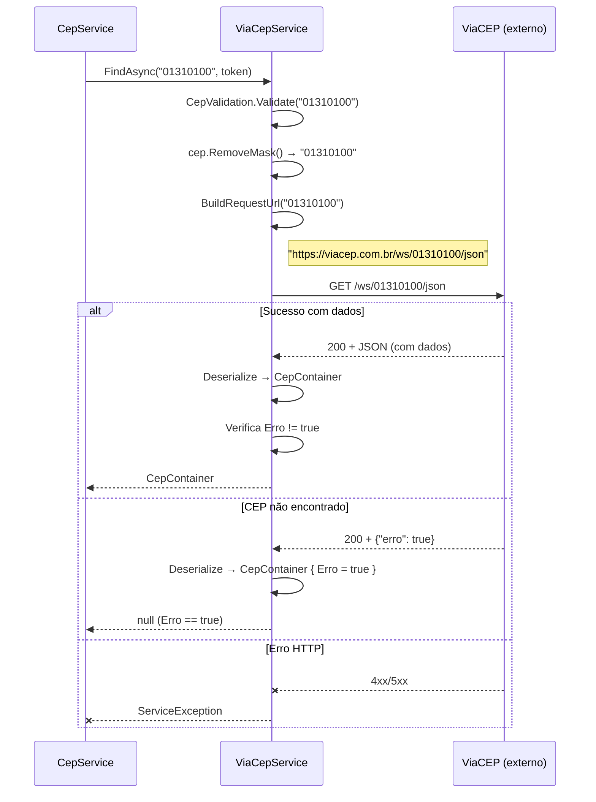

# Documentação da API — ViaCEP

## Metadados

| Campo                | Valor                    |
|----------------------|--------------------------|
| **Código**           | api-viacep               |
| **Título**           | ViaCEP — Consulta de CEP |
| **Data de criação**  | 23/07/2026               |
| **Última atualização**| 23/07/2026               |
| **Autor**            | Rodrigo Araujo Barbosa   |
| **Versão**           | v1.0                     |
| **Status**           | Rascunho                 |
| **Requisito associado** | `docs/requirement/req-0002-busca-endereco-fallback.md` |

---

## Histórico de Alterações

| Data       | Autor                 | Versão | Descrição                        |
|------------|-----------------------|--------|----------------------------------|
| 23/07/2026 | Rodrigo Araujo Barbosa | v1.0   | Criação da documentação da API   |

---

## 1. Visão Geral

- **Provedor:** ViaCEP
- **Site oficial:** [https://viacep.com.br/](https://viacep.com.br/)
- **Documentação da API:** [https://viacep.com.br/](https://viacep.com.br/)
- **Tipo:** Serviço público gratuito, sem necessidade de autenticação
- **Protocolo:** HTTPS obrigatório
- **Formato de resposta:** JSON
- **Método HTTP:** GET

---

## 2. Endpoint

### Consultar CEP

```
GET https://viacep.com.br/ws/{cep}/json
```

**Parâmetros de URL:**

| Parâmetro | Tipo | Obrigatório | Descrição | Exemplo |
|-----------|------|-------------|-----------|---------|
| `cep` | `string` | Sim | CEP com 8 dígitos numéricos (sem máscara) | `01310100` |
| Formato | — | — | Fixo: `json` | `json` |

**Headers:**

| Header | Valor | Descrição |
|--------|-------|-----------|
| `Accept` | `application/json` | Formato de resposta esperado |

---

## 3. Respostas

### 3.1 Sucesso (200 OK)

```json
{
  "cep": "01310-100",
  "logradouro": "Avenida Paulista",
  "complemento": "de 611 a 1045 - lado ímpar",
  "bairro": "Bela Vista",
  "localidade": "São Paulo",
  "uf": "SP",
  "ibge": "3550308",
  "gia": "1004",
  "ddd": "11",
  "siafi": "7107"
}
```

### 3.2 CEP Não Encontrado (200 OK com erro)

```json
{
  "erro": true
}
```

**Importante:** ViaCEP retorna HTTP 200 mesmo quando o CEP não existe. A indicação de "não encontrado" é feita pelo campo `erro: true` no corpo da resposta.

### 3.3 Mapeamento para CepContainer

| Campo JSON | Tipo | Mapeamento CepContainer | Descrição |
|------------|------|------------------------|-----------|
| `cep` | `string` | `Cep` | CEP formatado (00000-000) |
| `logradouro` | `string` | `Logradouro` | Nome do logradouro |
| `complemento` | `string` | `Complemento` | Informação complementar |
| `bairro` | `string` | `Bairro` | Nome do bairro |
| `localidade` | `string` | `Cidade` | Nome da cidade |
| `uf` | `string` | `Uf` | Sigla da UF (2 letras) |
| `ibge` | `string` | `Ibge` | Código IBGE do município |
| `erro` | `bool?` | `Erro` | Flag de não encontrado |

**Campos não mapeados:** `gia`, `ddd`, `siafi` (não utilizados no modelo)

### 3.4 Tratamento do Campo `erro`

O campo `erro` pode retornar como booleano (`true`) ou string (`"true"`). A classe `BooleanOrStringConverter` (custom `JsonConverter`) trata ambos os casos:

```csharp
internal sealed class BooleanOrStringConverter : JsonConverter<bool?>
{
    public override bool? Read(ref Utf8JsonReader reader, Type typeToConvert, JsonSerializerOptions options)
    {
        if (reader.TokenType == JsonTokenType.True) return true;
        if (reader.TokenType == JsonTokenType.False) return false;
        if (reader.TokenType == JsonTokenType.String)
        {
            var stringValue = reader.GetString();
            if (bool.TryParse(stringValue, out var boolValue)) return boolValue;
        }
        return null;
    }
}
```

**Regra de negócio:** Se `result?.Erro == true`, o serviço retorna `null` (CEP não encontrado).

### 3.5 Códigos de Status

| Código | Descrição | Comportamento no fallback |
|--------|-----------|--------------------------|
| 200 | Sucesso (com ou sem dados) | ✅ Verifica campo `erro` |
| 200 + `erro: true` | CEP não encontrado | → Tenta próximo provedor |
| 400 | Requisição inválida | → Tenta próximo provedor |
| 500 | Erro interno do servidor | → Tenta próximo provedor |
| Timeout | Sem resposta em 30s | → Tenta próximo provedor |

---

## 4. Diagrama de Sequência



---

## 5. Considerações Técnicas

- **Rate Limit:** ViaCEP não documenta rate limit explícito, mas recomenda-se intervalo mínimo de 1 segundo entre chamadas para o mesmo CEP.
- **Disponibilidade:** Serviço público sem SLA. É o provedor mais antigo e estável entre os 4.
- **Tempo de resposta típico:** 200-500ms.
- **Formato de CEP:** ViaCEP aceita tanto formatado (00000-000) quanto sem formatação (00000000).
- **Campos nulos:** Quando um campo não está disponível, a ViaCEP retorna o campo com valor vazio (`""`).

---

## 6. Classe C# de Desserialização

O ViaCEP desserializa diretamente para `CepContainer` (namespace `Sirb.CepBrasil.Models`), que contém os `JsonPropertyName` correspondentes ao formato ViaCEP, além do `BooleanOrStringConverter` para o campo `erro`.

---

## 7. Rastreabilidade

| Item | Referência |
|------|------------|
| Requisito | `docs/requirement/req-0002-busca-endereco-fallback.md` (RF-08) |
| Código do serviço | `Sirb.CepBrasil/Services/ViaCepService.cs` |
| Modelo de resposta | `Sirb.CepBrasil/Models/CepContainer.cs` |
| Conversor especial | `Sirb.CepBrasil/Models/CepContainer.cs` (BooleanOrStringConverter) |
| Testes | `Sirb.CepBrasil.Test/Services/ViaCepServiceTest.cs` |

---

## Clarification Log

| Data | Pergunta | Resposta | Status | Origem | Impacto |
|------|----------|----------|--------|--------|---------|
| 23/07/2026 | N/A — API pública documentada conforme código | — | N/A | Criação | Sem impacto |

---

**© 2026 Rodrigo Araujo Barbosa — Sirb.CepBrasil**
