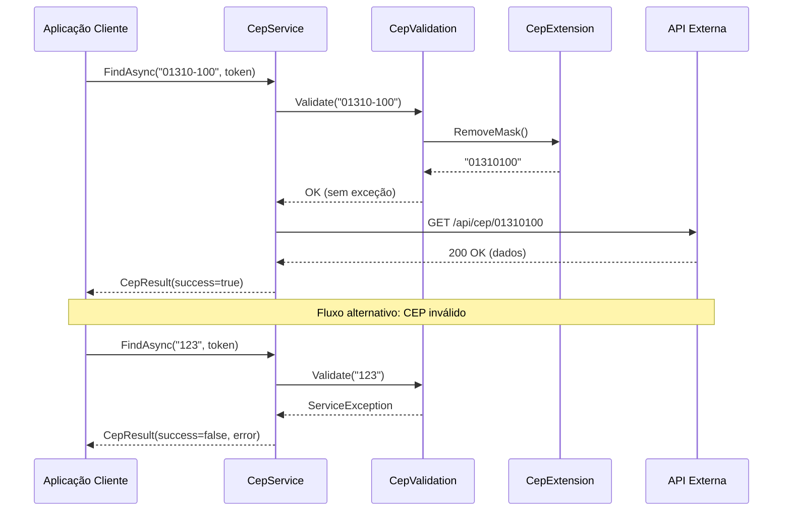
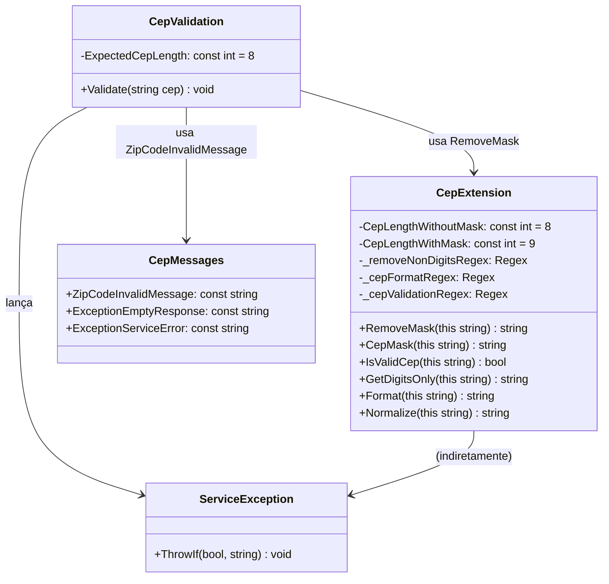

# tec-req-0001 — Validação de CEP (Detalhamento Técnico)

## Metadados

| Campo                | Valor                    |
|----------------------|--------------------------|
| **Código**           | tec-req-0001             |
| **Título**           | Validação de CEP         |
| **Data de criação**  | 23/07/2026               |
| **Última atualização**| 23/07/2026               |
| **Autor**            | Rodrigo Araujo Barbosa   |
| **Versão**           | v1.0                     |
| **Status**           | Rascunho                 |
| **Requisito de negócio relacionado** | `docs/requirement/req-0001-validacao-cep.md` (v1.0) |

---

## 1. Resumo do Requisito de Negócio

- **Requisito de origem:** `docs/requirement/req-0001-validacao-cep.md` (v1.0)
- **Síntese do "o quê":** Validar o formato do CEP brasileiro antes de qualquer consulta a provedores externos. Disponibilizar métodos de extensão para manipulação de CEP (remoção/aplicação de máscara, validação booleana, formatação, normalização).
- **Síntese do "por quê":** Prevenir requisições inválidas a provedores externos, reduzir latência com fail-fast (rejeição em < 10ms), garantir consistência de formato (8 dígitos numéricos) para todos os provedores.

---

## 2. Detalhamento Técnico Completo

### 2.1 Arquitetura

A validação de CEP é implementada em duas classes:

1. **`CepValidation`** (`internal static`) — validação estrita que lança exceções (`ArgumentNullException` para nulos/vazios, `ServiceException` para formato inválido).
2. **`CepExtension`** (`public static`) — métodos de extensão para manipulação segura de CEP, sem lançamento de exceções (retornam valores sentinela como `false`, `null` ou `""`).

Ambas as classes estão no namespace `Sirb.CepBrasil` e dependem de `CepMessages` para mensagens padronizadas.

### 2.2 Validações de Entrada (CepValidation.Validate)

O método `Validate(string cep)` executa as seguintes validações em ordem:

1. **Nulo/vazio/branco:** `string.IsNullOrWhiteSpace(cep)` → `ArgumentNullException`
2. **Caracteres inválidos:** iteração por `char.IsDigit(ch)` e `ch != '-'` → `ServiceException`
3. **Hífen no início ou final:** `StartsWith('-')` ou `EndsWith('-')` → `ServiceException`
4. **Hífen duplicado:** `Contains("--")` → `ServiceException`
5. **Posição do hífen:** se exatamente 1 hífen, verificar se `trimmed[5] == '-'` → `ServiceException`
6. **Comprimento:** após `RemoveMask()`, verificar `Length != 8` → `ServiceException`

### 2.3 Validação de Entrada (CepExtension.IsValidCep)

O método `IsValidCep(this string value)`:
1. `string.IsNullOrWhiteSpace(value)` → `false`
2. Verifica comprimento: `value.Trim().Length` deve ser 8 ou 9
3. Aplica regex `^\d{5}-?\d{3}$` com `RegexOptions.Compiled` e timeout de 15s

### 2.4 Manipulação de String (CepExtension)

| Método | Comportamento | Retorno para entrada inválida |
|--------|---------------|-------------------------------|
| `RemoveMask()` | Remove caracteres não-dígitos via regex `[^\d]` | Valor original se null/whitespace |
| `GetDigitsOnly()` | Alias para `RemoveMask()` | Idem |
| `CepMask()` | Remove máscara, valida comprimento 8, aplica regex `^(\d{5})(\d{3})$` → `$1-$2` | Valor original se inválido |
| `Format()` | Valida via `IsValidCep()`, remove máscara, aplica regex `$1-$2` | `""` (string vazia) se inválido |
| `Normalize()` | Valida via `IsValidCep()`, retorna `RemoveMask()` | `null` se inválido |

### 2.5 Regex Compilados (CepExtension)

```csharp
// Remove todos os caracteres não numéricos
private static readonly Regex _removeNonDigitsRegex = new(@"[^\d]", RegexOptions.Compiled, TimeSpan.FromSeconds(15));

// Formata CEP no padrão 00000-000 (5 dígitos + 3 dígitos)
private static readonly Regex _cepFormatRegex = new(@"^(\d{5})(\d{3})$", RegexOptions.Compiled, TimeSpan.FromSeconds(15));

// Valida formato com hífen opcional
private static readonly Regex _cepValidationRegex = new(@"^\d{5}-?\d{3}$", RegexOptions.Compiled, TimeSpan.FromSeconds(15));
```

### 2.6 Tratamento de Exceções

| Condição | Classe | Exceção | Mensagem |
|----------|--------|---------|----------|
| CEP nulo/vazio/branco | `CepValidation.Validate` | `ArgumentNullException` | "CEP cannot be null, empty, or contain only whitespace." |
| Caracteres inválidos | `CepValidation.Validate` | `ServiceException` | `CepMessages.ZipCodeInvalidMessage` |
| Comprimento inválido | `CepValidation.Validate` | `ServiceException` | `CepMessages.ZipCodeInvalidMessage` |
| Hífen mal posicionado | `CepValidation.Validate` | `ServiceException` | `CepMessages.ZipCodeInvalidMessage` |
| Formato inválido | `CepExtension.IsValidCep` | Nenhuma (retorna `false`) | N/A |

### 2.7 Considerações de Performance

- Regex compilados com `RegexOptions.Compiled` para performance em chamadas repetidas.
- Timeout de 15s em cada regex como proteção contra ReDoS.
- Validação de comprimento antes do regex (`_cepValidationRegex`) para evitar processamento desnecessário.
- `ServiceException.ThrowIf()` com condição curta para fail-fast.

### 2.8 Observabilidade

- Sem logging atualmente (biblioteca leve).
- Exceções propagadas para o consumidor tratar.

### 2.9 Dependências

- **BCL:** `System`, `System.Text.RegularExpressions`, `System.Linq`
- **Projeto:** `Sirb.CepBrasil.Exceptions` (ServiceException)
- **Testes:** `xUnit`, `Coverlet`

---

## 3. Regras Funcionais e Regras de Negócio Numeradas

### 3.1 Regras Funcionais (RF)

| ID | Descrição | Prioridade | Regra de negócio associada |
|----|-----------|------------|----------------------------|
| RF-01 | Validar formato de CEP (`CepValidation.Validate`) | Alta | RN-001, RN-002, RN-003, RN-004, RN-005, RN-006 |
| RF-02 | Remover máscara do CEP (`CepExtension.RemoveMask`) | Alta | RN-001, RN-010 |
| RF-03 | Aplicar máscara no CEP (`CepExtension.CepMask`) | Média | RN-001, RN-002, RN-008 |
| RF-04 | Validar CEP com retorno booleano (`CepExtension.IsValidCep`) | Alta | RN-003, RN-007 |
| RF-05 | Extrair apenas dígitos do CEP (`CepExtension.GetDigitsOnly`) | Baixa | RN-001, RN-010 |
| RF-06 | Formatar CEP com segurança (`CepExtension.Format`) | Média | RN-008 |
| RF-07 | Normalizar CEP (`CepExtension.Normalize`) | Média | RN-009 |

### 3.2 Regras de Negócio (RN)

| ID | Regra | Origem | Impacto |
|----|-------|--------|---------|
| RN-001 | O CEP deve conter exatamente 8 dígitos numéricos após remoção da máscara | Padrão Correios | `ExpectedCepLength = 8`, `CepLengthWithoutMask = 8` |
| RN-002 | CEP pode ser informado com máscara (`00000-000`) ou sem (`00000000`) | Usabilidade | Aceita ambos os formatos na validação |
| RN-003 | Nulo, vazio ou whitespace → rejeitado | Segurança (fail-fast) | `ArgumentNullException` em `Validate()`; `false` em `IsValidCep()` |
| RN-004 | Caracteres não numéricos (exceto hífen) → rejeitado | Segurança | `ServiceException` em `Validate()` |
| RN-005 | Hífen, se presente, deve estar na posição `[5]` | Padrão Correios | Verificação `trimmed[5] != '-'` |
| RN-006 | Hífen duplicado, no início ou final → rejeitado | Prevenção de ambiguidade | `StartsWith('-')`, `EndsWith('-')`, `Contains("--")` |
| RN-007 | `IsValidCep()` retorna `false`, não lança exceção | Suavidade (non-throwing) | Diferente de `Validate()` que lança |
| RN-008 | `Format()` retorna `""` para inválido; `CepMask()` retorna original | Comportamento seguro | Retorno condicional |
| RN-009 | `Normalize()` retorna `null` para inválido | Comportamento seguro | Null sentinel |
| RN-010 | `RemoveMask()` preserva espaços (regex `[^\d]`) | Comportamento do regex | Espaços não são dígitos, não são removidos |

---

## 4. Diagramas Técnicos

### 4.1 Diagrama de Fluxo — Validação de CEP

```mermaid
flowchart TD
    A[Início: Validate(cep)] --> B{IsNullOrWhiteSpace?}
    B -- Sim --> C[throw ArgumentNullException]
    B -- Não --> D[Trim entrada]
    D --> E{Para cada char: é dígito\nou hífen?}
    E -- Não --> F[throw ServiceException]
    E -- Sim --> G{Starts/Ends with '-'?\nContains '--'?}
    G -- Sim --> H[throw ServiceException]
    G -- Não --> I{Contém 1 hífen\nna posição 5?}
    I -- Não --> J[throw ServiceException]
    I -- Sim --> K[RemoveMask -> normaliza]
    K --> L{Length == 8?}
    L -- Sim --> M[Válido: sem exceção]
    L -- Não --> N[throw ServiceException]
```

### 4.2 Diagrama de Fluxo — IsValidCep (non-throwing)

```mermaid
flowchart TD
    A[Início: IsValidCep(value)] --> B{IsNullOrWhiteSpace?}
    B -- Sim --> C[return false]
    B -- Não --> D[Trim + check Length 8 or 9]
    D -- Inválido --> C
    D -- OK --> E[Regex: ^\\d{5}-?\\d{3}$]
    E -- Match --> F[return true]
    E -- NoMatch --> C
```

### 4.3 Diagrama de Sequência — Fluxo de Uso Típico



### 4.4 Diagrama de Classes — Validação



### 4.5 Observações dos Diagramas

- Os diagramas refletem o código atual em `v1.4.0`.
- `CepValidation` é `internal static` — não acessível externamente. O ponto de entrada público é `ICepService.FindAsync()`.
- `CepExtension` é `public static` — exposto como métodos de extensão de `string`.

---

## 5. Exemplos Técnicos

### 5.1 Exemplos de Validação (CepValidation.Validate)

```csharp
// ✅ CEPs válidos — nenhuma exceção
CepValidation.Validate("01310-100");    // Formatado
CepValidation.Validate("01310100");     // Sem máscara
CepValidation.Validate("  01310100  "); // Com espaços (trim internamente)

// ❌ CEPs inválidos — ArgumentNullException
CepValidation.Validate(null);           // Nulo
CepValidation.Validate("");             // Vazio
CepValidation.Validate("   ");          // Apenas espaços

// ❌ CEPs inválidos — ServiceException
CepValidation.Validate("123");          // Comprimento < 8
CepValidation.Validate("123456789");    // Comprimento > 8
CepValidation.Validate("0131a100");     // Caractere alfabético
CepValidation.Validate("01310@100");    // Caractere especial
CepValidation.Validate("01310--100");   // Hífen duplicado
CepValidation.Validate("-01310100");    // Hífen no início
CepValidation.Validate("01310100-");    // Hífen no final
CepValidation.Validate("013101-00");    // Hífen posição incorreta
```

### 5.2 Exemplos de Métodos de Extensão

```csharp
// RemoveMask
"01310-100".RemoveMask();               // "01310100"
"01310100".RemoveMask();                // "01310100"
"01-310.100".RemoveMask();              // "01310100"
"".RemoveMask();                        // ""
((string)null).RemoveMask();            // null

// CepMask
"01310100".CepMask();                   // "01310-100"
"01310-100".CepMask();                  // "01310-100"
"123".CepMask();                        // "123" (inválido → retorna original)
"".CepMask();                           // ""

// IsValidCep
"01310-100".IsValidCep();               // true
"01310100".IsValidCep();                // true
"123".IsValidCep();                     // false
"abcde-fgh".IsValidCep();               // false
((string)null).IsValidCep();            // false

// Format
"01310100".Format();                    // "01310-100"
"01310-100".Format();                   // "01310-100"
"123".Format();                         // "" (vazio para inválido)
"".Format();                            // ""

// Normalize
"01310-100".Normalize();                // "01310100"
"01310100".Normalize();                 // "01310100"
"123".Normalize();                      // null
"".Normalize();                         // null
```

### 5.3 Mensagens de Erro

```csharp
// CepMessages
CepMessages.ZipCodeInvalidMessage;      // "CEP com tamanho inválido."
```

---

## 6. Estratégia de Testes

### 6.1 Testes Existentes

| Classe de Teste | Localização | Qtd Testes | Cobertura |
|-----------------|-------------|-------------|-----------|
| `CepValidationTest` | `Sirb.CepBrasil.Test/Validations/CepValidationTest.cs` | 26 | 100% |
| `CepExtensionTest` | `Sirb.CepBrasil.Test/Extensions/CepExtensionTest.cs` | 52 | 100% |

### 6.2 Cenários Cobertos (CepValidationTest — 26 testes)

- 8 testes de CEP válido (formatado, sem máscara, variações)
- 3 testes de nulo/vazio/branco
- 7 testes de comprimento inválido
- 4 testes de caracteres não numéricos
- 4 testes de formato inválido
- 4 testes de edge cases (espaços, hífens múltiplos, mensagens)

### 6.3 Cenários Cobertos (CepExtensionTest — 52 testes)

- `RemoveMask`: 6 testes
- `CepMask`: 9 testes
- `IsValidCep`: 9 testes
- `GetDigitsOnly`: 3 testes
- `Format`: 7 testes
- `Normalize`: 8 testes

### 6.4 Execução

```bash
# Executar todos os testes
dotnet test

# Executar testes específicos
dotnet test --filter "CepValidationTest"
dotnet test --filter "CepExtensionTest"

# Verificar cobertura
dotnet test /p:CollectCoverage=true /p:CoverletOutputFormat=opencover
```

---

## 7. Rastreabilidade

| Item | Referência |
|------|------------|
| Requisito de negócio | `docs/requirement/req-0001-validacao-cep.md` |
| Classe de validação | `Sirb.CepBrasil/Validations/CepValidation.cs` (linhas 13-80) |
| Classe de extensão | `Sirb.CepBrasil/Extensions/CepExtension.cs` (linhas 9-171) |
| Mensagens | `Sirb.CepBrasil/Messages/CepMessages.cs` (linhas 3-8) |
| Exceção | `Sirb.CepBrasil/Exceptions/ServiceException.cs` |
| Testes — Validação | `Sirb.CepBrasil.Test/Validations/CepValidationTest.cs` |
| Testes — Extensão | `Sirb.CepBrasil.Test/Extensions/CepExtensionTest.cs` |
| APF | `docs/requirement/apf/apf-req-0001.md` |
| Análise cross-artifact | `docs/requirement/analises/analise-req-0001.md` |
| Quality Checklist | `docs/requirement/checklist/checklist-req-0001.md` |
| Matriz de risco | `docs/system-risk-matrix.md` (RSK-007, RSK-011, RSK-012) |
| Constituição | `docs/constituicao.md` (seções 1.1, 5.1) |

---

## 8. Histórico de Alterações e Clarification Log

### 8.1 Histórico de Alterações

| Data | Autor | Versão | Alteração |
|------|-------|--------|-----------|
| 23/07/2026 | Rodrigo Araujo Barbosa | v1.0 | Criação do documento técnico |

### 8.2 Clarification Log

| Data | Pergunta | Resposta | Status (Resolvido/Pendente) | Origem (Criação/Implementação) | Impacto no requisito |
|------|----------|----------|----------------------------|-------------------------------|----------------------|
| 23/07/2026 | Qual nome de usuário deve constar no campo Autor? | Rodrigo Araujo Barbosa | Resolvido | Criação | Define autor do documento |
| 23/07/2026 | Os métodos de extensão fazem parte deste requisito? | Sim, consolidado em req-0001 | Resolvido | Criação | req-0005 absorvido |
| 23/07/2026 | Há algum regex sem timeout que poderia causar ReDoS? | Todos os 3 regex têm `RegexOptions.Compiled` + `TimeSpan.FromSeconds(15)` | Resolvido | Criação | Proteção ReDoS documentada |

### Cobertura do Clarification (8 áreas)

| # | Área | Status (Resolvido \| N/A) | Ref. entrada no Log | Justificativa (se N/A) |
|---|------|---------------------------|---------------------|------------------------|
| 1 | Atores e personas | Resolvido | Autor definido | — |
| 2 | Fluxos principais e alternativos | N/A | — | Fluxo trivial (validação síncrona pura); coberto nos diagramas |
| 3 | Exceções e erros | Resolvido | ReDoS mitigation documentada | — |
| 4 | Integrações externas | N/A | — | Requisito sem integrações |
| 5 | Requisitos não-funcionais | Resolvido | Performance e segurança cobertos | — |
| 6 | Dados e privacidade | N/A | — | Sem dados pessoais |
| 7 | Validações e regras de negócio | Resolvido | 10 RNs documentadas | — |
| 8 | Critérios de aceite e mensurabilidade | Resolvido | 14 cenários Gherkin | — |

**Cobertura atual:** 6/8. **Meta:** 8/8.

---

**© 2026 Rodrigo Araujo Barbosa — Sirb.CepBrasil**
