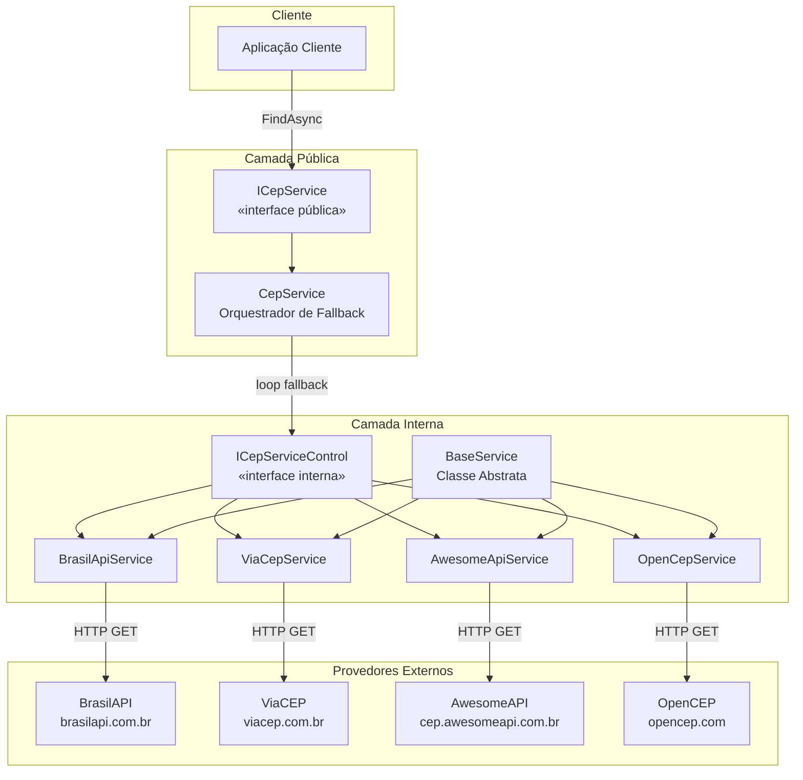
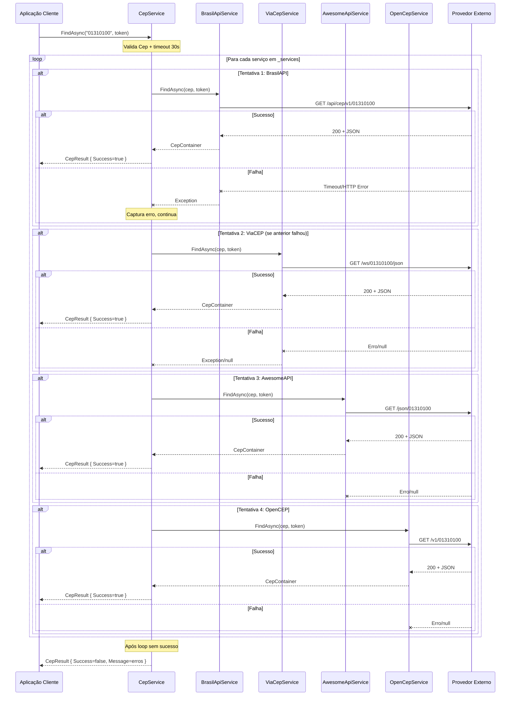

# tec-req-0002 — Busca de Endereço com Fallback Multi-Provedor (Detalhamento Técnico)

## Metadados

| Campo                | Valor                    |
|----------------------|--------------------------|
| **Código**           | tec-req-0002             |
| **Título**           | Busca de Endereço com Fallback Multi-Provedor |
| **Data de criação**  | 23/07/2026               |
| **Última atualização**| 23/07/2026               |
| **Autor**            | Rodrigo Araujo Barbosa   |
| **Versão**           | v1.0                     |
| **Status**           | Rascunho                 |
| **Requisito de negócio relacionado** | `docs/requirement/req-0002-busca-endereco-fallback.md` (v1.0) |

---

## 1. Resumo do Requisito de Negócio

- **Requisito de origem:** `docs/requirement/req-0002-busca-endereco-fallback.md` (v1.0)
- **Síntese do "o quê":** Implementar busca de endereço brasileiro por CEP com fallback automático entre 4 provedores públicos (BrasilAPI, ViaCEP, AwesomeAPI, OpenCEP), com API pública simples (`ICepService.FindAsync`).
- **Síntese do "por quê":** Garantir alta disponibilidade e resiliência na consulta de CEPs, mitigando a indisponibilidade de provedores individuais através de fallback sequencial, sem exigir conhecimento do consumidor sobre a estratégia.

---

## 2. Detalhamento Técnico Completo

### 2.1 Arquitetura

A arquitetura combina três padrões de design:

1. **Strategy Pattern:** Cada provedor externo (`BrasilApiService`, `ViaCepService`, `AwesomeApiService`, `OpenCepService`) implementa a interface comum `ICepServiceControl`.
2. **Facade Pattern:** `CepService` expõe a interface pública `ICepService` que oculta a complexidade do fallback.
3. **Chain of Responsibility (Fallback Chain):** Os provedores são encadeados em ordem de prioridade; cada um tenta processar a requisição e, se falhar, passa para o próximo.

### 2.2 Hierarquia de Classes

```
BaseService<T> (abstract, internal)
├── BrasilApiService (internal sealed) : ICepServiceControl
├── ViaCepService (internal sealed) : ICepServiceControl
├── AwesomeApiService (internal sealed) : ICepServiceControl
└── OpenCepService (internal sealed) : ICepServiceControl

CepService (public sealed) : ICepService, IDisposable
  └── Composição: List<ICepServiceControl> _services

Interfaces:
  ICepService (public) → Task<CepResult> FindAsync(string cep, CancellationToken)
  ICepServiceControl (internal) → Task<CepContainer> FindAsync(string cep, CancellationToken)
```

### 2.3 Interfaces

#### ICepService (Pública)

```csharp
namespace Sirb.CepBrasil.Interfaces;

public interface ICepService
{
    Task<CepResult> FindAsync(string cep, CancellationToken cancellationToken);
}
```

#### ICepServiceControl (Interna)

```csharp
namespace Sirb.CepBrasil.Interfaces;

internal interface ICepServiceControl
{
    Task<CepContainer> FindAsync(string cep, CancellationToken cancellationToken);
}
```

### 2.4 Classe Base — BaseService

`BaseService` (classe abstrata interna, namespace `Sirb.CepBrasil.Services`) fornece operações HTTP comuns:

| Método | Visibilidade | Descrição |
|--------|-------------|-----------|
| `GetCancellationTokenSource(CancellationToken)` | `static protected` | Cria CTS com timeout de 30s se token for `CancellationToken.None` |
| `CreateRequestMessage(string url)` | `static protected` | Cria `HttpRequestMessage` GET validando URL |
| `ExecuteRequestAsync(HttpRequestMessage, CancellationToken)` | `async protected` | Executa HTTP request via `HttpClient.SendAsync` |
| `GetResponseAsync<T>(HttpResponseMessage, CancellationToken)` | `static async protected` | Desserializa JSON response para tipo `T` |

**Detalhes de implementação:**
- `HttpClient` recebido via primary constructor
- `ConfigureAwait(false)` em todos os awaits (boas práticas para bibliotecas)
- `ArgumentNullException` para URL nula/vazia via `ArgumentException.ThrowIfNullOrWhiteSpace`
- `ServiceException` para status HTTP não bem-sucedido ou falha de desserialização
- Timeout padrão de 30 segundos gerenciado via `CancellationTokenSource` com `using`

```csharp
internal abstract class BaseService(HttpClient httpClient)
{
    private const int DefaultTimeoutMilliseconds = 30000;
    protected readonly string Url = string.Empty;

    static protected CancellationTokenSource GetCancellationTokenSource(CancellationToken cancellationToken)
    {
        return cancellationToken == CancellationToken.None
            ? new CancellationTokenSource(DefaultTimeoutMilliseconds)
            : null;
    }

    static protected HttpRequestMessage CreateRequestMessage(string url)
    {
        ArgumentException.ThrowIfNullOrWhiteSpace(url);
        var uri = new Uri(url);
        return new HttpRequestMessage(HttpMethod.Get, uri);
    }

    async protected Task<HttpResponseMessage> ExecuteRequestAsync(
        HttpRequestMessage request, CancellationToken cancellationToken)
    {
        var response = await httpClient.SendAsync(request, cancellationToken)
            .ConfigureAwait(false);
        ServiceException.ThrowIf(!response.IsSuccessStatusCode, CepMessages.ExceptionServiceError);
        return response;
    }

    static async protected Task<T> GetResponseAsync<T>(
        HttpResponseMessage response, CancellationToken cancellationToken)
    {
        var responseItem = await response.Content
            .ReadFromJsonAsync<T>(cancellationToken).ConfigureAwait(false);
        if (responseItem is not null)
            return responseItem;

        var responseString = await response.Content
            .ReadAsStringAsync(cancellationToken).ConfigureAwait(false);
        var errorMessage = string.IsNullOrWhiteSpace(responseString)
            ? "The service returned an empty or null response."
            : $"Failed to deserialize response: {responseString}";
        throw new ServiceException(errorMessage);
    }
}
```

### 2.5 Serviços Provedores

Cada provedor segue o mesmo padrão:
1. Validar CEP via `CepValidation.Validate(cep)`
2. Remover máscara via `cep.RemoveMask()`
3. Construir URL específica do provedor via `BuildRequestUrl()`
4. Criar `HttpRequestMessage` GET
5. Obter `CancellationTokenSource` com timeout (se necessário)
6. Executar requisição via `ExecuteRequestAsync()`
7. Desserializar resposta via `GetResponseAsync<T>()`
8. Mapear para `CepContainer`

#### BrasilApiService

```csharp
internal sealed class BrasilApiService(HttpClient httpClient) : BaseService(httpClient), ICepServiceControl
{
    private const string BrasilApiBaseUrl = "https://brasilapi.com.br/api/cep/v1";

    public async Task<CepContainer> FindAsync(string cep, CancellationToken cancellationToken)
    {
        CepValidation.Validate(cep);
        var cleanCep = cep.RemoveMask();
        var url = BuildRequestUrl(cleanCep);
        var request = CreateRequestMessage(url);

        using var cts = GetCancellationTokenSource(cancellationToken);
        var effectiveToken = cts?.Token ?? cancellationToken;

        var response = await ExecuteRequestAsync(request, effectiveToken).ConfigureAwait(false);
        var brasilApiResponse = await GetResponseAsync<BrasilApiResponse>(response, effectiveToken)
            .ConfigureAwait(false);

        if (brasilApiResponse is null)
            return null;

        return new CepContainer(
            brasilApiResponse.Uf,
            brasilApiResponse.Cidade,
            brasilApiResponse.Bairro,
            null,
            brasilApiResponse.Logradouro,
            brasilApiResponse.Cep,
            null);
    }

    private static string BuildRequestUrl(string cep) => $"{BrasilApiBaseUrl}/{cep}";
}
```

**DTO de resposta:** `BrasilApiResponse` (internal)
- `cep` → `Cep` | `state` → `Uf` | `city` → `Cidade` | `neighborhood` → `Bairro` | `street` → `Logradouro` | `service` → `Service`

#### ViaCepService

```csharp
internal sealed class ViaCepService(HttpClient httpClient) : BaseService(httpClient), ICepServiceControl
{
    private const string ViaCepBaseUrl = "https://viacep.com.br/ws";
    private const string JsonFormat = "json";

    async public Task<CepContainer> FindAsync(string cep, CancellationToken cancellationToken)
    {
        CepValidation.Validate(cep);
        using var cts = GetCancellationTokenSource(cancellationToken);
        var effectiveToken = cts?.Token ?? cancellationToken;

        var cleanCep = cep.RemoveMask();
        var url = BuildRequestUrl(cleanCep);
        var request = CreateRequestMessage(url);

        var response = await ExecuteRequestAsync(request, effectiveToken).ConfigureAwait(false);
        var result = await GetResponseAsync<CepContainer>(response, effectiveToken)
            .ConfigureAwait(false);

        // ViaCEP retorna {"erro": true} quando CEP não é encontrado
        return result?.Erro == true ? null : result;
    }

    static private string BuildRequestUrl(string cep) => $"{ViaCepBaseUrl}/{cep}/{JsonFormat}";
}
```

**Tratamento especial:** ViaCEP retorna objeto com campo `erro: true` quando o CEP não existe. O `BooleanOrStringConverter` trata esse campo que pode ser booleano ou string.

#### AwesomeApiService

```csharp
internal sealed class AwesomeApiService(HttpClient httpClient) : BaseService(httpClient), ICepServiceControl
{
    private const string AwesomeApiBaseUrl = "https://cep.awesomeapi.com.br/json";

    public async Task<CepContainer> FindAsync(string cep, CancellationToken cancellationToken)
    {
        CepValidation.Validate(cep);
        var cleanCep = cep.RemoveMask();
        var url = BuildRequestUrl(cleanCep);
        var request = CreateRequestMessage(url);

        using var cts = GetCancellationTokenSource(cancellationToken);
        var effectiveToken = cts?.Token ?? cancellationToken;

        var response = await ExecuteRequestAsync(request, effectiveToken).ConfigureAwait(false);
        var awesomeResponse = await GetResponseAsync<AwesomeApiResponse>(response, effectiveToken)
            .ConfigureAwait(false);

        if (awesomeResponse is null)
            return null;

        return new CepContainer(
            awesomeResponse.Uf,
            awesomeResponse.Cidade,
            awesomeResponse.Bairro,
            null,
            awesomeResponse.Logradouro,
            awesomeResponse.Cep,
            null);
    }

    private static string BuildRequestUrl(string cep) => $"{AwesomeApiBaseUrl}/{cep}";
}
```

**DTO de resposta:** `AwesomeApiResponse` (internal)
- `cep` → `Cep` | `state` → `Uf` | `city` → `Cidade` | `district` → `Bairro` | `address` → `Logradouro`

#### OpenCepService

```csharp
internal sealed class OpenCepService(HttpClient httpClient) : BaseService(httpClient), ICepServiceControl
{
    private const string OpenCepBaseUrl = "https://opencep.com/v1";

    public async Task<CepContainer> FindAsync(string cep, CancellationToken cancellationToken)
    {
        CepValidation.Validate(cep);
        var cleanCep = cep.RemoveMask();
        var url = BuildRequestUrl(cleanCep);
        var request = CreateRequestMessage(url);

        using var cts = GetCancellationTokenSource(cancellationToken);
        var effectiveToken = cts?.Token ?? cancellationToken;

        var response = await ExecuteRequestAsync(request, effectiveToken).ConfigureAwait(false);
        var result = await GetResponseAsync<CepContainer>(response, effectiveToken)
            .ConfigureAwait(false);

        return result;
    }

    private static string BuildRequestUrl(string cep) => $"{OpenCepBaseUrl}/{cep}";
}
```

**Observação:** OpenCEP desserializa diretamente para `CepContainer` (mesmo formato do ViaCEP, sem campo `erro`).

### 2.6 Orquestrador — CepService

**`CepService`** é a classe pública que orquestra o fallback:

```csharp
public sealed class CepService : ICepService, IDisposable
{
    private const int DefaultTimeoutMilliseconds = 30000;
    private readonly HttpClient _httpClient;
    private readonly bool _httpClientSelfCreated;
    private readonly List<ICepServiceControl> _services = new();

    // Construtor interno
    private CepService(HttpClient httpClient, bool httpClientSelfCreated)
    {
        _httpClientSelfCreated = httpClientSelfCreated;
        _httpClient = httpClient;
        StartServices();
    }

    // Construtor com HttpClient gerenciado internamente
    public CepService() : this(new HttpClient(), true) { }

    // Construtor com injeção de HttpClient externo
    public CepService(HttpClient httpClient)
        : this(httpClient ?? throw new ArgumentNullException(nameof(httpClient)), false) { }

    public async Task<CepResult> FindAsync(string cep, CancellationToken cancellationToken)
    {
        using var cts = GetCancellationTokenSource(cancellationToken);
        var effectiveToken = cts?.Token ?? cancellationToken;

        var message = string.Empty;
        foreach (var service in _services)
        {
            try
            {
                var response = await service.FindAsync(cep, effectiveToken).ConfigureAwait(false);

                if (response is null)
                    continue;

                return new CepResult(true, response, null);
            }
            catch (Exception e)
            {
                message += $"{e.AllMessages() ?? string.Empty} ";
            }
        }

        return new CepResult(false, null, message.TrimEnd());
    }

    public void Dispose()
    {
        if (_httpClientSelfCreated)
            _httpClient?.Dispose();
        _services.Clear();
    }

    private static CancellationTokenSource GetCancellationTokenSource(CancellationToken cancellationToken)
    {
        return cancellationToken == CancellationToken.None
            ? new CancellationTokenSource(DefaultTimeoutMilliseconds)
            : null;
    }

    private void StartServices()
    {
        _services.Add(new BrasilApiService(_httpClient));
        _services.Add(new ViaCepService(_httpClient));
        _services.Add(new AwesomeApiService(_httpClient));
        _services.Add(new OpenCepService(_httpClient));
    }
}
```

### 2.7 Fluxo de Execução do FindAsync

1. **Entrada:** Recebe `cep` (string) e `cancellationToken`
2. **Timeout:** Se `cancellationToken` for `CancellationToken.None`, cria CTS com 30s de timeout
3. **Loop de fallback:** Itera sobre `_services` na ordem registrada
4. **Para cada serviço:**
   - Chama `service.FindAsync(cep, effectiveToken)`
   - Se retorna `CepContainer` não nulo → cria e retorna `CepResult(true, response, null)`
   - Se retorna null → `continue` (próximo serviço)
   - Se lança exceção → captura, concatena mensagem, `continue`
5. **Após o loop:**
   - Se encontrou → `CepResult { Success = true }`
   - Se não encontrou → `CepResult { Success = false, Message = mensagens consolidadas }`

### 2.8 Tratamento de Exceções

| Condição | Exceção | Quem lança | Tratamento |
|----------|---------|------------|------------|
| CEP nulo/vazio | `ArgumentNullException` | `CepValidation.Validate` | Propaga para o consumidor |
| CEP inválido | `ServiceException` | `CepValidation.Validate` | Propaga para o consumidor |
| HTTP não bem-sucedido | `ServiceException` | `BaseService.ExecuteRequestAsync` | Capturada no CepService |
| Timeout | `OperationCanceledException` | `HttpClient.SendAsync` | Capturada no CepService |
| Falha desserialização | `ServiceException` | `BaseService.GetResponseAsync` | Capturada no CepService |
| URL inválida | `ArgumentNullException` / `UriFormatException` | `BaseService.CreateRequestMessage` | Propaga para o consumidor |

### 2.9 Modelos de Dados

#### CepContainer (modelo unificado)

| Propriedade | Tipo | JSON (JsonPropertyName) | Origem |
|------------|------|------------------------|--------|
| `Uf` | `string` | `"uf"` | Todos os provedores |
| `Cidade` | `string` | `"localidade"` | Todos os provedores |
| `Bairro` | `string` | `"bairro"` | Todos os provedores |
| `Complemento` | `string` | `"complemento"` | ViaCEP, OpenCEP |
| `Logradouro` | `string` | `"logradouro"` | Todos os provedores |
| `Cep` | `string` | `"cep"` | Todos os provedores |
| `Ibge` | `string` | `"ibge"` | ViaCEP, OpenCEP |
| `Erro` | `bool?` | `"erro"` | ViaCEP (específico) |

#### CepResult (container de resultado)

| Propriedade | Tipo | Descrição |
|------------|------|-----------|
| `Success` | `bool` | True se algum provedor retornou dados |
| `CepContainer` | `CepContainer` | Dados do endereço (quando Success = true) |
| `Message` | `string` | Mensagem de erro consolidada (quando Success = false) |
| `Exceptions` | `List<Exception>` | Lista de exceções capturadas |

### 2.10 Gerenciamento de HttpClient

| Cenário | Construtor | Ciclo de vida do HttpClient |
|---------|-----------|---------------------------|
| Uso simples | `new CepService()` | Criado internamente, descartado no `Dispose()` |
| Injeção de dependência | `new CepService(httpClient)` | Gerenciado externamente, NÃO descartado |
| DI com HttpClientFactory | `services.AddHttpClient<ICepService, CepService>()` | Gerenciado pelo container DI |

### 2.11 Mapeamento de Respostas

| Campo CepContainer | BrasilAPI | ViaCEP | AwesomeAPI | OpenCEP |
|-------------------|-----------|--------|------------|---------|
| `Cep` | `cep` | `cep` | `cep` | `cep` |
| `Logradouro` | `street` | `logradouro` | `address` | `logradouro` |
| `Bairro` | `neighborhood` | `bairro` | `district` | `bairro` |
| `Cidade` | `city` | `localidade` | `city` | `localidade` |
| `Uf` | `state` | `uf` | `state` | `uf` |
| `Complemento` | — (null) | `complemento` | — (null) | `complemento` |
| `Ibge` | — (null) | `ibge` | — (null) | `ibge` |

---

## 3. Regras Funcionais e Regras de Negócio Numeradas

### 3.1 Regras Funcionais (RF)

| ID | Descrição | Prioridade | Regra de negócio associada |
|----|-----------|------------|----------------------------|
| RF-08 | Buscar endereço com fallback automático entre 4 provedores | Alta | RN-011, RN-012 |
| RF-09 | Retornar resultado no primeiro sucesso sem tentar próximos | Alta | RN-012 |
| RF-10 | Consolidar erros de todos os provedores em caso de falha geral | Alta | RN-013 |
| RF-11 | Retornar CepResult com Success=false quando CEP não encontrado | Alta | RN-014 |
| RF-12 | Prover construtor com gerenciamento interno de HttpClient | Alta | RN-015 |
| RF-13 | Prover construtor com injeção de HttpClient externo (DI) | Alta | RN-015, RN-016 |
| RF-14 | Implementar IDisposable para liberação de recursos | Média | RN-016 |
| RF-15 | Suportar CancellationToken com timeout padrão de 30s | Alta | RN-017 |
| RF-16 | Validar entrada do CEP antes de consultar provedores | Alta | RN-003 (req-0001) |

### 3.2 Regras de Negócio (RN)

| ID | Regra | Origem | Impacto na Implementação |
|----|-------|--------|--------------------------|
| RN-011 | Ordem de tentativa: BrasilAPI → ViaCEP → AwesomeAPI → OpenCEP | Decisão arquitetural | `StartServices()` adiciona nesta ordem; `_services` é `List<ICepServiceControl>` |
| RN-012 | Primeiro resultado bem-sucedido interrompe o loop | Eficiência | `return new CepResult(true, response, null)` dentro do loop |
| RN-013 | Todos com erro → CepResult { Success = false, Message = erros } | Resiliência | Mensagens concatenadas via `e.AllMessages()`; retorno após o loop |
| RN-014 | Nenhum encontrou → CepResult { Success = false } | Semântica | Retorno padrão após loop sem sucesso |
| RN-015 | HttpClient gerenciado ou injetado | Flexibilidade | Dois construtores públicos com flag `_httpClientSelfCreated` |
| RN-016 | Dispose condicional do HttpClient | DI safety | `if (_httpClientSelfCreated) _httpClient?.Dispose()` |
| RN-017 | Timeout 30s por tentativa; CancellationToken do usuário prevalece | Performance | `GetCancellationTokenSource()` retorna null quando token não é None |
| RN-018 | Exceções capturadas são registradas, não propagadas | Resiliência | `catch (Exception e) { message += ... }` |

---

## 4. Diagramas Técnicos

### 4.1 Diagrama de Arquitetura



### 4.2 Diagrama de Sequência — Fallback Completo



### 4.3 Diagrama de Fluxo — Decisão de Fallback

```mermaid
flowchart TD
    A[FindAsync(cep, token)] --> B{CancellationToken<br/>== None?}
    B -->|Sim| C[Cria CTS 30s]
    B -->|Não| D[Usa token do usuário]
    C --> E[Inicia loop]
    D --> E

    E --> F[Próximo serviço<br/>na lista]
    F --> G{Tenta FindAsync}
    G --> H{Resultado?}
    H -->|CepContainer != null| I[Retorna CepResult<br/>Success = true]
    H -->|null| J[continue]
    H -->|Exception| K[Captura + concatena<br/>mensagem de erro]
    K --> L{Ainda há serviços?}
    L -->|Sim| F
    L -->|Não| M[Retorna CepResult<br/>Success = false<br/>Message = erros]
    J --> L
    I --> N[Fim]

    style I fill:#a5d6a7
    style M fill:#ffab91
    style C fill:#e3f2fd
    style K fill:#fff9c4
```

### 4.4 Observações dos Diagramas

- O diagrama de sequência mostra que **cada tentativa é síncrona** (não paralela)
- A validação de CEP ocorre **dentro de cada serviço provedor** (via `CepValidation.Validate`), não no CepService
- O método `AllMessages()` da `ExceptionExtension` é usado para extrair mensagens de exceções encadeadas
- `CepService` NÃO captura `ArgumentNullException` da validação — essas propagam para o consumidor

---

## 5. Exemplos Técnicos

### 5.1 Exemplo de Uso — Instanciação Direta

```csharp
using var cepService = new CepService();
var result = await cepService.FindAsync("01310100", CancellationToken.None);

if (result.Success)
{
    Console.WriteLine($"Endereço: {result.CepContainer.Logradouro}, {result.CepContainer.Bairro}");
    Console.WriteLine($"Cidade: {result.CepContainer.Cidade}/{result.CepContainer.Uf}");
    Console.WriteLine($"CEP: {result.CepContainer.Cep}");
}
else
{
    Console.WriteLine($"Erro: {result.Message}");
}
```

### 5.2 Exemplo de Uso — Injeção de Dependência

```csharp
// Program.cs
services.AddHttpClient<ICepService, CepService>();

// Controller
public class AddressController
{
    private readonly ICepService _cepService;

    public AddressController(ICepService cepService)
    {
        _cepService = cepService;
    }

    public async Task<IActionResult> Get(string cep)
    {
        var result = await _cepService.FindAsync(cep, CancellationToken.None);
        return result.Success ? Ok(result.CepContainer) : NotFound(result.Message);
    }
}
```

### 5.3 Exemplo de Resultado de Sucesso

```csharp
// CepResult ao encontrar endereço
var result = new CepResult(true, new CepContainer(
    uf: "SP",
    cidade: "São Paulo",
    bairro: "Bela Vista",
    complemento: null,
    logradouro: "Avenida Paulista",
    cep: "01310-100",
    ibge: "3550308"
), null);

// result.Success == true
// result.CepContainer.Logradouro == "Avenida Paulista"
// result.Message == null
// result.Exceptions == []
```

### 5.4 Exemplo de Resultado de Falha

```csharp
// CepResult quando todos os serviços falham
var result = new CepResult(false, null,
    "Houve um erro na requisição. Houve um erro na requisição. ");

// result.Success == false
// result.CepContainer == null
// result.Message == "Houve um erro na requisição. Houve um erro na requisição."
```

### 5.5 Edge Cases e Comportamentos

| Cenário | Entrada | Comportamento Esperado |
|---------|---------|------------------------|
| CEP nulo | `null` | `ArgumentNullException` (da validação, não capturada) |
| CEP vazio | `""` | `ArgumentNullException` |
| CEP inválido | `"123"` | `ServiceException` (da validação) |
| CEP com máscara | `"01310-100"` | Normalizado para `"01310100"` antes da chamada |
| CEP sem máscara | `"01310100"` | Usado diretamente |
| Timeout em todos | Qualquer CEP válido | `CepResult { Success = false, Message = "Houve um erro..." repetido 4x }` |
| Não encontrado em todos | `"00000000"` | `CepResult { Success = false, Message = "" }` |

### 5.6 Mensagens de Erro

```csharp
// CepMessages
CepMessages.ExceptionEmptyResponse;     // "Não foi possível encontrar o dado pesquisado."
CepMessages.ExceptionServiceError;      // "Houve um erro na requisição."
CepMessages.ZipCodeInvalidMessage;      // "CEP com tamanho inválido."
```

---

## 6. Estratégia de Testes

### 6.1 Estrutura de Testes

```
Sirb.CepBrasil.Test/Services/
├── BrasilApiServiceTest.cs         → Testes do provedor BrasilAPI
├── ViaCepServiceTest.cs            → Testes do provedor ViaCEP
├── AwesomeApiServiceTest.cs        → Testes do provedor AwesomeAPI
├── OpenCepServiceTest.cs           → Testes do provedor OpenCEP
└── CepServiceOrchestratorTest.cs   → Testes do orquestrador CepService
```

### 6.2 Cenários por Provedor (cada um dos 4)

- **Sucesso:** CEP válido e encontrado → retorna `CepContainer` com dados
- **Não encontrado:** CEP válido mas não existe → retorna `null`
- **Erro HTTP:** Serviço retorna erro → `ServiceException`
- **CancellationToken:** Token acionado → `OperationCanceledException`
- **Validação de entrada:** CEP inválido → `ServiceException` ou `ArgumentNullException`

### 6.3 Cenários do Orquestrador (CepService)

- **BrasilAPI sucesso:** BrasilAPI encontra → retorna sucesso, outros não chamados
- **BrasilAPI falha → ViaCEP sucesso:** BrasilAPI erro → ViaCEP encontra → retorna sucesso
- **BrasilAPI + ViaCEP falha → AwesomeAPI sucesso:** AwesomeAPI encontra → retorna sucesso
- **3 falham → OpenCEP sucesso:** OpenCEP encontra → retorna sucesso
- **Todos erro:** Todos com exceção → `CepResult { Success = false }` com mensagem
- **Todos null:** Nenhum encontra → `CepResult { Success = false }` sem mensagem
- **CancellationToken sinalizado:** Token acionado → `OperationCanceledException`

### 6.4 Execução

```bash
# Executar todos os testes
dotnet test

# Executar testes específicos de serviços
dotnet test --filter "FullyQualifiedName~Services"

# Verificar cobertura
dotnet test /p:CollectCoverage=true /p:CoverletOutputFormat=opencover
```

---

## 7. Rastreabilidade

| Item | Referência |
|------|------------|
| Requisito de negócio | `docs/requirement/req-0002-busca-endereco-fallback.md` |
| Interface pública | `Sirb.CepBrasil/Interfaces/ICepService.cs` (linhas 10-20) |
| Interface interna | `Sirb.CepBrasil/Interfaces/ICepServiceControl.cs` (linhas 7-15) |
| Base service | `Sirb.CepBrasil/Services/BaseService.cs` (linhas 14-103) |
| Orquestrador | `Sirb.CepBrasil/Services/CepService.cs` (linhas 25-173) |
| BrasilAPI | `Sirb.CepBrasil/Services/BrasilApiService.cs` (linhas 19-85) |
| ViaCEP | `Sirb.CepBrasil/Services/ViaCepService.cs` (linhas 25-90) |
| AwesomeAPI | `Sirb.CepBrasil/Services/AwesomeApiService.cs` (linhas 19-85) |
| OpenCEP | `Sirb.CepBrasil/Services/OpenCepService.cs` (linhas 19-75) |
| Modelo CepContainer | `Sirb.CepBrasil/Models/CepContainer.cs` (linhas 75-183) |
| Modelo CepResult | `Sirb.CepBrasil/Models/CepResult.cs` (linhas 15-76) |
| DTO BrasilAPI | `Sirb.CepBrasil/Models/BrasilApiResponse.cs` (linhas 14-60) |
| DTO AwesomeAPI | `Sirb.CepBrasil/Models/AwesomeApiResponse.cs` (linhas 14-59) |
| Exceção ServiceException | `Sirb.CepBrasil/Exceptions/ServiceException.cs` (linhas 9-45) |
| Testes — Orquestrador | `Sirb.CepBrasil.Test/Services/CepServiceOrchestratorTest.cs` |
| Testes — Provedores | `Sirb.CepBrasil.Test/Services/*ServiceTest.cs` |
| Documentação das APIs | `docs/requirement/api/api-brasilapi.md`, `api-viacep.md`, `api-awesomeapi.md`, `api-opencep.md` |
| Diagrama de classes | `docs/diagrams/dcl-estrutura-servicos.md` |
| Diagrama de integração | `docs/diagrams/min-fluxo-fallback.md` |
| APF | `docs/requirement/apf/apf-req-0002.md` |
| Análise cross-artifact | `docs/requirement/analises/analise-req-0002.md` |
| Quality Checklist | `docs/requirement/checklist/checklist-req-0002.md` |
| Matriz de risco | `docs/system-risk-matrix.md` |
| Constituição | `docs/constituicao.md` |

---

## 8. Histórico de Alterações e Clarification Log

### 8.1 Histórico de Alterações

| Data | Autor | Versão | Alteração |
|------|-------|--------|-----------|
| 23/07/2026 | Rodrigo Araujo Barbosa | v1.0 | Criação do documento técnico |

### 8.2 Clarification Log

| Data | Pergunta | Resposta | Status (Resolvido/Pendente) | Origem (Criação/Implementação) | Impacto no requisito |
|------|----------|----------|----------------------------|-------------------------------|----------------------|
| 23/07/2026 | Qual nome de usuário deve constar no campo Autor? | Rodrigo Araujo Barbosa | Resolvido | Criação | Define autor do documento |
| 23/07/2026 | O comportamento real do CepService.FindAsync difere da documentação legada (retorna CepResult com Success=false, não ServiceException). Qual está correto? | O código atual (CepService.cs linha 124) está correto: retorna CepResult { Success = false } com mensagem consolidada | Resolvido | Criação | RN-013 corrigida para refletir o código real |
| 23/07/2026 | O retorno quando nenhum provedor encontra o CEP é CepResult com Success=false, não null. Confirmado? | Confirmado. Código retorna `new CepResult(false, null, message.TrimEnd())` | Resolvido | Criação | RN-014 corrigida |

### Cobertura do Clarification (8 áreas)

| # | Área | Status (Resolvido \| N/A) | Ref. entrada no Log | Justificativa (se N/A) |
|---|------|---------------------------|---------------------|------------------------|
| 1 | Atores e personas | Resolvido | Autor definido | — |
| 2 | Fluxos principais e alternativos | Resolvido | Fluxo de fallback detalhado na seção 2.7 | — |
| 3 | Exceções e erros | Resolvido | Comportamento real vs documentado | — |
| 4 | Integrações externas | Resolvido | 4 provedores documentados | — |
| 5 | Requisitos não-funcionais | Resolvido | Seção 2.10, 2.11, timeout, HttpClient | — |
| 6 | Dados e privacidade | N/A | — | Sem dados pessoais |
| 7 | Validações e regras de negócio | Resolvido | RN-011 a RN-018 | — |
| 8 | Critérios de aceite e mensurabilidade | Resolvido | 8 cenários Gherkin, 6 cenários orquestrador | — |

**Cobertura atual:** 7/8. **Meta:** 8/8.

---

**© 2026 Rodrigo Araujo Barbosa — Sirb.CepBrasil**
