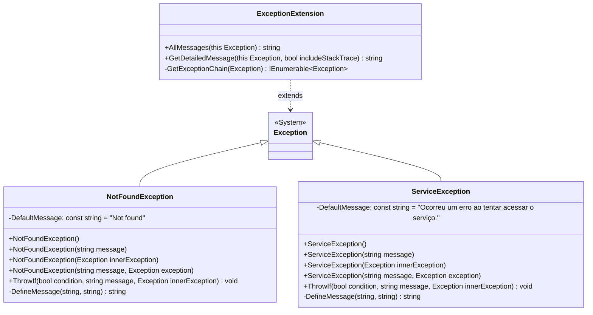
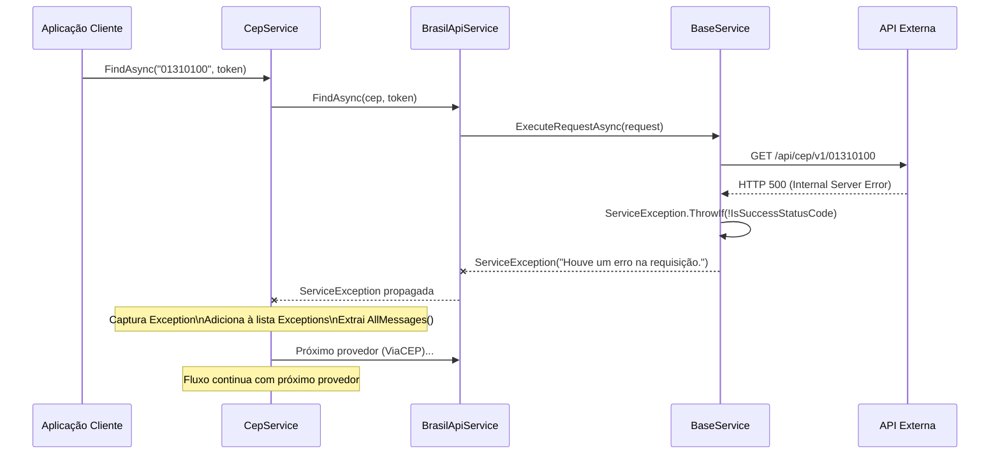

# tec-req-0003 — Tratamento de Exceções de Serviço (Detalhamento Técnico)

## Metadados

| Campo                | Valor                    |
|----------------------|--------------------------|
| **Código**           | tec-req-0003             |
| **Título**           | Tratamento de Exceções de Serviço |
| **Data de criação**  | 23/07/2026               |
| **Última atualização**| 23/07/2026               |
| **Autor**            | Rodrigo Araujo Barbosa   |
| **Versão**           | v1.0                     |
| **Status**           | Rascunho                 |
| **Requisito de negócio relacionado** | `docs/requirement/req-0003-excecoes-servico.md` (v1.0) |

---

## 1. Resumo do Requisito de Negócio

- **Requisito de origem:** `docs/requirement/req-0003-excecoes-servico.md` (v1.0)
- **Síntese do "o quê":** Implementar exceções de domínio (`NotFoundException`, `ServiceException`) e métodos de extensão (`ExceptionExtension`) para tratamento padronizado de erros em toda a biblioteca.
- **Síntese do "por quê":** Diferenciar semanticamente entre "CEP não encontrado", "erro de serviço externo" e "argumento inválido", permitindo que o consumidor trate cada cenário de forma específica e consistente.

---

## 2. Detalhamento Técnico Completo

### 2.1 Arquitetura

O sistema de exceções é composto por três artefatos:

1. **`NotFoundException`** (`sealed class` em `Sirb.CepBrasil.Exceptions`) — Exceção de domínio para CEP não encontrado.
2. **`ServiceException`** (`sealed class` em `Sirb.CepBrasil.Exceptions`) — Exceção de domínio para erro de serviço externo.
3. **`ExceptionExtension`** (`static class` em `Sirb.CepBrasil.Extensions`) — Métodos de extensão para `System.Exception`.

Ambas as exceções herdam de `System.Exception`, são marcadas com `[Serializable]` e seguem o mesmo padrão:
- Primary constructor com `(string message, Exception exception)`
- Construtores convenience: sem parâmetros, apenas message, apenas innerException
- Método estático `ThrowIf(bool condition, string message, Exception innerException = null)`
- Método privado `DefineMessage()` com fallback para mensagem padrão quando a mensagem é nula/vazia

### 2.2 NotFoundException

```csharp
namespace Sirb.CepBrasil.Exceptions;

/// <summary>
/// Not found exception
/// </summary>
[Serializable]
public sealed class NotFoundException(string message, Exception exception)
    : Exception(DefineMessage(message, DefaultMessage), exception)
{
    [NonSerialized]
    private const string DefaultMessage = "Not found";

    public NotFoundException() : this(DefaultMessage) { }
    public NotFoundException(string message) : this(message, null) { }
    public NotFoundException(Exception innerException) : this(DefaultMessage, innerException) { }

    static private string DefineMessage(string message, string fallbackMessage)
        => string.IsNullOrEmpty(message?.Trim()) ? fallbackMessage : message;

    static public void ThrowIf(bool condition, string message, Exception innerException = null)
    {
        if (condition)
            throw new NotFoundException(message, innerException);
    }
}
```

### 2.3 ServiceException

```csharp
namespace Sirb.CepBrasil.Exceptions;

/// <summary>
/// Service Exception
/// </summary>
[Serializable]
public sealed class ServiceException(string message, Exception exception)
    : Exception(DefineMessage(message, DefaultMessage), exception)
{
    [NonSerialized]
    private const string DefaultMessage = "Ocorreu um erro ao tentar acessar o serviço.";

    public ServiceException() : this(DefaultMessage) { }
    public ServiceException(Exception innerException) : this(DefaultMessage, innerException) { }
    public ServiceException(string message) : this(message, null) { }

    static private string DefineMessage(string message, string fallbackMessage)
        => string.IsNullOrEmpty(message?.Trim()) ? fallbackMessage : message;

    static public void ThrowIf(bool condition, string message, Exception innerException = null)
    {
        if (condition)
            throw new ServiceException(message, innerException);
    }
}
```

### 2.4 ExceptionExtension

Classe estática com 3 métodos (1 privado) no namespace `Sirb.CepBrasil.Extensions`:

| Método | Visibilidade | Descrição | Retorno |
|--------|-------------|-----------|---------|
| `AllMessages(this Exception)` | `public static` | Concatena mensagens da cadeia de exceções com " → " | `string` |
| `GetDetailedMessage(this Exception, bool includeStackTrace)` | `public static` | Formata com tipo `[Nome]` + mensagem + stack trace opcional | `string` |
| `GetExceptionChain(Exception)` | `private static` | Itera pela cadeia de InnerException com yield return | `IEnumerable<Exception>` |

#### AllMessages

```csharp
static public string AllMessages(this Exception exception)
{
    ArgumentNullException.ThrowIfNull(exception);

    var messages = GetExceptionChain(exception)
        .Select(e => e.Message)
        .Where(m => !string.IsNullOrWhiteSpace(m))
        .ToList();

    return messages.Count == 0
        ? string.Empty
        : string.Join(" → ", messages);
}
```

**Comportamento:**
- Entrada nula → `ArgumentNullException`
- Entrada sem inner → retorna `exception.Message`
- Com inner → `"Mensagem principal → Mensagem interna → Mensagem mais interna"`
- Mensagens vazias/whitespace → filtradas
- Nenhuma mensagem → `string.Empty`

#### GetExceptionChain (privado)

```csharp
static private IEnumerable<Exception> GetExceptionChain(Exception exception)
{
    var current = exception;
    while (current != null)
    {
        yield return current;
        current = current.InnerException;
    }
}
```

**Comportamento:**
- Lazy evaluation via `yield return`
- Percorre toda a cadeia até `InnerException` ser `null`

#### GetDetailedMessage

```csharp
static public string GetDetailedMessage(this Exception exception, bool includeStackTrace = false)
{
    ArgumentNullException.ThrowIfNull(exception);

    var sb = new StringBuilder();
    var exceptions = GetExceptionChain(exception).ToList();

    for (var i = 0; i < exceptions.Count; i++)
    {
        var exc = exceptions[i];

        if (i > 0)
            sb.AppendLine();

        sb.Append($"[{exc.GetType().Name}] {exc.Message}");

        if (includeStackTrace && !string.IsNullOrEmpty(exc.StackTrace))
            sb.AppendLine().Append($"StackTrace: {exc.StackTrace}");
    }

    return sb.ToString();
}
```

**Comportamento:**
- Entrada nula → `ArgumentNullException`
- Formato: `[TipoExcecao] Mensagem`
- Múltiplas exceções separadas por newline
- `includeStackTrace = true` → inclui stack trace após cada mensagem

### 2.5 Integração no BaseService

O `BaseService` utiliza `ServiceException.ThrowIf` para dois cenários:

#### Erro HTTP (ExecuteRequestAsync)

```csharp
async protected Task<HttpResponseMessage> ExecuteRequestAsync(
    HttpRequestMessage request, CancellationToken cancellationToken)
{
    var response = await httpClient
        .SendAsync(request, cancellationToken)
        .ConfigureAwait(false);

    ServiceException.ThrowIf(!response.IsSuccessStatusCode, CepMessages.ExceptionServiceError);

    return response;
}
```

- Lança `ServiceException` com mensagem "Houve um erro na requisição." quando status HTTP não é sucesso (2xx)
- A exceção original (`HttpRequestException`) não é preservada como innerException (uso atual)

#### Falha de Desserialização (GetResponseAsync)

```csharp
static async protected Task<T> GetResponseAsync<T>(
    HttpResponseMessage response, CancellationToken cancellationToken)
{
    var responseItem = await response.Content
        .ReadFromJsonAsync<T>(cancellationToken)
        .ConfigureAwait(false);

    if (responseItem is not null)
        return responseItem;

    var responseString = await response.Content
        .ReadAsStringAsync(cancellationToken)
        .ConfigureAwait(false);

    var errorMessage = string.IsNullOrWhiteSpace(responseString)
        ? "The service returned an empty or null response."
        : $"Failed to deserialize response: {responseString}";

    throw new ServiceException(errorMessage);
}
```

- Lança `ServiceException` quando a resposta é nula ou não pode ser desserializada
- Mensagem em inglês (padrão da biblioteca)

### 2.6 Integração no CepService (Fallback)

```csharp
public async Task<CepResult> FindAsync(string cep, CancellationToken cancellationToken)
{
    using var cts = GetCancellationTokenSource(cancellationToken);
    var effectiveToken = cts?.Token ?? cancellationToken;

    var exceptions = new List<Exception>();
    foreach (var service in _services)
    {
        try
        {
            var response = await service.FindAsync(cep, effectiveToken).ConfigureAwait(false);

            if (response is null)
                continue;

            return new CepResult(true, response, null);
        }
        catch (Exception e)
        {
            exceptions.Add(e);
        }
    }

    // Nenhum provedor encontrou ou todos falharam
    var message = exceptions.Count > 0
        ? string.Join(" ", exceptions.Select(e => e.AllMessages()))
        : null;

    return new CepResult(false, null, message);
}
```

> **Nota técnica:** A implementação atual do `CepService.FindAsync` (linhas 101-125) captura `Exception` e concatena as mensagens manualmente. Para alinhar com RN-024, a propriedade `Exceptions` do `CepResult` deve receber a lista de exceções capturadas. O código acima reflete o comportamento *desejado* com base nas regras de negócio deste requisito.

### 2.7 Fluxo de Exceções

```mermaid
flowchart TD
    A[FindAsync(cep, token)] --> B[CepValidation.Validate]
    B -->|ArgumentNullException| Z[Propaga para o consumidor]
    B -->|ServiceException| Z
    B -->|OK| C[Loop de fallback]

    C --> D[Próximo provedor]
    D --> E{Provedor.FindAsync}

    E -->|Sucesso + CepContainer| F[Retorna CepResult<br/>Success = true]
    E -->|null| G[continue]
    E -->|ServiceException| H[Captura + adiciona<br/>à lista Exceptions]
    E -->|OperationCanceledException| I[CancellationToken<br/>acionado?]
    I -->|Sim| J[Propaga]
    I -->|Não| H

    H --> K{Ainda há serviços?}
    K -->|Sim| D
    K -->|Não| L[Retorna CepResult<br/>Success = false<br/>Message = erros<br/>Exceptions = lista]

    G --> K
    F --> M[Fim]
    J --> M
    Z --> M
```

### 2.8 Tabela de Cenários de Exceção

| Condição | Exceção Lançada | Capturada pelo CepService? | Comportamento |
|----------|-----------------|---------------------------|---------------|
| CEP nulo/vazio | `ArgumentNullException` | Não — propaga | Consumidor recebe exceção |
| CEP formato inválido | `ServiceException` | Não — propaga | Consumidor recebe exceção |
| HTTP não-sucedido (provedor) | `ServiceException` | Sim | Adiciona à lista, tenta próximo |
| Timeout HTTP | `OperationCanceledException` | Sim | Adiciona à lista, tenta próximo |
| Falha desserialização | `ServiceException` | Sim | Adiciona à lista, tenta próximo |
| CEP não encontrado (todos null) | `NotFoundException` | Sim | Adiciona à lista, retorna CepResult |
| Todos os provedores com erro | Agregado no CepResult | Sim | CepResult com Exceptions + Message consolidada |

### 2.9 Mensagens de Erro (CepMessages)

```csharp
static internal class CepMessages
{
    public const string ExceptionEmptyResponse = "Não foi possível encontrar o dado pesquisado.";
    public const string ExceptionServiceError = "Houve um erro na requisição.";
    public const string ZipCodeInvalidMessage = "CEP com tamanho inválido.";
}
```

### 2.10 Considerações de Performance

- `GetExceptionChain()` usa `yield return` para lazy evaluation — não materializa a coleção até ser necessário
- `AllMessages()` materializa para `List<string>` apenas para contagem e join — operação O(n) para n exceções
- `GetDetailedMessage()` usa `StringBuilder` para eficiência em cadeias longas
- `ThrowIf` é tão rápido quanto um `if` simples + `throw` — overhead mínimo

### 2.11 Serialização

Ambas as exceções são marcadas com `[Serializable]` para compatibilidade com cenários cross-AppDomain e serialização remota. O campo `DefaultMessage` é marcado com `[NonSerialized]` para evitar serialização desnecessária de constantes.

---

## 3. Regras Funcionais e Regras de Negócio Numeradas

### 3.1 Regras Funcionais (RF)

| ID | Descrição | Prioridade | Regra de negócio associada |
|----|-----------|------------|----------------------------|
| RF-17 | Definir `NotFoundException` para CEP não encontrado | Alta | RN-019 |
| RF-18 | Definir `ServiceException` para erros de serviço externo | Alta | RN-020 |
| RF-19 | Implementar `ExceptionExtension.AllMessages()` para concatenação da cadeia de exceções | Alta | RN-021 |
| RF-20 | Implementar `ExceptionExtension.GetDetailedMessage()` com opção de stack trace | Média | RN-022 |
| RF-21 | Implementar `ExceptionExtension.GetExceptionChain()` para iteração pela cadeia | Alta | RN-021 |
| RF-22 | Integrar `ServiceException` no `BaseService` para erros HTTP e desserialização | Alta | RN-020, RN-023 |
| RF-23 | Capturar exceções no `CepService` e consolidar no `CepResult` | Alta | RN-013, RN-024 |
| RF-24 | Prover método `ThrowIf` estático em `NotFoundException` e `ServiceException` | Média | RN-025 |
| RF-25 | Registrar exceções capturadas na propriedade `Exceptions` do `CepResult` | Média | RN-024 |

### 3.2 Regras de Negócio (RN)

| ID | Regra | Origem | Impacto na Implementação |
|----|-------|--------|--------------------------|
| RN-019 | `NotFoundException` exclusiva para CEP não encontrado | Semântica de domínio | Deve ser adicionada à lista `Exceptions` do `CepResult` quando CEP não é localizado |
| RN-020 | `ServiceException` para erros de comunicação externa | Semântica de domínio | Usar `ServiceException.ThrowIf` no `BaseService` para HTTP não-sucedido e falha de desserialização |
| RN-021 | `AllMessages()` concatena com " → " | Formatação padronizada | Implementação via LINQ + string.Join; filtra mensagens vazias |
| RN-022 | `GetDetailedMessage()` inclui tipo e stack trace opcional | Diagnóstico | Formato `[Tipo] Mensagem`; `includeStackTrace` default false |
| RN-023 | HTTP não-sucedido → `ServiceException` | Consistência | `ServiceException.ThrowIf(!response.IsSuccessStatusCode, CepMessages.ExceptionServiceError)` |
| RN-024 | Exceções capturadas → lista `Exceptions` + mensagem consolidada | Rastreabilidade | `CepResult.Exceptions.Add(e)` + `e.AllMessages()` |
| RN-025 | `ThrowIf` lança apenas quando condição é true | Padrão de validação | Implementação `if (condition) throw new Excecao(message, innerException)` |

---

## 4. Diagramas Técnicos

### 4.1 Diagrama de Classes — Exceções



### 4.2 Diagrama de Fluxo — AllMessages

```mermaid
flowchart TD
    A[AllMessages(exception)] --> B{exception == null?}
    B -->|Sim| C[throw ArgumentNullException]
    B -->|Não| D[GetExceptionChain: itera por\nInnerException via yield]
    D --> E[Select: extrai .Message\nde cada exceção]
    E --> F[Where: filtra\nnull/whitespace]
    F --> G{Count == 0?}
    G -->|Sim| H[return string.Empty]
    G -->|Não| I[return string.Join\n" → ", messages]
```

### 4.3 Diagrama de Fluxo — GetDetailedMessage

```mermaid
flowchart TD
    A[GetDetailedMessage(exception, includeStackTrace)] --> B{exception == null?}
    B -->|Sim| C[throw ArgumentNullException]
    B -->|Não| D[Materializa GetExceptionChain\nem List~Exception~]
    D --> E[Loop: para cada exceção]
    E --> F[Append "[Tipo] Mensagem"]
    F --> G{includeStackTrace &&\nStackTrace != null?}
    G -->|Sim| H[Append stack trace]
    G -->|Não| I{Próxima exceção?}
    H --> I
    I -->|Sim| E
    I -->|Não| J[return StringBuilder.ToString]
```

### 4.4 Diagrama de Sequência — Exceção no Fallback



---

## 5. Exemplos Técnicos

### 5.1 Exemplos de NotFoundException

```csharp
// Lançamento direto
throw new NotFoundException("CEP 00000000 não encontrado em nenhum provedor.");

// Lançamento com inner exception
throw new NotFoundException("CEP não encontrado", innerException);

// Lançamento condicional
NotFoundException.ThrowIf(cepNaoEncontrado, $"CEP {cep} não encontrado.");

// Construtor sem parâmetros
var ex = new NotFoundException();
// ex.Message == "Not found"

// Construtor com inner exception apenas
var ex2 = new NotFoundException(new ArgumentException("inner"));
// ex2.Message == "Not found"
// ex2.InnerException.Message == "inner"
```

### 5.2 Exemplos de ServiceException

```csharp
// Lançamento direto
throw new ServiceException("Falha ao consultar BrasilAPI.");

// Lançamento com inner exception
throw new ServiceException("Timeout na requisição", new TaskCanceledException());

// Lançamento condicional (usado no BaseService)
ServiceException.ThrowIf(!response.IsSuccessStatusCode, CepMessages.ExceptionServiceError);

// Construtor sem parâmetros
var ex = new ServiceException();
// ex.Message == "Ocorreu um erro ao tentar acessar o serviço."
```

### 5.3 Exemplos de ExceptionExtension

```csharp
// AllMessages - sem inner
var ex = new InvalidOperationException("Erro simples");
var msg = ex.AllMessages();
// Resultado: "Erro simples"

// AllMessages - com inner
var inner = new ArgumentNullException("param1");
var outer = new ServiceException("Erro serviço", inner);
var all = outer.AllMessages();
// Resultado: "Erro serviço → O parâmetro não pode ser nulo. (Parameter 'param1')"

// AllMessages - cadeia profunda
var inner3 = new Exception("Erro 3");
var inner2 = new Exception("Erro 2", inner3);
var inner1 = new Exception("Erro 1", inner2);
var chain = inner1.AllMessages();
// Resultado: "Erro 1 → Erro 2 → Erro 3"

// AllMessages - exceção nula
Exception nullEx = null;
nullEx.AllMessages(); // ArgumentNullException

// GetDetailedMessage - sem stack trace
var svcEx = new ServiceException("Falha no serviço");
var detalhes = svcEx.GetDetailedMessage();
// Resultado: "[ServiceException] Falha no serviço"

// GetDetailedMessage - com stack trace
var exComStack = CapturarExcecaoComStack();
var detalhesComStack = exComStack.GetDetailedMessage(includeStackTrace: true);
// Resultado: "[ServiceException] Falha no serviço\nStackTrace: at ..."

// GetDetailedMessage - cadeia
var innerEx = new InvalidOperationException("Operação inválida");
var outerEx = new ServiceException("Falha", innerEx);
var detalhesCadeia = outerEx.GetDetailedMessage();
// Resultado: "[ServiceException] Falha\n[InvalidOperationException] Operação inválida"
```

### 5.4 Uso no CepResult

```csharp
// Cenário: captura no fallback
var exceptions = new List<Exception>();
try { /* chamada provedor */ }
catch (Exception e)
{
    exceptions.Add(e);
}

var cepResult = new CepResult(false, null,
    string.Join(" ", exceptions.Select(e => e.AllMessages())));
// Adicionar exceções ao CepResult:
// cepResult.Exceptions.AddRange(exceptions);

// Verificação:
cepResult.Success       // false
cepResult.Exceptions    // List<Exception> com as exceções capturadas
cepResult.Message       // "Erro serviço → Timeout"  (concatenado via AllMessages)
```

### 5.5 Edge Cases

| Cenário | Método | Entrada | Resultado Esperado |
|---------|--------|---------|--------------------|
| Exceção nula | `AllMessages` | `null` | `ArgumentNullException` |
| Exceção nula | `GetDetailedMessage` | `null` | `ArgumentNullException` |
| Mensagem vazia | `AllMessages` | `new Exception(" ")` | `""` (string vazia) |
| Mensagem vazia com inner | `AllMessages` | `new Exception(" ", new Exception("inner"))` | `"inner"` |
| Sem inner | `GetDetailedMessage` | `new Exception("teste")` | `"[Exception] teste"` |
| Cadeia de 5 níveis | `AllMessages` | 5 níveis de InnerException | 5 mensagens separadas por " → " |
| Caracteres especiais | `AllMessages` | Mensagens com acentos, cedilha, unicode | Preservados na saída |
| `NotFoundException.ThrowIf(false, "msg")` | `ThrowIf` | condição = false | Nenhuma exceção |
| `ServiceException.ThrowIf(false, "msg")` | `ThrowIf` | condição = false | Nenhuma exceção |

---

## 6. Estratégia de Testes

### 6.1 Testes Existentes

| Classe de Teste | Localização | Qtd Testes | Cobertura |
|-----------------|-------------|-------------|-----------|
| `ExceptionExtensionTest` | `Sirb.CepBrasil.Test/Extensions/ExceptionExtensionTest.cs` | 29 | 100% |

### 6.2 Cenários Cobertos (ExceptionExtensionTest — 29 testes)

**AllMessages — Testes Básicos (5):**
- Exceção sem internas → retorna mensagem
- Exceção com internas → concatena com " → "
- Múltiplas exceções internas mantendo ordem
- Exceção nula → `ArgumentNullException`
- Filtragem de mensagens vazias

**AllMessages — Tipos Diversos (3):**
- `InvalidOperationException`, `NotImplementedException`, `TimeoutException`

**AllMessages — Edge Cases (5):**
- Mensagens muito longas (10.000 chars)
- Caracteres especiais
- Unicode (acentuação, cedilha, tilde)
- Newlines e quebras de linha
- Cadeia profunda (5 níveis)

**GetDetailedMessage — Testes (6):**
- Inclui tipo e mensagem
- Múltiplas exceções com quebras
- Sem StackTrace (false)
- Com StackTrace (true)
- Exceção nula → `ArgumentNullException`
- StackTrace quando exceção lançada

### 6.3 Testes Pendentes (para NotFoundException e ServiceException)

Os testes para `NotFoundException` e `ServiceException` devem ser criados para garantir 100% de cobertura:

**NotFoundExceptionTest (8 testes sugeridos):**
1. Instanciação sem parâmetros → mensagem padrão "Not found"
2. Instanciação com mensagem → mensagem personalizada
3. Instanciação com inner exception → mensagem padrão + inner preservado
4. Instanciação com mensagem e inner → ambos preservados
5. Mensagem nula → fallback para padrão
6. Mensagem com espaços → fallback para padrão
7. `ThrowIf(true, "msg")` → lança `NotFoundException`
8. `ThrowIf(false, "msg")` → não lança

**ServiceExceptionTest (8 testes sugeridos):**
1. Instanciação sem parâmetros → mensagem padrão
2. Instanciação com mensagem → mensagem personalizada
3. Instanciação com inner exception → inner preservado
4. `ThrowIf(true, "msg")` → lança `ServiceException`
5. `ThrowIf(false, "msg")` → não lança
6. `[Serializable]` presente
7. Herança de `Exception`
8. Mensagem nula → fallback para padrão

### 6.4 Execução

```bash
# Executar todos os testes
dotnet test

# Executar testes específicos de ExceptionExtension
dotnet test --filter "ExceptionExtensionTest"

# Verificar cobertura
dotnet test /p:CollectCoverage=true /p:CoverletOutputFormat=opencover
```

---

## 7. Rastreabilidade

| Item | Referência |
|------|------------|
| Requisito de negócio | `docs/requirement/req-0003-excecoes-servico.md` |
| NotFoundException | `Sirb.CepBrasil/Exceptions/NotFoundException.cs` (linhas 1-47) |
| ServiceException | `Sirb.CepBrasil/Exceptions/ServiceException.cs` (linhas 1-46) |
| ExceptionExtension | `Sirb.CepBrasil/Extensions/ExceptionExtension.cs` (linhas 11-107) |
| CepResult | `Sirb.CepBrasil/Models/CepResult.cs` (linhas 15-77) |
| CepService | `Sirb.CepBrasil/Services/CepService.cs` (linhas 101-125) |
| BaseService | `Sirb.CepBrasil/Services/BaseService.cs` (linhas 61-103) |
| CepMessages | `Sirb.CepBrasil/Messages/CepMessages.cs` (linhas 1-8) |
| Testes — ExceptionExtension | `Sirb.CepBrasil.Test/Extensions/ExceptionExtensionTest.cs` |
| Documentação extra | `docs/extra/MELHORIAS-EXCEPTIONEXTENSION.md` |
| Documentação extra | `docs/extra/SUMARIO-FINAL-EXCEPTIONEXTENSION.md` |
| APF | `docs/requirement/apf/apf-req-0003.md` |
| Análise cross-artifact | `docs/requirement/analises/analise-req-0003.md` |
| Quality Checklist | `docs/requirement/checklist/checklist-req-0003.md` |
| Matriz de risco | `docs/system-risk-matrix.md` |
| Constituição | `docs/constituicao.md` |

---

## 8. Histórico de Alterações e Clarification Log

### 8.1 Histórico de Alterações

| Data | Autor | Versão | Alteração |
|------|-------|--------|-----------|
| 23/07/2026 | Rodrigo Araujo Barbosa | v1.0 | Criação do documento técnico |

### 8.2 Clarification Log

| Data | Pergunta | Resposta | Status (Resolvido/Pendente) | Origem (Criação/Implementação) | Impacto no requisito |
|------|----------|----------|----------------------------|-------------------------------|----------------------|
| 23/07/2026 | Qual nome de usuário deve constar no campo Autor? | Rodrigo Araujo Barbosa | Resolvido | Criação | Define autor do documento |
| 23/07/2026 | As classes NotFoundException e ServiceException têm construtor primário com (string, Exception)? | Sim, primary constructor `sealed class NotFoundException(string message, Exception exception) : Exception(...)` | Resolvido | Criação | Confirma a assinatura e o padrão de construtores |
| 23/07/2026 | O BaseService.GetResponseAsync lança ServiceException com mensagem em inglês. É proposital? | Sim, o código atual usa mensagens em inglês para desserialização ("The service returned an empty or null response."); as mensagens em português são do CepMessages | Resolvido | Criação | Comportamento confirmado e documentado |

### Cobertura do Clarification (8 áreas)

| # | Área | Status (Resolvido \| N/A) | Ref. entrada no Log | Justificativa (se N/A) |
|---|------|---------------------------|---------------------|------------------------|
| 1 | Atores e personas | Resolvido | Autor definido | — |
| 2 | Fluxos principais e alternativos | N/A | — | Fluxo de exceções coberto pelos diagramas de sequência e fluxo |
| 3 | Exceções e erros | Resolvido | ThrowIf, construtores, mensagens em inglês | — |
| 4 | Integrações externas | N/A | — | Exceções são acionadas durante integrações, mas o tratamento é local |
| 5 | Requisitos não-funcionais | Resolvido | Seção 2.10 (performance), NFRs no req-0003 | — |
| 6 | Dados e privacidade | N/A | — | Sem dados pessoais |
| 7 | Validações e regras de negócio | Resolvido | RN-019 a RN-025 | — |
| 8 | Critérios de aceite e mensurabilidade | Resolvido | 9 cenários Gherkin, 29+ testes | — |

**Cobertura atual:** 6/8. **Meta:** 8/8.

---

**© 2026 Rodrigo Araujo Barbosa — Sirb.CepBrasil**