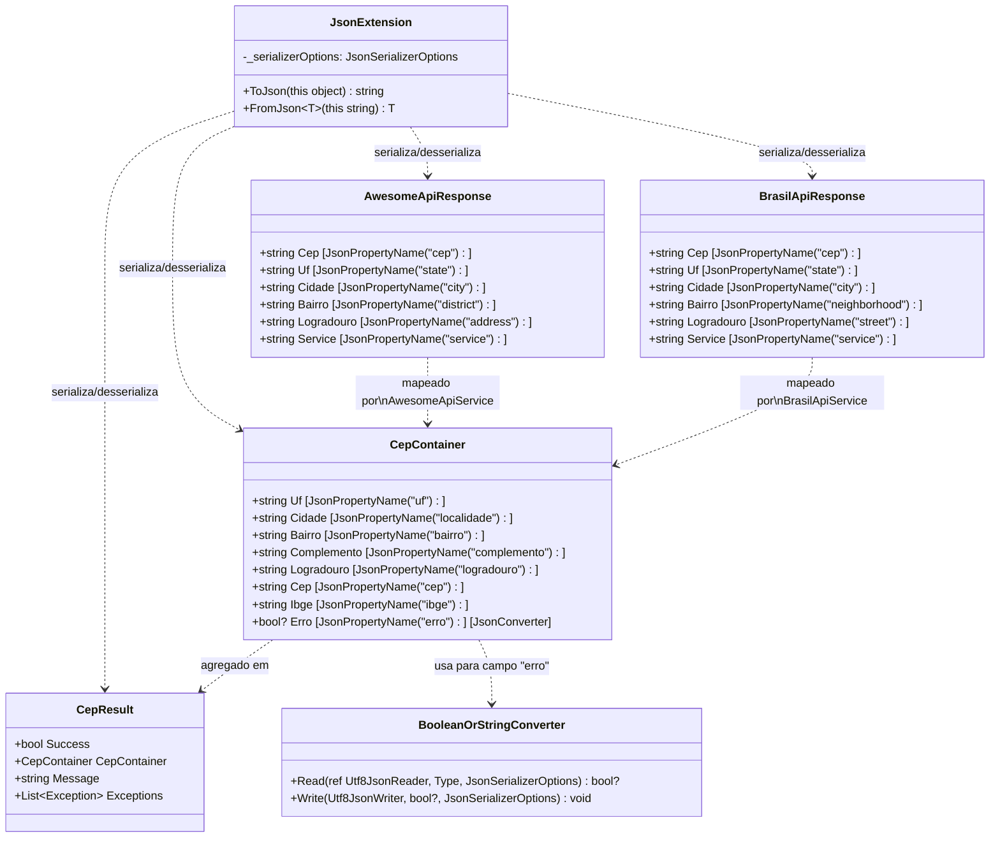
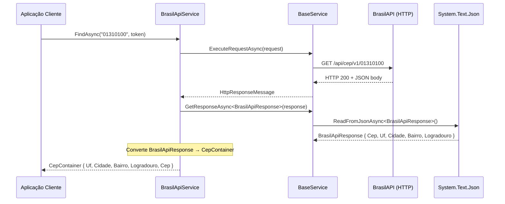
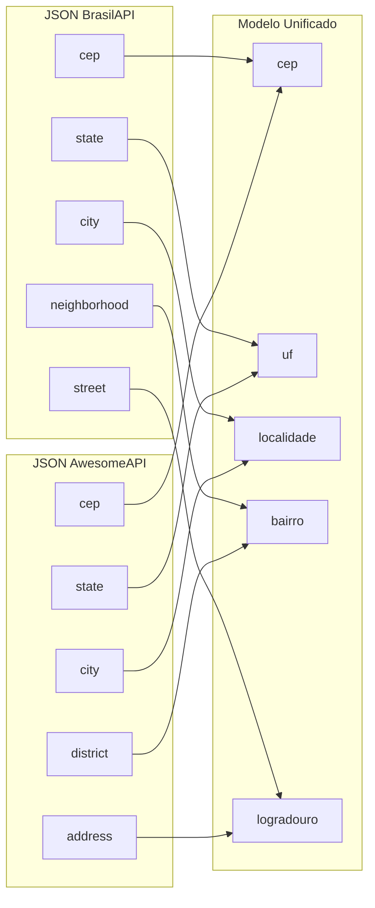

# tec-req-0004 — Serialização/Desserialização JSON (Detalhamento Técnico)

## Metadados

| Campo                | Valor                    |
|----------------------|--------------------------|
| **Código**           | tec-req-0004             |
| **Título**           | Serialização/Desserialização JSON |
| **Data de criação**  | 23/07/2026               |
| **Última atualização**| 23/07/2026               |
| **Autor**            | Rodrigo Araujo Barbosa   |
| **Versão**           | v1.0                     |
| **Status**           | Rascunho                 |
| **Requisito de negócio relacionado** | `docs/requirement/req-0004-serializacao-json.md` (v1.0) |

---

## 1. Resumo do Requisito de Negócio

- **Requisito de origem:** `docs/requirement/req-0004-serializacao-json.md` (v1.0)
- **Síntese do "o quê":** Implementar métodos de extensão `ToJson()` e `FromJson<T>()` com configurações padronizadas do `System.Text.Json`, modelos de resposta específicos por provedor (`BrasilApiResponse`, `AwesomeApiResponse`) e conversor customizado `BooleanOrStringConverter` para o campo `erro` do ViaCEP.
- **Síntese do "por quê":** Garantir serialização JSON confiável, consistente e eficiente para comunicação com 4 provedores externos, cada um com formatos JSON distintos, protegendo contra variações de capitalização e mudanças de contrato.

---

## 2. Detalhamento Técnico Completo

### 2.1 Arquitetura

O sistema de serialização JSON é composto por três camadas:

1. **Camada de extensão** (`JsonExtension` em `Sirb.CepBrasil.Extensions`) — Métodos públicos `ToJson()` e `FromJson<T>()` com configurações compartilhadas.
2. **Camada de modelos específicos** (`BrasilApiResponse`, `AwesomeApiResponse` em `Sirb.CepBrasil.Models`) — DTOs com `JsonPropertyName` para mapeamento exato dos campos de cada provedor.
3. **Camada de modelo unificado** (`CepContainer` em `Sirb.CepBrasil.Models`) — Modelo de endereço normalizado, usado como saída pelos serviços e também como entrada direta para o ViaCEP e OpenCEP. Contém o `BooleanOrStringConverter` embutido.

### 2.2 JsonExtension

```csharp
namespace Sirb.CepBrasil.Extensions;

static public class JsonExtension
{
    static private readonly JsonSerializerOptions _serializerOptions = new()
    {
        DefaultIgnoreCondition = JsonIgnoreCondition.WhenWritingNull,
        PropertyNameCaseInsensitive = true,
        PropertyNamingPolicy = JsonNamingPolicy.CamelCase,
        WriteIndented = false
    };

    static public string ToJson(this object value) { ... }
    static public T FromJson<T>(this string value) { ... }
}
```

#### Propriedades do `_serializerOptions`

| Propriedade | Valor | Efeito |
|-------------|-------|--------|
| `DefaultIgnoreCondition` | `WhenWritingNull` | Propriedades com valor `null` são omitidas do JSON de saída |
| `PropertyNameCaseInsensitive` | `true` | Nomes de propriedades no JSON de entrada não diferenciam maiúsculas/minúsculas |
| `PropertyNamingPolicy` | `CamelCase` | Nomes de propriedades no JSON de saída usam camelCase (ex.: `logradouro`, `cep`) |
| `WriteIndented` | `false` | JSON compacto (sem indentação) para eficiência |

#### ToJson (linhas 41-55)

```csharp
static public string ToJson(this object value)
{
    ArgumentNullException.ThrowIfNull(value);

    try
    {
        return JsonSerializer.Serialize(value, _serializerOptions);
    }
    catch (JsonException ex)
    {
        throw new InvalidOperationException(
            $"Erro ao serializar objeto do tipo '{value.GetType().Name}' para JSON.",
            ex);
    }
}
```

**Comportamento:**
- Entrada nula → `ArgumentNullException`
- Serialização OK → string JSON em camelCase, sem nulos
- Falha de serialização → `InvalidOperationException` com nome do tipo e `JsonException` original como inner

#### FromJson (linhas 74-93)

```csharp
static public T FromJson<T>(this string value)
{
    ArgumentNullException.ThrowIfNull(value);

    if (string.IsNullOrWhiteSpace(value))
        throw new ArgumentException(
            "A string JSON não pode estar vazia ou conter apenas espaços em branco.",
            nameof(value));

    try
    {
        return JsonSerializer.Deserialize<T>(value, _serializerOptions);
    }
    catch (JsonException ex)
    {
        throw new InvalidOperationException(
            $"Erro ao desserializar JSON para o tipo '{typeof(T).Name}'.",
            ex);
    }
}
```

**Comportamento:**
- Entrada nula → `ArgumentNullException`
- String vazia/whitespace → `ArgumentException`
- Desserialização OK → instância de `T`
- Falha de desserialização → `InvalidOperationException` com nome do tipo e `JsonException` original como inner

### 2.3 BrasilApiResponse

```csharp
namespace Sirb.CepBrasil.Models;

internal sealed class BrasilApiResponse
{
    [JsonPropertyName("cep")]         public string Cep { get; set; }
    [JsonPropertyName("state")]       public string Uf { get; set; }
    [JsonPropertyName("city")]        public string Cidade { get; set; }
    [JsonPropertyName("neighborhood")]public string Bairro { get; set; }
    [JsonPropertyName("street")]      public string Logradouro { get; set; }
    [JsonPropertyName("service")]     public string Service { get; set; }
}
```

**Mapeamento BrasilAPI → CepContainer:**

| Campo BrasilAPI | Propriedade BrasilApiResponse | Propriedade CepContainer |
|----------------|------------------------------|--------------------------|
| `cep` | `Cep` | `Cep` |
| `state` | `Uf` | `Uf` |
| `city` | `Cidade` | `Cidade` |
| `neighborhood` | `Bairro` | `Bairro` |
| `street` | `Logradouro` | `Logradouro` |
| `service` | `Service` | — (não mapeado) |

### 2.4 AwesomeApiResponse

```csharp
namespace Sirb.CepBrasil.Models;

internal sealed class AwesomeApiResponse
{
    [JsonPropertyName("cep")]     public string Cep { get; set; }
    [JsonPropertyName("state")]   public string Uf { get; set; }
    [JsonPropertyName("city")]    public string Cidade { get; set; }
    [JsonPropertyName("district")]public string Bairro { get; set; }
    [JsonPropertyName("address")] public string Logradouro { get; set; }
    [JsonPropertyName("service")] public string Service { get; set; }
}
```

**Mapeamento AwesomeAPI → CepContainer:**

| Campo AwesomeAPI | Propriedade AwesomeApiResponse | Propriedade CepContainer |
|-----------------|-------------------------------|--------------------------|
| `cep` | `Cep` | `Cep` |
| `state` | `Uf` | `Uf` |
| `city` | `Cidade` | `Cidade` |
| `district` | `Bairro` | `Bairro` |
| `address` | `Logradouro` | `Logradouro` |
| `service` | `Service` | — (não mapeado) |

### 2.5 BooleanOrStringConverter (CepContainer)

```csharp
namespace Sirb.CepBrasil.Models;

internal sealed class BooleanOrStringConverter : JsonConverter<bool?>
{
    public override bool? Read(ref Utf8JsonReader reader, Type typeToConvert, JsonSerializerOptions options)
    {
        if (reader.TokenType == JsonTokenType.True)
            return true;

        if (reader.TokenType == JsonTokenType.False)
            return false;

        if (reader.TokenType == JsonTokenType.String)
        {
            var stringValue = reader.GetString();
            if (bool.TryParse(stringValue, out var boolValue))
                return boolValue;
        }

        return null;
    }

    public override void Write(Utf8JsonWriter writer, bool? value, JsonSerializerOptions options)
    {
        if (value.HasValue)
            writer.WriteBooleanValue(value.Value);
        else
            writer.WriteNullValue();
    }
}
```

**Comportamento:**
| Token JSON recebido | Resultado |
|---------------------|-----------|
| `true` (booleano) | `true` |
| `false` (booleano) | `false` |
| `"true"` (string) | `true` |
| `"false"` (string) | `false` |
| `"qualquer_outra_coisa"` (string) | `null` |
| Ausente/nulo | `null` |

### 2.6 CepContainer (Propriedades com JsonPropertyName)

```csharp
public sealed class CepContainer(string uf, string cidade, string bairro, string complemento,
    string logradouro, string cep, string ibge)
{
    [JsonPropertyName("uf")]          public string Uf { get; } = uf;
    [JsonPropertyName("localidade")]  public string Cidade { get; } = cidade;
    [JsonPropertyName("bairro")]      public string Bairro { get; } = bairro;
    [JsonPropertyName("complemento")] public string Complemento { get; } = complemento;
    [JsonPropertyName("logradouro")]  public string Logradouro { get; } = logradouro;
    [JsonPropertyName("cep")]         public string Cep { get; } = cep;
    [JsonPropertyName("ibge")]        public string Ibge { get; } = ibge;
    [JsonPropertyName("erro")]
    [JsonConverter(typeof(BooleanOrStringConverter))]
    public bool? Erro { get; init; }
}
```

> **Nota técnica:** O `CepContainer` usa `JsonPropertyName` com nomes no estilo ViaCEP (`localidade` para cidade, `uf`, `bairro`, `logradouro`, `cep`, `ibge`, `complemento`, `erro`), pois é utilizado diretamente na desserialização das respostas do ViaCEP e OpenCEP. As propriedades são `{ get; }` (init-only) por ser um `record class` via primary constructor, exceto `Erro` que é `{ get; init; }`.

### 2.7 Uso no BaseService (ReadFromJsonAsync)

O `BaseService.GetResponseAsync<T>()` utiliza `ReadFromJsonAsync<T>()` do namespace `System.Net.Http.Json`, **não** o `FromJson<T>()` do `JsonExtension`:

```csharp
static async protected Task<T> GetResponseAsync<T>(
    HttpResponseMessage response,
    CancellationToken cancellationToken)
{
    var responseItem = await response.Content
        .ReadFromJsonAsync<T>(cancellationToken)
        .ConfigureAwait(false);

    if (responseItem is not null)
        return responseItem;

    // Se falhou, tenta ler como string para diagnóstico
    var responseString = await response.Content
        .ReadAsStringAsync(cancellationToken)
        .ConfigureAwait(false);

    var errorMessage = string.IsNullOrWhiteSpace(responseString)
        ? "The service returned an empty or null response."
        : $"Failed to deserialize response: {responseString}";

    throw new ServiceException(errorMessage);
}
```

> `ReadFromJsonAsync<T>()` usa suas próprias configurações do `System.Text.Json` (não compartilha `_serializerOptions` do `JsonExtension`). Isso é aceitável porque `ReadFromJsonAsync` já usa `JsonSerializerDefaults.Web` por padrão (camelCase, case-insensitive). O `JsonExtension` é voltado para uso público pelo consumidor da biblioteca.

### 2.8 Conversão nos Serviços

#### BrasilApiService → CepContainer

```csharp
var brasilApiResponse = await GetResponseAsync<BrasilApiResponse>(response, effectiveToken);
// ...
return new CepContainer(
    brasilApiResponse.Uf,
    brasilApiResponse.Cidade,
    brasilApiResponse.Bairro,
    null,                                    // complemento (ausente na BrasilAPI)
    brasilApiResponse.Logradouro,
    brasilApiResponse.Cep,
    null);                                   // ibge (ausente na BrasilAPI)
```

#### AwesomeApiService → CepContainer

```csharp
var awesomeResponse = await GetResponseAsync<AwesomeApiResponse>(response, effectiveToken);
// ...
return new CepContainer(
    awesomeResponse.Uf,
    awesomeResponse.Cidade,
    awesomeResponse.Bairro,
    null,                                    // complemento (ausente na AwesomeAPI)
    awesomeResponse.Logradouro,
    awesomeResponse.Cep,
    null);                                   // ibge (ausente na AwesomeAPI)
```

#### ViaCepService → CepContainer (direto)

```csharp
var result = await GetResponseAsync<CepContainer>(response, effectiveToken);
return result?.Erro == true ? null : result;  // Verifica campo "erro" do ViaCEP
```

#### OpenCepService → CepContainer (direto)

```csharp
var result = await GetResponseAsync<CepContainer>(response, effectiveToken);
return result;
```

### 2.9 Diagrama de Relacionamento dos Modelos



### 2.10 Fluxo de Desserialização nos Provedores



---

## 3. Regras Funcionais e Regras de Negócio Numeradas

### 3.1 Regras Funcionais (RF)

| ID | Descrição | Prioridade | Regra de negócio associada |
|----|-----------|------------|----------------------------|
| RF-26 | Implementar `JsonExtension.ToJson()` para serialização de objetos | Alta | RN-026, RN-027 |
| RF-27 | Implementar `JsonExtension.FromJson<T>()` para desserialização de strings JSON | Alta | RN-026, RN-028 |
| RF-28 | Configurar `JsonSerializerOptions` com `PropertyNameCaseInsensitive = true`, `DefaultIgnoreCondition.WhenWritingNull` e `PropertyNamingPolicy.CamelCase` | Alta | RN-026 |
| RF-29 | Definir `BrasilApiResponse` com mapeamento `JsonPropertyName` para campos da BrasilAPI | Alta | RN-029 |
| RF-30 | Definir `AwesomeApiResponse` com mapeamento `JsonPropertyName` para campos da AwesomeAPI | Alta | RN-029 |
| RF-31 | Implementar `BooleanOrStringConverter` para suportar campo `erro` como booleano ou string | Alta | RN-030 |
| RF-32 | Validar entrada nula em `ToJson()` e `FromJson<T>()` com `ArgumentNullException` | Alta | RN-027, RN-028 |
| RF-33 | Validar string vazia ou espaços em branco em `FromJson<T>()` com `ArgumentException` | Alta | RN-028 |
| RF-34 | Tratar erros de serialização com `InvalidOperationException` e mensagem contextualizada | Média | RN-031 |
| RF-35 | Reutilizar instância única de `JsonSerializerOptions` para toda a biblioteca | Alta | RN-032 |

### 3.2 Regras de Negócio (RN)

| ID | Regra | Origem | Impacto na Implementação |
|----|-------|--------|--------------------------|
| RN-026 | Toda serialização/desserialização deve usar as mesmas configurações padronizadas: camelCase, case-insensitive e ignorar nulos | Consistência | Instância `_serializerOptions` como `private static readonly` em `JsonExtension` |
| RN-027 | `ToJson()` deve lançar `ArgumentNullException` se o objeto for nulo e `InvalidOperationException` se a serialização falhar | Validação | `ArgumentNullException.ThrowIfNull(value)` + try/catch `JsonException` |
| RN-028 | `FromJson<T>()` deve lançar `ArgumentNullException` se a string for nula, `ArgumentException` se for vazia, e `InvalidOperationException` se a desserialização falhar | Validação | Validação tripla: null → ArgumentNull, empty → ArgumentException, falha → InvalidOperation |
| RN-029 | Cada provedor deve ter seu próprio modelo de resposta com `JsonPropertyName` mapeando os campos exatos do JSON retornado | Isolamento | `BrasilApiResponse.cs` e `AwesomeApiResponse.cs` com `[JsonPropertyName("...")]` em cada propriedade |
| RN-030 | O campo `erro` do ViaCEP deve aceitar tanto booleano (`true`/`false`) quanto string (`"true"`/`"false"`) via `BooleanOrStringConverter` | Compatibilidade | `JsonConverter<bool?>` customizado no `CepContainer.cs` |
| RN-031 | Erros de serialização/desserialização devem ser encapsulados em `InvalidOperationException` com o tipo envolvido na mensagem | Diagnóstico | Mensagem: `"Erro ao serializar objeto do tipo '{type.Name}' para JSON."` |
| RN-032 | A instância de `JsonSerializerOptions` deve ser única, estática e readonly para toda a biblioteca | Performance | `private static readonly JsonSerializerOptions _serializerOptions` |

---

## 4. Diagramas Técnicos

### 4.1 Diagrama de Fluxo — ToJson

```mermaid
flowchart TD
    A[ToJson(value)] --> B{value == null?}
    B -->|Sim| C[throw ArgumentNullException]
    B -->|Não| D[JsonSerializer.Serialize\nvalue + _serializerOptions]
    D -->|Sucesso| E[return string JSON]
    D -->|JsonException| F[throw InvalidOperationException\ncom nome do tipo]
```

### 4.2 Diagrama de Fluxo — FromJson

```mermaid
flowchart TD
    A[FromJson~T~(value)] --> B{value == null?}
    B -->|Sim| C[throw ArgumentNullException]
    B -->|Não| D{IsNullOrWhiteSpace?}
    D -->|Sim| E[throw ArgumentException]
    D -->|Não| F[JsonSerializer.Deserialize~T~\nvalue + _serializerOptions]
    F -->|Sucesso| G[return T instance]
    F -->|JsonException| H[throw InvalidOperationException\ncom nome do tipo T]
```

### 4.3 Mapeamento de Campos por Provedor



---

## 5. Exemplos Técnicos

### 5.1 Exemplos de ToJson

```csharp
// Serialização de CepContainer
var container = new CepContainer("SP", "São Paulo", "Consolação", null,
    "Avenida Paulista", "01310-100", "3550308");
var json = container.ToJson();
// Resultado: {"uf":"SP","localidade":"São Paulo","bairro":"Consolação",
//              "logradouro":"Avenida Paulista","cep":"01310-100","ibge":"3550308"}

// Complemento null → omitido no JSON
var containerSemComplemento = new CepContainer("RJ", "Rio de Janeiro", "Copacabana",
    null, "Avenida Atlântica", "22070-001", "3304557");
var json2 = containerSemComplemento.ToJson();
// Resultado: {"uf":"RJ","localidade":"Rio de Janeiro","bairro":"Copacabana",
//              "logradouro":"Avenida Atlântica","cep":"22070-001","ibge":"3304557"}

// Serialização de CepResult
var result = new CepResult(true, container, null);
var json3 = result.ToJson();
// Resultado: {"success":true,"cepContainer":{...},"exceptions":[]}

// Serialização com objeto nulo
object obj = null;
obj.ToJson(); // ArgumentNullException
```

### 5.2 Exemplos de FromJson

```csharp
// Desserialização de CepContainer
var json = "{\"uf\":\"SP\",\"localidade\":\"São Paulo\",\"logradouro\":\"Av Paulista\"}";
var container = json.FromJson<CepContainer>();
// Resultado: CepContainer { Uf = "SP", Cidade = "São Paulo", Logradouro = "Av Paulista" }

// Desserialização case-insensitive (nomes em maiúsculo)
var jsonUpper = "{\"UF\":\"SP\",\"LOCALIDADE\":\"São Paulo\"}";
var containerUpper = jsonUpper.FromJson<CepContainer>();
// Resultado: CepContainer { Uf = "SP", Cidade = "São Paulo" }

// Desserialização com campos faltando
var jsonPartial = "{\"uf\":\"SP\"}";
var containerPartial = jsonPartial.FromJson<CepContainer>();
// Resultado: CepContainer { Uf = "SP", Cidade = null, Bairro = null, ... }

// Desserialização de BrasilApiResponse
var brasilJson = "{\"cep\":\"01310100\",\"state\":\"SP\",\"city\":\"São Paulo\"," +
    "\"neighborhood\":\"Consolação\",\"street\":\"Avenida Paulista\"}";
var brasilResponse = brasilJson.FromJson<BrasilApiResponse>();
// Resultado: BrasilApiResponse { Cep = "01310100", Uf = "SP", Cidade = "São Paulo",
//                                Bairro = "Consolação", Logradouro = "Avenida Paulista" }

// Desserialização de AwesomeApiResponse
var awesomeJson = "{\"cep\":\"01310100\",\"state\":\"SP\",\"city\":\"São Paulo\"," +
    "\"district\":\"Consolação\",\"address\":\"Avenida Paulista\"}";
var awesomeResponse = awesomeJson.FromJson<AwesomeApiResponse>();
// Resultado: AwesomeApiResponse { Cep = "01310100", Uf = "SP", Cidade = "São Paulo",
//                                 Bairro = "Consolação", Logradouro = "Avenida Paulista" }
```

### 5.3 Exemplos de BooleanOrStringConverter

```csharp
// ViaCEP retorna erro como booleano true
var jsonViaCepErro = "{\"cep\":\"00000000\",\"erro\":true}";
var container = jsonViaCepErro.FromJson<CepContainer>();
// container.Erro == true

// ViaCEP sem erro (campo ausente)
var jsonViaCepOk = "{\"cep\":\"01310100\",\"uf\":\"SP\",\"localidade\":\"São Paulo\"}";
var container2 = jsonViaCepOk.FromJson<CepContainer>();
// container2.Erro == null

// ViaCEP com erro como string (caso raro)
var jsonViaCepString = "{\"cep\":\"00000000\",\"erro\":\"true\"}";
var container3 = jsonViaCepString.FromJson<CepContainer>();
// container3.Erro == true

// ViaCEP com valor inválido
var jsonViaCepInvalido = "{\"cep\":\"00000000\",\"erro\":\"invalido\"}";
var container4 = jsonViaCepInvalido.FromJson<CepContainer>();
// container4.Erro == null
```

### 5.4 Exemplos de Round-trip

```csharp
// CepContainer completo → ToJson → FromJson → CepContainer igual
var original = new CepContainer("SP", "São Paulo", "Consolação", "lado ímpar",
    "Avenida Paulista", "01310-100", "3550308");
var json = original.ToJson();
var restored = json.FromJson<CepContainer>();
// original.Uf == restored.Uf
// original.Cidade == restored.Cidade
// original.Logradouro == restored.Logradouro
// original.Cep == restored.Cep
// original.Complemento == restored.Complemento
// original.Ibge == restored.Ibge
```

### 5.5 Edge Cases

| Cenário | Método | Entrada | Resultado Esperado |
|---------|--------|---------|--------------------|
| Objeto nulo | `ToJson` | `null` | `ArgumentNullException` |
| String nula | `FromJson<T>` | `null` | `ArgumentNullException` |
| String vazia | `FromJson<T>` | `""` | `ArgumentException` |
| String whitespace | `FromJson<T>` | `"   "` | `ArgumentException` |
| JSON inválido | `FromJson<T>` | `"{invalido}"` | `InvalidOperationException` |
| JSON null | `FromJson<T>` | `"null"` | Instância válida (T pode ser null) |
| JSON com campos extras | `FromJson<T>` | `{"uf":"SP","extra":"valor"}` | Ignora campo extra, desserializa normalmente |
| Propriedade ausente | `FromJson<T>` | `{"uf":"SP"}` | Propriedade fica null (default) |
| Case diferente | `FromJson<T>` | `{"UF":"SP"}` | Desserializa normalmente (case-insensitive) |
| Unicode/acentos | `FromJson<T>` | `{"localidade":"São Paulo"}` | Preserva acentos |
| Números em string | `FromJson<T>` | `{"cep":123}` | Pode falhar (espera string) |

---

## 6. Considerações de Performance

- **Instância única de `JsonSerializerOptions`:** `_serializerOptions` é `private static readonly`, criada uma única vez na inicialização do tipo e reutilizada em todas as chamadas. Isso elimina overhead de reflexão e compilação de contratos.
- **`WriteIndented = false`:** JSON compacto, sem indentação, reduz tamanho da saída e tempo de serialização.
- **Validação de entrada:** `ArgumentNullException.ThrowIfNull(value)` é otimizada em .NET (intrínseca do runtime), com custo desprezível.
- **Sem cache de `JsonSerializerOptions` externo:** A instância não é exposta publicamente, evitando que código cliente crie dependência ou modifique as configurações.

## 7. Estratégia de Testes

### 7.1 Testes Existentes

| Classe de Teste | Localização | Qtd Testes | Cobertura |
|-----------------|-------------|-------------|-----------|
| `JsonExtensionTest` | `Sirb.CepBrasil.Test/Extensions/JsonExtensionTest.cs` | 22 | 100% (alvo) |

### 7.2 Cenários de Teste (sugeridos)

**ToJson — 14 testes:**
- Serialização de CepContainer com dados completos
- Serialização de CepContainer com propriedades nulas
- Serialização de CepResult
- Nomes em camelCase no JSON de saída
- Propriedades nulas omitidas
- Objeto nulo → `ArgumentNullException`
- Serialização com erro → `InvalidOperationException`
- Serialização de tipos anônimos
- Serialização de listas/coleções
- Serialização de strings
- Serialização com caracteres especiais/unicode
- Serialização de números
- Serialização de booleanos
- Verificação de JSON compacto (sem indentação)

**FromJson — 6 testes:**
- Desserialização de CepContainer completo
- Desserialização case-insensitive
- Desserialização com campos faltando (null)
- String nula → `ArgumentNullException`
- String vazia → `ArgumentException`
- JSON inválido → `InvalidOperationException`

**Round-trip — 2 testes:**
- CepContainer → ToJson → FromJson → valores preservados
- CepResult → ToJson → FromJson → valores preservados

### 7.3 Execução

```bash
# Executar todos os testes
dotnet test

# Executar testes específicos de JsonExtension
dotnet test --filter "JsonExtensionTest"

# Verificar cobertura
dotnet test /p:CollectCoverage=true /p:CoverletOutputFormat=opencover
```

---

## 8. Rastreabilidade

| Item | Referência |
|------|------------|
| Requisito de negócio | `docs/requirement/req-0004-serializacao-json.md` |
| JsonExtension | `Sirb.CepBrasil/Extensions/JsonExtension.cs` (linhas 1-94) |
| BrasilApiResponse | `Sirb.CepBrasil/Models/BrasilApiResponse.cs` (linhas 1-61) |
| AwesomeApiResponse | `Sirb.CepBrasil/Models/AwesomeApiResponse.cs` (linhas 1-60) |
| CepContainer | `Sirb.CepBrasil/Models/CepContainer.cs` (linhas 1-184) |
| BooleanOrStringConverter | `Sirb.CepBrasil/Models/CepContainer.cs` (linhas 10-43) |
| CepResult | `Sirb.CepBrasil/Models/CepResult.cs` (linhas 1-77) |
| BaseService | `Sirb.CepBrasil/Services/BaseService.cs` (linhas 83-103) |
| BrasilApiService | `Sirb.CepBrasil/Services/BrasilApiService.cs` (linhas 44-86) |
| AwesomeApiService | `Sirb.CepBrasil/Services/AwesomeApiService.cs` (linhas 44-86) |
| ViaCepService | `Sirb.CepBrasil/Services/ViaCepService.cs` (linhas 58-91) |
| OpenCepService | `Sirb.CepBrasil/Services/OpenCepService.cs` (linhas 44-76) |
| Testes — JsonExtension | `Sirb.CepBrasil.Test/Extensions/JsonExtensionTest.cs` |
| Documentação extra | `docs/extra/MELHORIAS-JSONEXTENSION.md` |
| APF | `docs/requirement/apf/apf-req-0004.md` |
| Análise cross-artifact | `docs/requirement/analises/analise-req-0004.md` |
| Quality Checklist | `docs/requirement/checklist/checklist-req-0004.md` |
| Dicionário de dados | `docs/requirement/did/did-models-resposta.md` |
| Matriz de risco | `docs/system-risk-matrix.md` |
| Constituição | `docs/constituicao.md` |

---

## 9. Histórico de Alterações e Clarification Log

### 9.1 Histórico de Alterações

| Data | Autor | Versão | Alteração |
|------|-------|--------|-----------|
| 23/07/2026 | Rodrigo Araujo Barbosa | v1.0 | Criação do documento técnico |

### 9.2 Clarification Log

| Data | Pergunta | Resposta | Status (Resolvido/Pendente) | Origem (Criação/Implementação) | Impacto no requisito |
|------|----------|----------|----------------------------|-------------------------------|----------------------|
| 23/07/2026 | Qual nome de usuário deve constar no campo Autor? | Rodrigo Araujo Barbosa | Resolvido | Criação | Define autor do documento |
| 23/07/2026 | O BaseService.GetResponseAsync usa FromJson do JsonExtension ou ReadFromJsonAsync? | Usa `ReadFromJsonAsync<T>()` do `System.Net.Http.Json`, não o `FromJson` do `JsonExtension` | Resolvido | Criação | Confirma que JsonExtension é independente do BaseService |
| 23/07/2026 | O BooleanOrStringConverter está em arquivo separado ou embutido? | Embutido em `CepContainer.cs` como classe interna | Resolvido | Criação | Localização confirmada |

### Cobertura do Clarification (8 áreas)

| # | Área | Status (Resolvido \| N/A) | Ref. entrada no Log | Justificativa (se N/A) |
|---|------|---------------------------|---------------------|------------------------|
| 1 | Atores e personas | Resolvido | Autor definido | — |
| 2 | Fluxos principais e alternativos | N/A | — | Fluxos cobertos pelos diagramas de sequência e Gherkin |
| 3 | Exceções e erros | Resolvido | ReadFromJsonAsync vs FromJson, BooleanOrStringConverter | — |
| 4 | Integrações externas | Resolvido | Provedores usam ReadFromJsonAsync, não JsonExtension | — |
| 5 | Requisitos não-funcionais | Resolvido | Seção 6 (performance) e NFRs no req-0004 | — |
| 6 | Dados e privacidade | N/A | — | Modelos de resposta sem dados sensíveis |
| 7 | Validações e regras de negócio | Resolvido | RN-026 a RN-032 | — |
| 8 | Critérios de aceite e mensurabilidade | Resolvido | 15 cenários Gherkin, 22+ testes | — |

**Cobertura atual:** 6/8. **Meta:** 8/8.

---

**© 2026 Rodrigo Araujo Barbosa — Sirb.CepBrasil**
