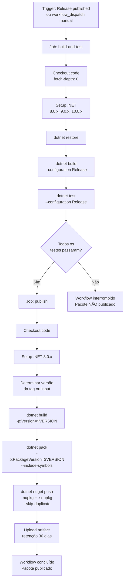
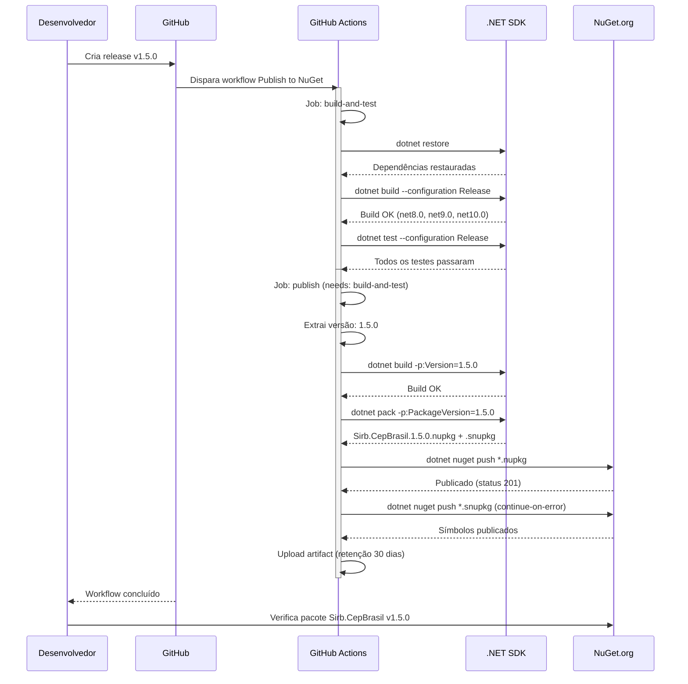
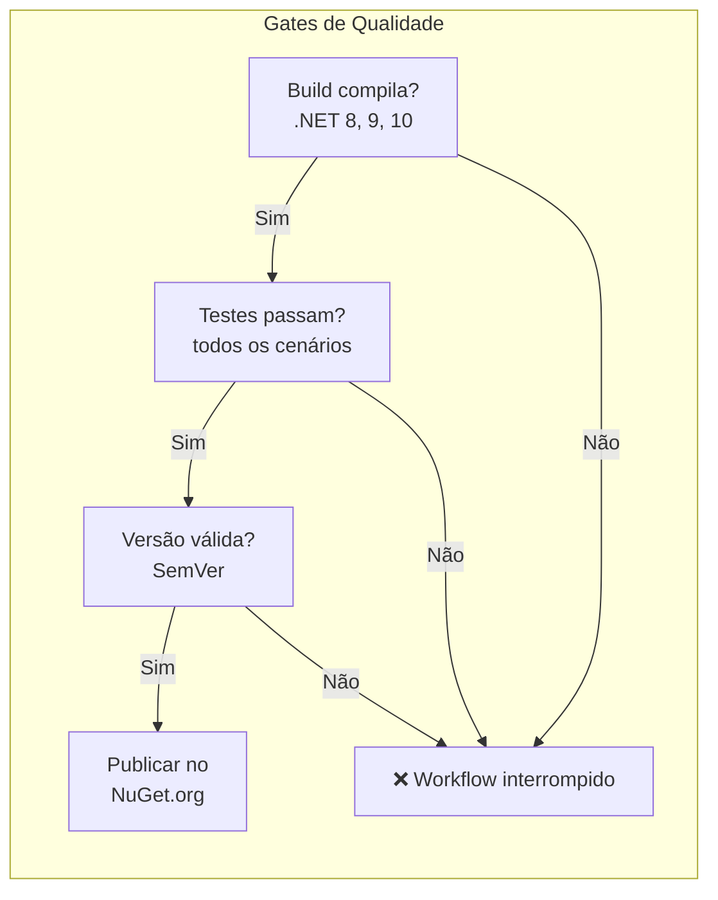

# tec-req-0006 — Publicação Automática no NuGet (Requisito Técnico)

## Metadados

| Campo                | Valor                    |
|----------------------|--------------------------|
| **Código**           | tec-req-0006             |
| **Título**           | Publicação Automática no NuGet |
| **Data de criação**  | 23/07/2026               |
| **Última atualização**| 23/07/2026               |
| **Autor**            | Rodrigo Araujo Barbosa   |
| **Versão**           | v1.0                     |
| **Status**           | Rascunho                 |
| **Requisito de negócio relacionado** | `docs/requirement/req-0006-publicacao-nuget.md` (v1.0) |

---

## Histórico de Alterações

| Data | Autor | Versão | Alteração |
|------|-------|--------|-----------|
| 23/07/2026 | Rodrigo Araujo Barbosa | v1.0 | Criação do documento técnico |

---

## 1. Resumo do Requisito de Negócio

- **Requisito de origem:** `docs/requirement/req-0006-publicacao-nuget.md` (v1.0)
- **Síntese do "o quê":** Automatizar o pipeline de CI/CD para build multi-target (.NET 8, 9, 10), execução de testes unitários e publicação do pacote NuGet no NuGet.org, com gatilho automático ao publicar uma release no GitHub e opção de execução manual.
- **Síntese do "por quê":** Eliminar o processo manual de publicação propenso a erro, garantir que todo pacote publicado passe por testes automatizados, assegurar rastreabilidade entre releases e pacotes, e aplicar princípios de segurança (least privilege, secrets gerenciados).

---

## 2. Detalhamento Técnico Completo

### 2.1 Estrutura do Workflow

O pipeline é definido no arquivo `.github/workflows/publish_nuget.yml` e contém **2 jobs sequenciais**:

#### Job 1: `build-and-test`

| Step | Ação | Comando / Action | Observação |
|------|------|------------------|------------|
| 1 | Checkout do código | `actions/checkout@v4` com `fetch-depth: 0` | Profundidade total para git describe |
| 2 | Setup .NET | `actions/setup-dotnet@v4` com `8.0.x, 9.0.x, 10.0.x` | 3 versões simultâneas |
| 3 | Restore | `dotnet restore` | Restaura dependências NuGet |
| 4 | Build | `dotnet build --configuration Release --no-restore` | Build multi-target |
| 5 | Testes | `dotnet test --configuration Release --no-build --verbosity normal` | **Atualmente comentado** |
| 6 | Cobertura | `dotnet test --configuration Release --no-build --collect:"XPlat Code Coverage"` | **Atualmente comentado** |

#### Job 2: `publish`

| Step | Ação | Comando / Action | Observação |
|------|------|------------------|------------|
| 1 | Checkout | `actions/checkout@v4` com `fetch-depth: 0` | — |
| 2 | Setup .NET | `actions/setup-dotnet@v4` com `8.0.x` | Versão única para empacotamento |
| 3 | Restore | `dotnet restore` | Restaura dependências |
| 4 | Determinar versão | Script bash — extrai da tag da release ou do input manual | Ver seção 2.2 |
| 5 | Build Release | `dotnet build ... -p:Version=$VERSION` | Build com versão específica |
| 6 | Pack | `dotnet pack ... -p:PackageVersion=$VERSION --include-symbols -p:SymbolPackageFormat=snupkg` | Gera .nupkg e .snupkg |
| 7 | Listar pacotes | `ls -la ./nupkg` | Log para auditoria |
| 8 | Push NuGet | `dotnet nuget push ... --api-key ${{ secrets.NUGET_API_KEY }} --skip-duplicate` | Publica no NuGet.org |
| 9 | Push símbolos | `dotnet nuget push .../*.snupkg ... --skip-duplicate` com `continue-on-error: true` | Símbolos não bloqueiam |
| 10 | Upload artefato | `actions/upload-artifact@v4` com `retention-days: 30` | Backup do pacote |

### 2.2 Versionamento

A versão do pacote é determinada no step "Determine version" do job `publish`:

```yaml
- name: Determine version
  id: version
  run: |
    if [ "${{ github.event_name }}" == "release" ]; then
      VERSION="${{ github.event.release.tag_name }}"
      VERSION="${VERSION#v}"
    else
      VERSION="${{ github.event.inputs.version }}"
    fi
    echo "VERSION=$VERSION" >> $GITHUB_OUTPUT
    echo "Publishing version: $VERSION"
```

**Regras:**
- Para `release` events: extrai `github.event.release.tag_name` e remove prefixo `v` (ex.: `v1.4.0` → `1.4.0`).
- Para `workflow_dispatch`: usa o valor do input obrigatório `version` diretamente.
- O valor é gravado em `$GITHUB_OUTPUT` como `VERSION` para uso nos steps subsequentes.

### 2.3 Empacotamento (Pack)

O comando `dotnet pack` é executado diretamente no projeto da biblioteca:

```bash
dotnet pack Sirb.CepBrasil/Sirb.CepBrasil.csproj \
  --configuration Release \
  --no-build \
  --output ./nupkg \
  -p:PackageVersion=${{ steps.version.outputs.VERSION }} \
  -p:IncludeSymbols=true \
  -p:SymbolPackageFormat=snupkg
```

**Flags:**
- `--no-build`: reaproveita o build do step anterior (performance).
- `-p:PackageVersion`: sobrescreve a versão do .csproj com a versão extraída.
- `-p:IncludeSymbols=true`: inclui arquivos de símbolo (.pdb) no pacote.
- `-p:SymbolPackageFormat=snupkg`: formato snupkg (padrão NuGet).

### 2.4 Publicação no NuGet.org

```bash
# Publicar pacote principal
dotnet nuget push ./nupkg/*.nupkg \
  --api-key ${{ secrets.NUGET_API_KEY }} \
  --source https://api.nuget.org/v3/index.json \
  --skip-duplicate

# Publicar símbolos (continue-on-error: true)
dotnet nuget push ./nupkg/*.snupkg \
  --api-key ${{ secrets.NUGET_API_KEY }} \
  --source https://api.nuget.org/v3/index.json \
  --skip-duplicate
```

**Observações:**
- `--skip-duplicate`: evita erro se a versão já existir no NuGet (útil para reexecução).
- `continue-on-error: true` no step de símbolos: falha na publicação de .snupkg não interrompe o workflow.
- A API Key é obtida do `secrets.NUGET_API_KEY` (GitHub Secrets).

### 2.5 Configuração do .csproj para Empacotamento

O arquivo `Sirb.CepBrasil/Sirb.CepBrasil.csproj` contém as seguintes propriedades relevantes para o NuGet:

```xml
<PropertyGroup>
  <TargetFrameworks>net8.0;net9.0;net10.0</TargetFrameworks>
  <PackageId>Sirb.CepBrasil</PackageId>
  <PackageVersion>1.4.0</PackageVersion>
  <GeneratePackageOnBuild>true</GeneratePackageOnBuild>
  <Version>1.4.0</Version>
  <Authors>Rodrigo Araujo Barbosa</Authors>
  <Description>Biblioteca .NET para consulta de endereços brasileiros através do CEP...</Description>
  <PackageTags>CEP endereço endereco logradouro zipcode brasil viacep</PackageTags>
  <PackageLicenseExpression>MIT</PackageLicenseExpression>
  <RepositoryUrl>https://github.com/rodabarbosa/CepBrasil</RepositoryUrl>
  <PackageReadmeFile>README.md</PackageReadmeFile>
  <GenerateDocumentationFile>true</GenerateDocumentationFile>
</PropertyGroup>
```

### 2.6 Permissões do Workflow (Least Privilege)

```yaml
permissions:
  contents: read
  packages: write
```

- `contents: read`: necessário para checkout do código.
- `packages: write`: necessário para upload de artefatos (GitHub Packages).
- Nenhuma permissão adicional é concedida.

### 2.7 Triggers do Workflow

```yaml
on:
  release:
    types: [published]       # Automático: quando uma release é publicada
  workflow_dispatch:          # Manual: via GitHub Actions UI
    inputs:
      version:
        description: 'Version to publish (e.g., 1.4.0)'
        required: true
        type: string
```

### 2.8 Observabilidade

- **Logs:** cada step do workflow gera logs detalhados acessíveis via GitHub Actions UI.
- **Artefatos:** o pacote .nupkg é preservado como artefato por 30 dias.
- **Notificações:** o mantenedor recebe notificação por e-mail do GitHub em caso de falha (configuração padrão do GitHub Actions).

---

## 3. Regras Funcionais e Regras de Negócio Numeradas

### Regras Funcionais (RF)

| ID | Descrição | Prioridade | Regra de negócio associada |
|----|-----------|------------|----------------------------|
| RF-26 | Executar build multi-target (.NET 8, 9, 10) em configuração Release | Alta | RN-026 |
| RF-27 | Executar todos os testes unitários antes da publicação | Alta | RN-027, RN-031 |
| RF-28 | Extrair versão automaticamente da tag da release (ex.: v1.4.0 → 1.4.0) | Alta | RN-028 |
| RF-29 | Permitir execução manual do workflow com versão explícita | Alta | RN-029 |
| RF-30 | Empacotar NuGet com símbolos (.snupkg) | Alta | RN-030 |
| RF-31 | Publicar pacote no NuGet.org com skip-duplicate | Alta | RN-031 |
| RF-32 | Publicar símbolos no NuGet.org com continue-on-error | Média | RN-030 |
| RF-33 | Fazer upload do pacote como artefato do workflow (retenção 30 dias) | Média | RN-032 |
| RF-34 | Utilizar permissões mínimas (least privilege) no workflow | Alta | RN-033 |
| RF-35 | Bloquear publicação se o job build-and-test falhar | Alta | RN-027, RN-034 |

### Regras de Negócio (RN)

| ID | Regra | Origem | Impacto |
|----|-------|--------|---------|
| RN-026 | O build deve ser multi-target para .NET 8, 9 e 10 simultaneamente em configuração Release | Compatibilidade multi-versão | Garante que o pacote funciona nas 3 plataformas |
| RN-027 | Testes unitários devem ser executados **antes** do empacotamento; se falharem, o workflow deve ser interrompido e o pacote não publicado | Gate de qualidade | Impede publicação de código com regressões |
| RN-028 | A versão do pacote é extraída da tag da release (removendo o prefixo "v") ou do input manual | Versionamento explícito | Garante rastreabilidade entre tag e versão publicada |
| RN-029 | O workflow pode ser acionado manualmente via `workflow_dispatch` com versão explícita como parâmetro obrigatório | Flexibilidade de controle | Permite republicação e publicação fora de release |
| RN-030 | O pacote NuGet deve incluir símbolos (.snupkg) para debugging via Source Link; a publicação de símbolos não deve bloquear o workflow se falhar | Debugging | Símbolos são opcionais; falha não impede publicação |
| RN-031 | A publicação no NuGet.org deve usar `--skip-duplicate` para evitar erro ao republicar versão já existente | Idempotência | Permite reexecução segura do workflow |
| RN-032 | O artefato .nupkg gerado deve ser preservado como artefato do workflow por 30 dias | Backup | Permite recuperação em caso de falha no push |
| RN-033 | O workflow deve usar permissões mínimas (`contents: read, packages: write`) | Segurança | Previne alterações não intencionais no repositório |
| RN-034 | O job de publicação (`publish`) deve depender do job de build e teste (`build-and-test`) via `needs:` | Ordem de execução | Garante sequência correta: testar antes de publicar |

---

## 4. Diagramas Técnicos

### 4.1 Diagrama de Fluxo do Workflow



### 4.2 Diagrama de Sequência (Release → NuGet)



### 4.3 Diagrama de Decisão (Gates)



---

## 5. Exemplos Técnicos

### 5.1 Configuração do Workflow (YAML completo)

O arquivo completo está em `.github/workflows/publish_nuget.yml`. Abaixo os blocos mais relevantes:

**Triggers:**
```yaml
on:
  release:
    types: [published]
  workflow_dispatch:
    inputs:
      version:
        description: 'Version to publish (e.g., 1.4.0)'
        required: true
        type: string
```

**Permissões:**
```yaml
permissions:
  contents: read
  packages: write
```

**Setup .NET (build-and-test):**
```yaml
- name: Setup .NET
  uses: actions/setup-dotnet@v4
  with:
    dotnet-version: |
      8.0.x
      9.0.x
      10.0.x
```

### 5.2 Publicação Manual (workflow_dispatch)

**Payload de request (via GitHub Actions UI):**
```json
{
  "ref": "main",
  "inputs": {
    "version": "1.5.0"
  }
}
```

### 5.3 Criação de Release (gatilho automático)

**Comandos git para criar release:**
```bash
# Atualizar versão no .csproj
# <Version>X.Y.Z</Version>

git add .
git commit -m "chore: release version X.Y.Z"
git push origin main

git tag vX.Y.Z
git push origin vX.Y.Z
```

**Criar release no GitHub:**
- GitHub → Releases → "Draft a new release"
- Tag: `vX.Y.Z` (ex.: `v1.5.0`)
- Título: `Release vX.Y.Z`
- Descrição: changelog da versão
- Publicar release

### 5.4 Saída Esperada do Pack

```bash
$ ls -la ./nupkg
Sirb.CepBrasil.1.5.0.nupkg
Sirb.CepBrasil.1.5.0.snupkg
```

### 5.5 Erro: API Key não configurada

```bash
# Log do workflow:
##[error]The secret NUGET_API_KEY is not configured
# O workflow falha no step de push com erro 401 Unauthorized
```

### 5.6 Erro: Versão já existe no NuGet (com --skip-duplicate)

```bash
# Log do workflow (com --skip-duplicate):
# Aviso: O pacote Sirb.CepBrasil 1.4.0 já existe no servidor.
# O workflow continua sem falha.
```

### 5.7 Cenários de Borda e Exceções

- **Cenário 1 — Testes comentados no workflow:** os steps de teste (linhas 46-50) estão atualmente comentados. Para atender RN-027, devem ser descomentados antes da primeira publicação. Enquanto comentados, o workflow não valida qualidade — o build é o único gate.
- **Cenário 2 — Falha de build em uma plataforma:** se o build falhar em .NET 10 mas passar em 8 e 9, o workflow inteiro falha e nada é publicado.
- **Cenário 3 — Release sem tag semântica:** se a tag não começar com `v` (ex.: `release-1.5.0`), o script de versão pode produzir um valor inesperado. A tag deve seguir o padrão `vMAJOR.MINOR.PATCH`.
- **Cenário 4 — Workflow reexecutado:** com `--skip-duplicate`, reexecutar o workflow para a mesma versão não causa erro — o pacote apenas não é sobrescrito.
- **Cenário 5 — Timeout na publicação:** se o NuGet.org estiver lento, o step de push pode exceder o timeout padrão do GitHub Actions (360 min). Recomenda-se timeout explícito.

### 5.8 Códigos de Retorno / Status Aplicáveis

| Status | Quando ocorre | Ação esperada |
|--------|--------------|---------------|
| ✅ Sucesso | Todos os steps executam sem erro | Pacote publicado no NuGet.org |
| ❌ Build falhou | Erro de compilação em qualquer plataforma | Corrigir código e criar nova release |
| ❌ Testes falharam | Um ou mais testes unitários falham | Corrigir testes e reexecutar |
| ❌ Push rejeitado | API Key inválida ou expirada | Renovar API Key no NuGet.org e atualizar secret |
| ⚠️ Símbolos falharam | Push de .snupkg falha (continue-on-error) | Verificar logs; pacote .nupkg já publicado |
| ⚠️ Skip-duplicate | Versão já existe no NuGet | Nenhuma ação necessária |

---

## 6. Rastreabilidade

| Item | Referência |
|------|------------|
| Requisito de negócio (req-0006) | `docs/requirement/req-0006-publicacao-nuget.md` (v1.0) |
| Workflow CI/CD | `.github/workflows/publish_nuget.yml` (118 linhas) |
| Projeto Sirb.CepBrasil | `Sirb.CepBrasil/Sirb.CepBrasil.csproj` |
| Projeto de testes | `Sirb.CepBrasil.Test/Sirb.CepBrasil.Test.csproj` |
| Secret NuGet | `NUGET_API_KEY` (GitHub Secrets) |
| Documento APF | `docs/requirement/apf/apf-req-0006.md` |
| Análise cross-artifact | `docs/requirement/analises/analise-req-0006.md` |
| Quality Checklist | `docs/requirement/checklist/checklist-req-0006.md` |
| Matriz de risco global | `docs/system-risk-matrix.md` |
| Documentos de apoio | `docs/extra/WORKFLOW-NUGET-PUBLISH.md`, `docs/extra/RESUMO-CORRECAO-CI-CD.md`, `docs/extra/CHECKLIST-RELEASE.md` |

---

## 7. Validações Realizadas para esta Documentação

- [x] `README.md` do projeto analisado
- [x] `req-0006` correspondente lido e referenciado
- [x] Código do workflow analisado (`.github/workflows/publish_nuget.yml`)
- [x] Projetos `.csproj` analisados (biblioteca + testes)
- [x] Diagramas Mermaid validados (sintaxe e fidelidade ao workflow)
- [x] Documentações correlatas revisadas (`WORKFLOW-NUGET-PUBLISH.md`, `RESUMO-CORRECAO-CI-CD.md`, `CHECKLIST-RELEASE.md`)
- [x] Matriz global de risco do sistema atualizada (`system-risk-matrix.md`)
- [x] APF do requisito criado/atualizado (`apf-req-0006.md`)
- [x] Clarification Log preenchido
- [x] Nenhum item Pendente no Clarification Log que impacte aceite/escopo

---

## 8. Histórico de Alterações e Clarification Log

### 8.1 Histórico de Alterações

| Data | Autor | Versão | Alteração |
|------|-------|--------|-----------|
| 23/07/2026 | Rodrigo Araujo Barbosa | v1.0 | Criação do documento |

### 8.2 Clarification Log

| Data | Pergunta | Resposta | Status (Resolvido/Pendente) | Origem (Criação/Implementação) | Impacto no requisito |
|------|----------|----------|----------------------------|-------------------------------|----------------------|
| 23/07/2026 | O workflow atual executa testes ou estão comentados? | Os steps de teste estão comentados (linhas 46-50 do publish_nuget.yml) | Resolvido | Criação | RN-027 documenta testes como gate; atualmente comentados — pendente ativação |
| 23/07/2026 | A numeração de RF/RN deve continuar a partir de req-0003 (RF-25 e RN-025)? | Sim, iniciar RF em RF-26 e RN em RN-026 | Resolvido | Criação | Define numeração |
| 23/07/2026 | Qual a estratégia de versionamento para o workflow manual vs release? | Release usa tag (remove prefixo "v"); manual usa input obrigatório | Resolvido | Criação | Confirma RN-028 e RN-029 |

### Cobertura do Clarification (8 áreas)

| # | Área | Status (Resolvido \| N/A) | Ref. entrada no Log | Justificativa (se N/A) |
|---|------|---------------------------|---------------------|------------------------|
| 1 | Atores e personas | Resolvido | Autor definido e atores documentados | — |
| 2 | Fluxos principais e alternativos | Resolvido | 8 cenários Gherkin cobrem fluxos | — |
| 3 | Exceções e erros | Resolvido | Testes comentados documentados; cenários de borda | — |
| 4 | Integrações externas | Resolvido | NuGet.org, GitHub Actions, GitHub Releases | — |
| 5 | Requisitos não-funcionais (perf, segurança, disp, UX) | Resolvido | NFRs na seção 8 do req-0006 | — |
| 6 | Dados e privacidade | N/A | — | Pipeline não processa dados pessoais; apenas chave de API |
| 7 | Validações e regras de negócio | Resolvido | RN-026 a RN-034 documentadas | — |
| 8 | Critérios de aceite e mensurabilidade | Resolvido | Gherkin + métricas de sucesso | — |

**Cobertura atual:** 7/8 (Resolvido). **Meta:** 8/8.

---

**© 2026 Rodrigo Araujo Barbosa — Sirb.CepBrasil**
