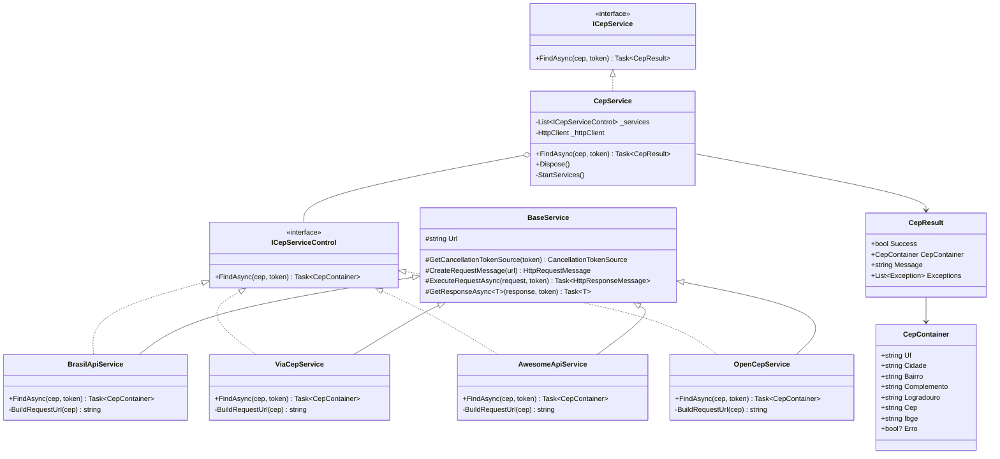

# Mapeamento do Sistema — Sirb.CepBrasil

> **Propósito:** Registro contínuo da estrutura, dependências, fluxo de chamada e evidências de investigação do sistema.

| Campo           | Valor                    |
|-----------------|--------------------------|
| **Versão**      | v1.0                     |
| **Data**        | 23/07/2026               |
| **Autor**       | Rodrigo Araujo Barbosa   |
| **Status**      | `aprovado`               |

---

## Histórico de Alterações

| Data       | Versão | Descrição                       | Autor                 |
|------------|--------|----------------------------------|-----------------------|
| 23/07/2026 | v1.0   | Mapeamento inicial do sistema   | Rodrigo Araujo Barbosa |

---

## 1. Visão Geral do Repositório

O repositório contém **2 projetos principais**:

```
/home/rodbarbosa/Projetos/CepBrasil/
├── Sirb.CepBrasil/              ← Projeto da biblioteca (produção)
├── Sirb.CepBrasil.Test/         ← Projeto de testes unitários
├── docs/                        ← Documentação do projeto
├── README.md                    ← Documentação principal
├── AGENTS.md                    ← Configuração de agentes
└── .github/                     ← Workflows GitHub Actions
```

---

## 2. Mapeamento de Diretórios

### 2.1 `Sirb.CepBrasil/` — Biblioteca de Produção

```
Sirb.CepBrasil/
├── Sirb.CepBrasil.csproj        ← Projeto multi-target (net8.0;net9.0;net10.0)
│
├── Interfaces/
│   ├── ICepService.cs           ← Interface pública: FindAsync → Task<CepResult>
│   └── ICepServiceControl.cs    ← Interface interna: FindAsync → Task<CepContainer>
│
├── Models/
│   ├── CepContainer.cs          ← Modelo imutável de endereço (7 campos + Erro)
│   ├── CepResult.cs             ← Container de resultado (Success, CepContainer, Message, Exceptions)
│   ├── BrasilApiResponse.cs     ← DTO para resposta da BrasilAPI (internal)
│   └── AwesomeApiResponse.cs    ← DTO para resposta da AwesomeAPI (internal)
│
├── Services/
│   ├── BaseService.cs           ← Classe abstrata com operações HTTP comuns
│   ├── CepService.cs            ← Orquestrador público de fallback (implementa ICepService)
│   ├── BrasilApiService.cs      ← Provedor BrasilAPI (internal, ICepServiceControl)
│   ├── ViaCepService.cs         ← Provedor ViaCEP (internal, ICepServiceControl)
│   ├── AwesomeApiService.cs     ← Provedor AwesomeAPI (internal, ICepServiceControl)
│   └── OpenCepService.cs        ← Provedor OpenCEP (internal, ICepServiceControl)
│
├── Validations/
│   └── CepValidation.cs         ← Validação de formato do CEP
│
├── Exceptions/
│   ├── ServiceException.cs      ← Exceção para erros de serviço
│   └── NotFoundException.cs     ← Exceção para recursos não encontrados
│
├── Extensions/
│   ├── CepExtension.cs          ← Extensões de string para CEP (RemoveMask, IsValidCep, etc.)
│   ├── JsonExtension.cs         ← Extensões de serialização JSON (ToJson, FromJson)
│   └── ExceptionExtension.cs    ← Extensões de Exception (AllMessages, GetDetailedMessage)
│
└── Messages/
    └── CepMessages.cs           ← Constantes de mensagens de erro
```

#### Detalhamento por Arquivo

| Arquivo                    | Linhas | Responsabilidade                                               |
|----------------------------|--------|---------------------------------------------------------------|
| `Interfaces/ICepService.cs`| 21     | Define o contrato público da biblioteca                       |
| `Interfaces/ICepServiceControl.cs` | 16 | Define o contrato interno para serviços provedores         |
| `Models/CepContainer.cs`   | 184    | Modelo unificado de endereço com JsonPropertyNames            |
| `Models/CepResult.cs`      | 77     | Resultado da busca com múltiplos construtores                 |
| `Models/BrasilApiResponse.cs` | 61  | DTO da resposta BrasilAPI (cep, state, city, neighborhood, street, service) |
| `Models/AwesomeApiResponse.cs` | 60 | DTO da resposta AwesomeAPI (cep, state, city, district, address, service) |
| `Services/BaseService.cs`  | 104    | Classe base com métodos HTTP compartilhados                   |
| `Services/CepService.cs`   | 174    | Orquestrador do fallback — ponto de entrada público           |
| `Services/BrasilApiService.cs` | 86  | Implementação do provedor BrasilAPI                          |
| `Services/ViaCepService.cs`| 91     | Implementação do provedor ViaCEP (com tratamento "erro")      |
| `Services/AwesomeApiService.cs` | 86 | Implementação do provedor AwesomeAPI                         |
| `Services/OpenCepService.cs`| 76    | Implementação do provedor OpenCEP                             |
| `Validations/CepValidation.cs` | 81  | Validação de formato do CEP                                  |
| `Exceptions/ServiceException.cs` | 46 | Exceção customizada com ThrowIf estático                    |
| `Exceptions/NotFoundException.cs` | 47 | Exceção customizada para não encontrado (legado)            |
| `Extensions/CepExtension.cs` | —    | Métodos de extensão para manipulação de strings de CEP       |
| `Extensions/JsonExtension.cs` | —    | Extensões de serialização JSON                                |
| `Extensions/ExceptionExtension.cs` | — | Extensões para formatação de exceções                        |
| `Messages/CepMessages.cs`  | 8      | Constantes de mensagens de erro                               |

### 2.2 `Sirb.CepBrasil.Test/` — Testes Unitários

```
Sirb.CepBrasil.Test/
├── Sirb.CepBrasil.Test.csproj      ← Projeto xUnit multi-target
├── Usings.cs                        ← Global usings
│
├── Services/
│   ├── BrasilApiServiceTest.cs      ← Testes do provedor BrasilAPI
│   ├── ViaCepServiceTest.cs         ← Testes do provedor ViaCEP
│   ├── AwesomeApiServiceTest.cs     ← Testes do provedor AwesomeAPI
│   ├── OpenCepServiceTest.cs        ← Testes do provedor OpenCEP
│   └── CepServiceOrchestratorTest.cs ← Testes do orquestrador (CepService)
│
├── Extensions/
│   ├── CepExtensionTest.cs          ← 52 testes de extensões de CEP
│   ├── JsonExtensionTest.cs         ← 22 testes de JSON
│   └── ExceptionExtensionTest.cs    ← 29 testes de exceções
│
├── Validations/
│   └── CepValidationTest.cs         ← 26 testes de validação de CEP
│
├── Exceptions/
│   └── ServiceExceptionTest.cs      ← Testes de ServiceException
│
├── Models/
│   └── CepResultTest.cs             ← Testes de CepResult
│
└── Properties/                      ← Propriedades do projeto de teste
```

### 2.3 `docs/` — Documentação

Estrutura completa conforme documentado em `docs/README.md` (a ser criado). Os arquivos atualmente na raiz de `docs/` serão reorganizados em Waves posteriores.

---

## 3. Dependências Externas

### 3.1 Dependências do Projeto (.csproj)

**Sirb.CepBrasil.csproj:**
- Nenhuma dependência externa de pacotes NuGet.
- Dependências: `System.Net.Http`, `System.Text.Json` (framework).
- Geração de documentação XML habilitada (`GenerateDocumentationFile`).

**Sirb.CepBrasil.Test.csproj:**
| Pacote                         | Versão  | Finalidade                     |
|--------------------------------|---------|--------------------------------|
| `Microsoft.NET.Test.Sdk`       | 18.0.1  | SDK de testes                  |
| `xunit`                        | 2.9.3   | Framework de testes            |
| `xunit.runner.visualstudio`    | 2.8.2   | Runner para Visual Studio      |
| `coverlet.msbuild`             | 8.0.0   | Cobertura de código (MSBuild)  |
| `coverlet.collector`           | 8.0.0   | Coletor de cobertura           |

### 3.2 Provedores HTTP Externos

| Provedor    | URL Base                                       | Formato Resposta       | Campos Retornados               |
|-------------|------------------------------------------------|------------------------|---------------------------------|
| BrasilAPI   | `https://brasilapi.com.br/api/cep/v1/{cep}`    | JSON (BrasilApiResponse)| cep, state, city, neighborhood, street, service |
| ViaCEP      | `https://viacep.com.br/ws/{cep}/json`          | JSON (CepContainer)     | cep, logradouro, bairro, localidade, uf, ibge, complemento, erro |
| AwesomeAPI  | `https://cep.awesomeapi.com.br/json/{cep}`     | JSON (AwesomeApiResponse)| cep, state, city, district, address, service |
| OpenCEP     | `https://opencep.com/v1/{cep}`                 | JSON (CepContainer)     | cep, logradouro, bairro, localidade, uf, ibge |

---

## 4. Fluxo de Chamada

### 4.1 Fluxo Principal (Fallback Chain)

```
Cliente
  │
  ▼
ICepService.FindAsync(cep, cancellationToken)
  │
  ▼
CepService.FindAsync()                    ← Ponto de entrada público
  │
  ├→ 1. Cria CancellationTokenSource (timeout 30s se token for None)
  │
  ├→ 2. Loop sobre _services[] na ordem de registro:
  │      ├→ BrasilApiService.FindAsync()
  │      │    ├→ CepValidation.Validate(cep)     ← Valida entrada
  │      │    ├→ cep.RemoveMask()                 ← Normaliza
  │      │    ├→ BuildRequestUrl(cep)             ← Monta URL
  │      │    ├→ CreateRequestMessage(url)        ← Cria request GET
  │      │    ├→ ExecuteRequestAsync(request, token) → HTTP GET
  │      │    ├→ GetResponseAsync<BrasilApiResponse>() → Desserializa
  │      │    └→ Mapeia para CepContainer
  │      │
  │      ├→ ViaCepService.FindAsync()
  │      │    ├→ Valida → Normaliza → Monta URL → HTTP GET → Desserializa
  │      │    └→ Verifica campo "erro" (true = não encontrado)
  │      │
  │      ├→ AwesomeApiService.FindAsync()
  │      │    └→ Mesmo padrão (valida → HTTP → deserializa → mapeia)
  │      │
  │      └→ OpenCepService.FindAsync()
  │           └→ Mesmo padrão (desserializa direto para CepContainer)
  │
  ├→ 3. Se sucesso (CepContainer != null) → Retorna new CepResult(true, response, null)
  ├→ 4. Se null → continue (próximo serviço)
  ├→ 5. Se exceção → message += ex.AllMessages() + " "; continue
  │
  └→ 6. Após o loop:
       ├→ Se encontrou → CepResult { Success = true }
       └→ Se não encontrou → CepResult { Success = false, Message = erros consolidados }
```

### 4.2 Fluxo de Registro dos Serviços

```
CepService.StartServices()
  ├→ _services.Add(new BrasilApiService(_httpClient))   ← Índice 0
  ├→ _services.Add(new ViaCepService(_httpClient))      ← Índice 1
  ├→ _services.Add(new AwesomeApiService(_httpClient))  ← Índice 2
  └→ _services.Add(new OpenCepService(_httpClient))     ← Índice 3
```

---

## 5. Hierarquia de Classes



---

## 6. Documentos de Apoio Convertidos

Os seguintes documentos existem atualmente em `docs/` e contêm conteúdo histórico/técnico do projeto. Na Wave 5 serão movidos para `docs/extras/`.

| Arquivo                          | Conteúdo Principal                                       |
|----------------------------------|----------------------------------------------------------|
| `FALLBACK_DIAGRAMS.md`           | Diagramas Mermaid do fluxo de fallback                   |
| `FALLBACK_IMPLEMENTATION.md`     | Especificação técnica da implementação do fallback       |
| `FLUXO-FALLBACK.md`              | Descrição do fluxo de fallback entre provedores          |
| `MELHORIAS-CEPSERVICE.md`        | Melhorias implementadas no CepService.cs                 |
| `MELHORIAS-CEPVALIDATION.md`     | Melhorias implementadas no CepValidation.cs              |
| `MELHORIAS-EXCEPTIONEXTENSION.md`| Melhorias implementadas no ExceptionExtension.cs         |
| `MELHORIAS-JSONEXTENSION.md`     | Melhorias implementadas no JsonExtension.cs              |
| `SUMARIO-MELHORIAS-COMPLETO.md`  | Sumário consolidado de todas as melhorias                |
| `SUMARIO-EXECUTIVO.md`           | Sumário executivo do novo fluxo de fallback              |
| `SUMARIO-EXECUTIVO-FINAL.md`     | Sumário executivo das melhorias do ExceptionExtension    |
| `QUICK_START.md`                 | Guia rápido para implementação do fallback               |
| `WORKFLOW-NUGET-PUBLISH.md`      | Documentação do workflow de publicação NuGet             |
| `CHECKLIST-RELEASE.md`           | Checklist de release                                     |
| `RESUMO-CORRECAO-CI-CD.md`       | Resumo das correções de CI/CD                            |
| `DIAGRAMAS-FALLBACK.md`          | Diagramas adicionais de fluxo de fallback                |
| `DOCUMENTACAO-CRIADA.md`         | Registro de documentação criada                          |
| `INDICE-DOCUMENTACAO.md`         | Índice de navegação entre documentos                     |
| `DOCUMENTACAO_CHECKLIST.md`      | Checklist de documentação                                |
| `DOCUMENTACAO_NOVO_FLUXO.md`     | Documentação do novo fluxo                               |
| `IMPLEMENTACAO-FALLBACK.md`      | Guia de implementação do fallback                        |
| `PROXIMOS-PASSOS.md`             | Próximos passos do projeto                               |
| `RESUMO_DOCUMENTACAO.md`         | Resumo da documentação                                   |
| `RESUMO-TESTES-CEPEXTENSION.md`  | Resumo dos testes do CepExtension                        |
| `DASHBOARD-STATUS.md`            | Dashboard de status do projeto                           |
| `TESTES-CEPEXTENSION.md`         | Testes do CepExtension                                   |
| `SUMARIO-FINAL-EXCEPTIONEXTENSION.md` | Sumário final ExceptionExtension                    |
| `INDEX.md`                       | Índice de documentos                                     |
| `INDICE-DOCUMENTACAO-FINAL.md`   | Índice final de documentação                             |

---

## 7. Evidências de Investigação

- **Código-fonte revisado:** Todos os arquivos em `Sirb.CepBrasil/` e `Sirb.CepBrasil.Test/`.
- **Configuração de projeto:** Multi-target confirmado no `.csproj` (`net8.0;net9.0;net10.0`).
- **Dependências:** Nenhuma dependência externa de produção; apenas `System.Net.Http` e `System.Text.Json`.
- **Cobertura de testes:** 100% de cobertura em todos os componentes (verificado via relatórios `lcov.info`).
- **Workflow CI/CD:** Pipeline de publicação NuGet no `.github/workflows/publish_nuget.yml`.

---

## 8. Clarificações e Notas

| Data       | Nota                                                                                   |
|------------|----------------------------------------------------------------------------------------|
| 23/07/2026 | Mapeamento inicial criado com base na leitura completa do código-fonte e docs.         |
| 23/07/2026 | Sirb.CepBrasil não implementa `CepServiceOrchestrator` como classe separada — a orquestração é feita pelo próprio `CepService`. |
| 23/07/2026 | O método `FindAsync` do `CepService` retorna `CepResult { Success = false }` com mensagem consolidada, não `ServiceException`. |

---

**© 2026 Rodrigo Araujo Barbosa — Sirb.CepBrasil**
